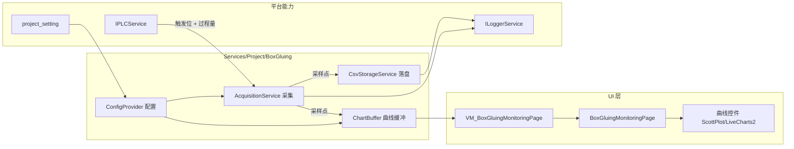

# BoxGluing（口琴管涂胶）项目开发规划

> 文档版本：2026-08-18（P0 采集 / 三出胶曲线 / 分文件 CSV 已落地）  
> **角色：冷层详规** — 范围、架构、点位说明；**不要**在本文维护每日进度  
> **进度 / 待办 / 索引**：[BoxGluing进度存档.md](./BoxGluing进度存档.md)（新会话只拖进度存档）  
> 平台：SUNWODA SEVB（`develop`，.NET 8 WPF）  
> 维护人：接手开发者  

---

## 0. 开发资料录入（工作流）

> **状态**：已录入（样板）· 原始投放目录见 [开发资料/](./开发资料/)  
> **整理后真相**：[plc点位表.csv](./plc点位表.csv)、[plc设备信息.csv](./plc设备信息.csv)、[工艺阈值表.csv](./工艺阈值表.csv)  
> 新原始资料请放入 `开发资料/` 后再次走工作流「开始录入」。

---

## 1. 项目定位与目标

### 1.1 业务定位

**BoxGluing** 为口琴管涂胶工序的产线监测模块，运行于欣旺达 SEVB 统一桌面平台。

核心价值：

1. 按可配置周期采集计量泵相关过程量（压力 / 扭矩 / 液位）
2. 以曲线形式实时展示，并叠加工艺阈值参考线
3. 将采集数据按天、按出胶分文件落盘为 CSV，供追溯与后续算法使用
4. （后续）调用 Python 算法做异常判定并回写 PLC —— **本期不做**

### 1.2 本期范围（P0）

| 能力 | 是否本期 | 说明 |
|------|----------|------|
| PLC 触发 + 周期采集 | ✅ 已做 | 默认 80ms；进页即监听；PerLane |
| CSV 按出胶分文件 | ✅ 已做 | `yyyy_MM_dd_出胶N.csv`，段末空行 |
| 实时曲线显示 | ✅ 已做 | 三图按出胶；每图 6 线；Y 轴 -30～100 |
| 阈值参考线（工艺表） | ❌ 未画 | 配置已入模型，图上按约定暂不画 |
| 启停监测、界面状态 | ✅ 已做 | 出胶N↔工位N；模拟按钮 5～8s |
| Python 算法调用 | ❌ 延后 | 点位表「算法部署状态：未开发」 |
| NG 判定回写 PLC | ❌ 延后 | 反馈地址 D1623～D1638 已登记 |
| 工位4 | ⚠️ 预留 | 地址保留，`Enabled=false`，暂不采不画 |

### 1.2.1 当前进度

**见 [BoxGluing进度存档.md](./BoxGluing进度存档.md)**，不在本文重复维护。

### 1.3 明确不做（本期）

- 不移植旧框架 `SUNWODA.UI` / `ValueListener` / `CSVHelper` 等历史耦合代码
- 不实现 Python.NET 模型加载与 `AlgoPython*` 调用链
- 不建设复杂报警中心、MES 上报（可后续按产线要求加）
- 不引入商业图表库授权（优先开源方案）

---

## 2. 现有资料盘点

### 2.1 旧项目参考源码

路径：`e:\WorkSpace\BoxGluing\VM_PageBoxGluing.cs`（旧上位机单文件 ViewModel，约 1800 行）

可复用的**业务逻辑精华**（需按新框架重写，禁止整文件拷贝）：

| 旧逻辑 | 行为摘要 | 新框架落点建议 |
|--------|----------|----------------|
| 触发位轮询 | 约 50ms 读触发寄存器，边沿启动/停止采集 Timer | `BoxGluingAcquisitionService` |
| 周期采集 | `Timer(..., 80)` 批量读扭矩+压力寄存器 | 同上，周期改为可配置 |
| 曲线缓冲 | 多组 `ObservableCollection<double>` 分通道追加 | 图表服务 / ViewModel 环形缓冲 |
| CSV 落盘 | 目录按日、按出胶分文件 `yyyy_MM_dd_出胶N.csv`，追加写 | `IBoxGluingCsvStorage` |
| 结束一拍 | 停表后拷贝 `tempDataList` 交给算法 | 本期仅结束会话写日志，算法预留接口 |
| 点位映射 | 标签 → `GlumingDataModel` 寄存器地址 | `project_setting` JSON + 地址表 |

旧项目中**明显需改进**之处：

1. UI、采集、CSV、算法、PLC 写回全部堆在一个 ViewModel
2. 采样周期硬编码 `80`，无法在线调整
3. `PlotValue` 丢弃 `0` 值，可能导致曲线断点/失真（新方案**默认保留 0**）
4. 每次采集都 `Dispatcher.BeginInvoke` 更新 UI，80ms × 多曲线易卡顿
5. CSV 与算法临时缓冲混用同一列表，线程安全脆弱
6. 基地（义乌/枣庄/南京）分支散落在 `switch`，难维护

### 2.2 工艺阈值表（图片资料）

| 阶段 | 参数 | A | B | 备注（约束） |
|------|------|---|---|--------------|
| 计量1～计量2 | 压力值 | 70 | 70 | 不能大于 70 |
| 计量1～计量2 | 扭矩 | 25 | 25 | 不能大于 25 |
| 计量1～计量2 | 液位 | &lt;10 | &gt;60 | 不能大于 60，不能小于 10 |
| 计量3 | 压力值 | 85 | 85 | 不能大于 85 |

说明：

- 表中 A/B 为通道侧设定/约束；液位一行为区间约束（10～60），与压力/扭矩「上限」语义不同
- 阈值进入 `project_setting`（可改）；**图上暂不画水平参考线**（P0 约定）；是否超限报警放后续
- **勿与 PLC 限值寄存器 D1635～D1638 混淆**（见 §2.3.5）

### 2.3 PLC 点位表（`plc.1`，已归档）

源文件：`e:\WorkSpace\BoxGluing\plc.1`  
文档副本：
- [`plc点位表.csv`](./plc点位表.csv) — 过程量 / 启动信号 / 反馈信号（含启用、工位）
- [`plc设备信息.csv`](./plc设备信息.csv) — 设备编号、IP、协议、平台支持结论
- [`工艺阈值表.csv`](./工艺阈值表.csv) — 会话工艺图阈值

#### 2.3.1 设备与通讯

| 项 | 值 |
|----|-----|
| 设备编号 | `SD260429003` |
| PLC 型号 | 欧姆龙 NX102-1100 |
| PLC IP | `192.168.3.220` |
| 端口 | `9600` |
| 协议 | **Fins/TCP**（平台已支持，见下） |
| 内网 IP | `10.178.202.37` |
| 账号/密码 | （表中为空，待补充） |
| 算法部署 | **未开发** |

**平台对欧姆龙 Fins/TCP：已支持（代码核实）。**

| 位置 | 说明 |
|------|------|
| 枚举 | `PLCBrandSpecificationProtocal.Omron_Fins_TCP`（`SUNWODA_SEVB.Core/Enumerations/PLC/`） |
| 实现 | `PLCService.ConfigureOmron` → `HslCommunication.Profinet.Omron.OmronFinsNet(ip, port)` |
| 种子数据 | `DatabaseInitializer` 已有「欧姆龙测试PLC」，协议 `Omron_Fins_TCP`，端口默认 `9600` |
| 配置写法 | `plc_config.BrandSpecificationProtocal = "Omron_Fins_TCP"`（解析时大小写不敏感） |

BoxGluing 联机时在 `plc_config` 填入 `192.168.3.220` / `9600` / `Omron_Fins_TCP` 即可；地址统一按 `Dxxxx` INT16 处理。

#### 2.3.2 过程量采集点（曲线 + CSV，P0 核心）

全部为 `INT`，建议按地址连续批量读 `D1600`～`D1619`（共 20 个字）。

| 分组 | 参数名 | 地址 | 曲线归属 | 启用 |
|------|--------|------|----------|------|
| 伺服扭矩 | 伺服扭矩A1～B3 | D1600～D1605 | 扭矩图（工位 1～3 × A/B） | **现行** |
| 伺服扭矩 | 伺服扭矩A4/B4 | D1606～D1607 | — | **预留**（暂不采/不画，配置可开） |
| 入口压力 | 入口压力A1～B3 | D1608～D1613 | 压力图（工位 1～3 × A/B） | **现行** |
| 入口压力 | 入口压力A4/B4 | D1614～D1615 | — | **预留** |
| 中转液位 | 中转液位A1/B1 | D1616～D1617 | 液位图（仅工位1） | **现行** |
| 中转液位 | 中转液位A2/B2 | D1618～D1619 | — | **备用预留** |

与旧项目标签对照：

| 旧标签习惯 | 本点位表命名 | 说明 |
|------------|--------------|------|
| 计量N扭矩A/B | 伺服扭矩AN/BN | **现行工位 1～3**；工位 4 地址预留 |
| 计量N压力A/B | 入口压力AN/BN | 同上 |
| （无） | 中转液位A1/B1 | **现行仅 1 组**；A2/B2 备用预留 |

#### 2.3.3 启动信号与工位映射（已确认）

| 参数名 | 地址 | 类型 | 备注 | 对应工位 |
|--------|------|------|------|----------|
| 自动出胶1信号 | D1620 | INT | **1 = 启动** | **工位 1** |
| 自动出胶2信号 | D1621 | INT | **1 = 启动** | **工位 2** |
| 自动出胶3信号 | D1622 | INT | **1 = 启动** | **工位 3** |
| （无） | — | — | 工位 4 预留，暂无出胶信号 | **工位 4 预留** |

规划含义（已拍板）：

- **现行仅三个工位**；过程量中的「4」组地址为预留，P0 默认不采集、不入曲线
- **中转液位现行仅 A1/B1（D1616/D1617）**；A2/B2 备用不采；三路曲线与 CSV 均复用这一组
- **出胶 N ↔ 工位 N（1:1）**：`PerLane` 分路采集
- 触发值类型为 **INT（1/非1）**，不是 Bool
- 多路可并行：例如出胶1、出胶3 同时为 1，则同时采工位1与工位3 通道

工位通道子集（分路采集时）：

| 出胶信号 | 扭矩 | 压力 | 液位 |
|----------|------|------|------|
| 出胶1 → 工位1 | A1/B1（D1600/D1601） | A1/B1（D1608/D1609） | A1/B1（D1616/D1617）现行，三路公用 |
| 出胶2 → 工位2 | A2/B2（D1602/D1603） | A2/B2（D1610/D1611） | 同上，曲线/CSV 复用 A1/B1 |
| 出胶3 → 工位3 | A3/B3（D1604/D1605） | A3/B3（D1612/D1613） | 同上，曲线/CSV 复用 A1/B1 |
| 工位4（预留） | A4/B4（D1606/D1607） | A4/B4（D1614/D1615） | — |

#### 2.3.4 反馈 / 结果点（算法阶段写入，P0 仅登记）

语义：`0 = OK`，`1 = NG`（表中仅在计量1扭矩A1注明，其余按同类理解）。

| 分组 | 参数名 | 地址 |
|------|--------|------|
| 扭矩判定 | 计量1～3 扭矩值 A/B | D1623～D1628 |
| 压力判定 | 计量1～3 压力值 A/B | D1629～D1634 |
| 液位限值 | 液位中转A1上限/下限、B1上限/下限 | D1635～D1638 |

注意：

- 反馈扭矩/压力覆盖 **计量 1～3**，与现行三工位一致；工位 4 过程量预留、亦无对应反馈点
- 液位 **过程值** 与 **限值寄存器** 不是同一批地址，见 §2.3.5

#### 2.3.5 过程量 / 工艺阈值 / PLC 限值 —— 三者区分（上线前再选型）

容易混淆，对照如下：

| 类别 | 是什么 | 典型地址 / 来源 | 用途 |
|------|--------|-----------------|------|
| **过程量** | 传感器实时读数 | 液位 **D1616 / D1617**（现行）；A2/B2 为 D1618/D1619（备用） | 曲线、CSV 采集 |
| **工艺阈值** | 上位机配置的工艺约束 | `工艺阈值表.csv`：液位不能小于 10、不能大于 60 | 曲线水平参考线；后续报警逻辑 |
| **PLC 限值点** | PLC 内保存的上下限设定 | **D1635～D1638**（液位中转 A1/B1 上/下限） | 非过程曲线；可选读回与工艺阈值对照 |

要点：

1. 图中/点位表里的「中转液位A1」= **D1616**，是过程量，**不是** D1635。
2. D1635～D1638 名称带「上限/下限」，属于反馈/设定类点位，与 D1616 过程值分开。
3. **P0 开发约定**：采过程量；工艺表阈值进配置；**图上暂不画参考线、不读** D1635～D1638。
4. **正式上线前**：再向负责人确认阈值线/报警以何为准——仅工艺配置、仅 PLC 限值、或两者对比/取严。确认前保持 P0 约定。

选型待确认项（上线 checklist）：

- [ ] 阈值线来源：工艺表 / PLC 限值 / 双源
- [ ] 若双源不一致时的处理（告警 / 以谁为准）
- [ ] 是否在 UI 展示 PLC 限值当前值

### 2.4 平台约束（必须遵守）

对齐现有文档：

- [项目架构说明](../项目架构说明.md)
- [新增业务模块上手指南](../新增业务模块上手指南.md)
- [接手任务规划](../接手任务规划.md)

模块形态：

```
ViewModels/Pages/BoxGluing/VM_BoxGluingMonitoringPage.cs   + [Module]
Views/Pages/BoxGluing/BoxGluingMonitoringPage.xaml(.cs)
Services/Project/BoxGluing/                                业务服务实现
Core/Interfaces/Project/BoxGluing/                         接口契约
Core/Models/Project/BoxGluing/                             DTO / 配置模型
```

配置与启用：

- 模块开关：`workspace_project.is_enabled`
- 业务参数：`project_setting`（JSON）
- PLC：平台 `IPLCService` + `plc_config` / 地址配置
- 主窗口：开发期使用 `MainWindow`

---

## 3. 总体架构设计



### 3.1 分层原则

| 层 | 职责 | 禁止 |
|----|------|------|
| View | 布局、图表宿主、绑定 | 业务计算、PLC 读写、写文件 |
| ViewModel | 命令、状态、把缓冲绑定到图表 | 直接 `new` 通讯类、硬编码地址 |
| Service | 采集调度、CSV、缓冲、配置 | 依赖具体 Page |
| Core 接口/模型 | 契约与 DTO | 引用 WPF |

### 3.2 建议服务清单（P0）

| 接口 | 职责 |
|------|------|
| `IBoxGluingConfigService` | 读写 `project_setting`：采样周期、点位、阈值、CSV 路径 |
| `IBoxGluingAcquisitionService` | 触发监听、周期采样、会话开始/结束事件 |
| `IBoxGluingCsvStorage` | 按出胶分文件追加、表头、跨日、段末空行 |
| `IBoxGluingChartDataService` | 环形缓冲、降采样推送 UI（阈值数据已带出，图暂不画） |
| `IBoxGluingAlgorithmService` | **尚未建**；算法阶段再加空接口 / NoOp |

DI 注册：在 `ProjectServiceCollectionExtensions.AddProjectServices()` 增加 BoxGluing 一组注册。

---

## 4. 数据采集设计

### 4.1 采集状态机

本机有 **3 路启动信号**（D1620 / D1621 / D1622，INT，`1`=启动）。每路可维护独立会话状态：

```
Idle ──(该路信号==1)──► Acquiring ──(该路信号!=1)──► Flushing ──► Idle
                           │
                           └── 每 SampleIntervalMs 批量读过程量并落盘/刷曲线
```

对齐旧项目并按点位表调整：

1. 后台任务轮询三路触发寄存器（建议周期 ≤ 采样周期，默认 50ms，可配置）
2. 某路 ON：记录该路会话开始时间、按映射清空/准备缓冲、启动（或复用）采样定时器
3. 采样：按当前活跃工位读对应通道子集（或批量读现行区后过滤）→ CSV 追加 → 推入曲线缓冲
4. 该路 OFF：若无其它工位仍在采，则停定时器；记录时长日志；（预留）会话数据交算法
5. **触发模式：`PerLane`（出胶N ↔ 工位N）**；工位4、液位2 通道默认 `Enabled=false`

### 4.2 采样周期

| 项 | 约定 |
|----|------|
| 配置键 | `SampleIntervalMs` |
| 默认 | `80` |
| 建议范围 | 20～1000 ms（需现场验证 PLC 批量读耗时） |
| 变更方式 | 项目设置页 / `project_setting`；运行中变更需「停止监测后生效」或热更新明确策略 |

**风险**：若 PLC 单次批量读 > 采样周期，会出现堆积；P0 需在日志中打印每次读耗时，P1 再做背压策略。

### 4.3 采集通道（已按 `plc.1` 落地）

**过程量（现行默认 14 点启用；工位4 与液位2 共 6 点预留）：**

| 标签 | 地址 | Group | Meter | Side | Enabled |
|------|------|-------|-------|------|---------|
| 伺服扭矩A1 | D1600 | Torque | 1 | A | true |
| 伺服扭矩B1 | D1601 | Torque | 1 | B | true |
| 伺服扭矩A2 | D1602 | Torque | 2 | A | true |
| 伺服扭矩B2 | D1603 | Torque | 2 | B | true |
| 伺服扭矩A3 | D1604 | Torque | 3 | A | true |
| 伺服扭矩B3 | D1605 | Torque | 3 | B | true |
| 伺服扭矩A4 | D1606 | Torque | 4 | A | **false（预留）** |
| 伺服扭矩B4 | D1607 | Torque | 4 | B | **false（预留）** |
| 入口压力A1 | D1608 | Pressure | 1 | A | true |
| 入口压力B1 | D1609 | Pressure | 1 | B | true |
| 入口压力A2 | D1610 | Pressure | 2 | A | true |
| 入口压力B2 | D1611 | Pressure | 2 | B | true |
| 入口压力A3 | D1612 | Pressure | 3 | A | true |
| 入口压力B3 | D1613 | Pressure | 3 | B | true |
| 入口压力A4 | D1614 | Pressure | 4 | A | **false（预留）** |
| 入口压力B4 | D1615 | Pressure | 4 | B | **false（预留）** |
| 中转液位A1 | D1616 | Level | 1 | A | true |
| 中转液位B1 | D1617 | Level | 1 | B | true |
| 中转液位A2 | D1618 | Level | 2 | A | **false（备用）** |
| 中转液位B2 | D1619 | Level | 2 | B | **false（备用）** |

**触发（轮询，出胶N ↔ 工位N）：**

| 标签 | 地址 | 启动条件 | Station |
|------|------|----------|---------|
| 自动出胶1信号 | D1620 | `== 1` | 1 |
| 自动出胶2信号 | D1621 | `== 1` | 2 |
| 自动出胶3信号 | D1622 | `== 1` | 3 |

**反馈点（P0 只进配置，不写）：** D1623～D1638（见 §2.3.4）

配置模型建议（概念）：

```json
{
  "DeviceCode": "SD260429003",
  "Plc": {
    "Ip": "192.168.3.220",
    "Port": 9600,
    "BrandSpecificationProtocal": "Omron_Fins_TCP",
    "CpuType": "Omron NX102-1100"
  },
  "SampleIntervalMs": 80,
  "TriggerPollIntervalMs": 50,
  "TriggerValueType": "Int16",
  "TriggerMode": "PerLane",
  "Triggers": [
    { "Label": "自动出胶1信号", "Address": "D1620", "ActiveValue": 1, "Station": 1 },
    { "Label": "自动出胶2信号", "Address": "D1621", "ActiveValue": 1, "Station": 2 },
    { "Label": "自动出胶3信号", "Address": "D1622", "ActiveValue": 1, "Station": 3 }
  ],
  "CsvRootPath": "D:\\BoxGluingData",
  "Channels": [
    { "Label": "伺服扭矩A1", "Address": "D1600", "Group": "Torque", "Meter": 1, "Side": "A", "Enabled": true },
    { "Label": "伺服扭矩A4", "Address": "D1606", "Group": "Torque", "Meter": 4, "Side": "A", "Enabled": false }
  ],
  "Thresholds": [
    { "Group": "Pressure", "MeterFrom": 1, "MeterTo": 2, "Max": 70 },
    { "Group": "Torque", "MeterFrom": 1, "MeterTo": 2, "Max": 25 },
    { "Group": "Level", "MeterFrom": 1, "MeterTo": 1, "Min": 10, "Max": 60 },
    { "Group": "Pressure", "MeterFrom": 3, "MeterTo": 3, "Max": 85 }
  ],
  "ResultAddresses": {
    "TorqueNg": ["D1623", "D1624", "D1625", "D1626", "D1627", "D1628"],
    "PressureNg": ["D1629", "D1630", "D1631", "D1632", "D1633", "D1634"],
    "LevelLimit": ["D1635", "D1636", "D1637", "D1638"]
  }
}
```

> `Channels` 完整 20 项按上表展开；工位4 与液位2 默认 `Enabled=false`。`TriggerMode=PerLane`：出胶N 仅驱动工位N 通道。

### 4.4 与旧逻辑差异（刻意改进）

| 点 | 旧实现 | 新规划 |
|----|--------|--------|
| 0 值 | `value != 0` 才画 | 默认保留 0；可配置「过滤全 0 行」仅用于跳过空读 |
| UI 更新 | 每点 BeginInvoke | 缓冲合并，UI 刷新频率独立（如 10～20 FPS） |
| 采样周期 | 硬编码 | 配置化 |
| 线程 | Timer + 多处 lock | 采集单线程/单队列，落盘异步队列 |

---

## 5. CSV 存储设计

### 5.1 目录与文件

参考旧路径习惯，规范化为：

```
{CsvRootPath}/
  └── yyyy年MM月dd日/
        ├── yyyy_MM_dd_出胶1.csv
        ├── yyyy_MM_dd_出胶2.csv
        └── yyyy_MM_dd_出胶3.csv
```

规则：

- **每天每出胶一个文件**（三工位并行时各自追加，互不串行）
- 跨自然日自动切换新文件并写新表头
- 该出胶一段结束后，在**本文件**末尾追加空行，下一段继续写在同一文件
- 每出胶独立队列与刷盘，避免三路同时生产时行交错
- 算法临时数据若以后需要，另目录 `Session/` 或 `Temp/`

### 5.2 表头约定（按出胶分文件）

每个文件只含该出胶的扭矩/压力列，液位三路公用现行 A1/B1（D1616/D1617）：

```
出胶1：时间,伺服扭矩A1,伺服扭矩B1,入口压力A1,入口压力B1,中转液位A1,中转液位B1
出胶2：时间,伺服扭矩A2,伺服扭矩B2,入口压力A2,入口压力B2,中转液位A1,中转液位B1
出胶3：时间,伺服扭矩A3,伺服扭矩B3,入口压力A3,入口压力B3,中转液位A1,中转液位B1
```

- 时间格式：`"yyyy-MM-dd HH:mm:ss.fff"`（引号包裹，含小时；避免 Excel 误显为分:秒）
- 该路无出胶时不写行；仅活跃工位追加到对应文件
- 预留通道启用后，再追加对应列（建议换日或新文件，避免同日列结构变化）

### 5.3 性能与可靠性

- 80ms 采样 ≈ 12.5 行/秒 ≈ 约 108 万行/天（满采）；必须用缓冲批量刷盘（如 50～100 行或 1s flush）
- 进程退出 / 停止监测时强制 flush
- 磁盘失败：记错误日志，不拖垮采集线程（可降级为仅内存曲线）

---

## 6. 曲线显示方案选型

### 6.1 候选对比（开源 / 工业桌面）

| 方案 | GitHub 量级（约） | 优势 | 劣势 | 适合场景 |
|------|-------------------|------|------|----------|
| **ScottPlot 5** | ~6.7k ⭐ | 大数据量与实时刷新强；API 面向科学/工业曲线；MIT | UI 炫技弱于 LiveCharts | **高频过程曲线（首选）** |
| **LiveCharts2** | ~5.3k ⭐ | 现代 MVVM、动画、文档与示例丰富；WPF 官方支持好 | 极高频多系列时需仔细优化 | 偏展示、交互强的看板 |
| OxyPlot | 中等 | 稳定、经典 | 维护活跃度一般，实时性能一般 | 低频静态图 |
| SciChart / LightningChart | 商业 | 汽车/航天级实时性能 | 授权成本 | 预算允许时的备选 |

工业上位机「过程量实时曲线」领域，**ScottPlot** 与商业 SciChart 一类更贴近「示波器/趋势图」诉求；LiveCharts2 更贴近「美观业务看板」。

### 6.2 本期推荐结论

**已锁定：ScottPlot 5.0.55（WPF）**

理由：

1. Star 量级与活跃度处于 .NET 开源图表第一梯队  
2. 对「持续追加点、滑动窗口、多系列、水平阈值线」场景成熟  
3. 80ms 采样 × 现行约 14 条曲线，适合用 Signal / DataStreamer 类 API + 固定窗口点数  
4. MIT，无授权风险  

**备选：LiveCharts2**

若团队更看重 XAML 声明式绑定与视觉效果，且实测 **14 系列** × 80ms 无卡顿，可选 LiveCharts2；需强制：

- 使用其 RealTime 示例模式（`SyncContext`、限制可见点数）
- UI 刷新与采集解耦

**不建议**：继续用旧项目那种多 `ObservableCollection` + 自研 Chart 绑定，性能与维护成本双高。

### 6.3 交互与展示（已落地）

| 需求 | 规格 | 状态 |
|------|------|------|
| 图表分区 | **3 个图按出胶 1/2/3**，每图一口六条线（扭矩A/B、压力A/B、液位A/B） | ✅ |
| 系列区分 | 同组同色：扭矩蓝、压力橙、液位绿；A 实线、B 虚线 | ✅ |
| Y 轴 | **固定 -30～100**（含负值过程量），不随数据自动缩放 | ✅ |
| 阈值线 | 压力 70/85、扭矩 25、液位 10/60 | ❌ 配置有，图未画 |
| 触发状态 | 出胶1/2/3 开/关 + 已采点数 | ✅ |
| 时间轴 | 该路出胶相对秒，从 0 贴左边；初始窗口 5s，之后随数据伸长 | ✅ |
| 窗口 | 滑动窗口 `ChartWindowPoints`（默认 3000） | ✅ |
| 实时数值 | 底部约 1/4：三路扭矩/压力/液位最新点，与曲线同拍刷新 | ✅ |
| 算法区 | 右侧约 1/4 预留，本期仅占位 | ✅ 占位 |
| 最大化 | 单图铺满整页，可还原三图 | ✅ |
| 操作 | 暂停刷新、通道显隐、自适应 Y | ❌ 未做（Y 已改为固定） |
| 进页行为 | 进入监测页即开始监听，无「启动采集」按钮 | ✅ |

### 6.4 UI 页面草图（与现页一致）

```
┌──────────────────────────────────────────────┬──────────────┐
│  口琴管涂胶监测     [保存配置] [打开CSV目录]  │              │
│  采样  CSV  ☑模拟  [出胶1][出胶2][出胶3]     │              │
├──────────┬──────────┬──────────┬─────────────┤              │
│ 出胶1图  │ 出胶2图  │ 出胶3图  │ 算法结果预留│  ← 上 3/4   │
│ 最大化   │ 最大化   │ 最大化   │             │              │
├──────────┴──────────┴──────────┴─────────────┤              │
│ 出胶1实时 │ 出胶2实时 │ 出胶3实时             │  ← 下 1/4   │
│ 扭矩/压力/液位 A/B 最新值（与采集同步）      │              │
└──────────────────────────────────────────────┴──────────────┘
```

菜单显示名建议：`口琴管涂胶监测`；模块名：`VM_BoxGluingMonitoringPage`。

---

## 7. 配置与可运维性

### 7.1 存放位置

| 配置 | 位置 |
|------|------|
| PLC 连接（IP/协议） | 平台 `plc_config`：`Omron_Fins_TCP` + `192.168.3.220:9600`（**平台已支持**） |
| 通道地址、触发、阈值、工位启用 | `project_setting`（默认值来自点位/阈值 CSV） |
| 模块是否显示 | `workspace_project` |
| 全局 Python 开关 | `global_setting`（算法阶段再用） |

### 7.2 设置页

P0 监测页已可改采样周期、CSV 根目录、模拟开关并保存到 `project_setting`。通道/阈值/点位仍走代码默认值。独立「BoxGluing 项目设置」页未做。

---

## 8. 算法模块预留（不实现）

保留扩展点，避免以后大改：

```csharp
// 概念接口，P0 未建；算法阶段再加空实现
Task<BoxGluingAlgoResult?> AnalyzeSessionAsync(
    BoxGluingSessionData session,
    CancellationToken ct);
```

- 会话结束时若配置 `EnableAlgorithm=false`（默认），跳过调用  
- 算法脚本、模型路径、入参/出参规范到位后另开文档：`BoxGluing算法接入说明.md`

---

## 9. 实施阶段与里程碑

### 阶段 A：骨架与配置（预计 1～2 天）

- [x] 建 `BoxGluing` 目录三件套（VM + View）并 `[Module]` 注册
- [x] SQL 启用模块，菜单可见（脚本：`enable_boxgluing_module.sql`；MariaDB 已执行）
- [x] Core 接口 + 配置模型 + DI 注册（`AddBoxGluingServices`）
- [x] 页面骨架与 CSV 根目录可配置提示（默认建议 `D:\BoxGluingData`）

**验收**：菜单进入空白页不崩；配置能读到默认值与点位表地址。  
**进度（2026-08-18）**：三件套已创建；`dotnet build` 0 错误。MariaDB 12.3 已连通，`sunwoda_demo` 已初始化，`VM_BoxGluingMonitoringPage` 已 `is_enabled=1`，`AppStartMainWindow=MainWindow`。**请完全退出后重新启动应用**以刷新菜单。

### 阶段 B：CSV 与模拟采集（预计 2～3 天）

- [x] `CsvStorage`：按天、按出胶分文件（`D:\BoxGluingData\yyyy年MM月dd日\yyyy_MM_dd_出胶N.csv`）
- [x] 用模拟数据发生器（无 PLC）按 80ms 推现行通道；出胶按钮随机 5～8s 结束
- [ ] 磁盘抽样检查行数与时间戳（需启动应用后人工验收）

**验收**：运行约 1 分钟应有连续时间戳；三路并行时三个文件互不串行；段末空行。  
**进度（2026-08-18）**：代码已编译通过。抽检：勾选「模拟采集」后分别点「出胶1/2/3」，确认三个 CSV。

### 阶段 C：曲线显示（预计 2～3 天）

- [x] 引入 ScottPlot 5.0.55（`ScottPlot.WPF`）
- [x] 三图按出胶；每图 6 线；同组同色；A 实 / B 虚；Y 轴 -30～100；最大化
- [x] UI 刷新与采集解耦、滑动窗口（约 100ms 拷贝快照）
- [ ] 工艺阈值水平参考线（配置已在快照中，绘图未用）

**验收**：模拟下曲线连续、纵轴不抖动。  
**进度（2026-08-18）**：阈值线按约定暂不画，不读 D1635～D1638。

### 阶段 D：真实 PLC 接入（预计 2～4 天）

- [x] `plc_config` 种子：`口琴管涂胶PLC`，`Omron_Fins_TCP`，`192.168.3.220:9600`
- [x] 三路触发 PerLane：D1620～D1622 ↔ 工位1～3（代码已实现）
- [x] 批量读 D1600～D1622（23 字），过滤工位4、液位2 预留
- [ ] 与工艺现场对比：曲线形态、CSV 列、会话时长
- [ ] 耗时监控与丢点统计

**验收**：现场出胶一轮，CSV 含现行过程列且时间戳连续。  
**进度（2026-08-18）**：联机读块已接到 `IPLCService.ReadInt16BlockAsync`；无 PLC 时请用模拟模式。

### 阶段 E：打磨与文档（预计 1～2 天）

- [x] 监测页启停（进页监听）、模拟出胶、状态栏、基础日志
- [x] 更新本文档「已完成 / 未完成」清单
- [ ] 现场异常提示打磨、采集耗时与丢点统计
- [ ] （可选）独立项目设置 UI

### 后续（算法到位后）

- Python 环境、模型加载、会话数据喂入、结果 UI、PLC 回写、NG CSV

---

## 10. 风险与待确认事项

| # | 事项 | 影响 | 建议 | 状态 |
|---|------|------|------|------|
| 1 | 液位点位 | 液位曲线/CSV | 现行仅 D1616/D1617；D1618/19 备用 | **已关闭** |
| 2 | 出胶1/2/3 与工位映射 | 分路采集 | 出胶N↔工位N；工位4预留 | **已关闭** |
| 3 | 触发类型 | 边沿判断 | 点位表为 INT，`1`=启动 | **已关闭** |
| 4 | 80ms × 批量读现行通道是否超时 | 丢点/卡顿 | 上线前压测 Fins/TCP | 待压测 |
| 5 | CSV 根目录权限与磁盘容量 | 满盘失败 | 默认盘符与清理策略 | 待定 |
| 6 | 算法对 CSV 列序依赖 | 后期对接 | 表头按现行启用通道冻结 | 已规划 |
| 7 | 液位工艺区间 vs D1635～D1638 | 阈值线来源 | P0 用工艺表、不读 PLC 限值；**正式上线前再确认选型**（见 §2.3.5） | **上线前再问** |
| 8 | 工位4 / 液位2 预留地址 | 扩展 | 配置 `Enabled=false` | **已确认** |
| 9 | 平台欧姆龙 Fins/TCP | 联机 | 枚举+`OmronFinsNet`+种子配置均已具备 | **已关闭** |
| 10 | 账号密码为空 | 远程/内网运维 | 向现场要账号或确认无需 | 待补充 |
| 11 | 工位2/3 无独立液位 | 三路曲线/CSV 均复用 D1616/D1617 | 已落地 |

---

## 11. 开发约定（对齐平台）

1. 命名：`VM_BoxGluingMonitoringPage` ↔ `BoxGluingMonitoringPage`  
2. 业务逻辑进 `Services/Project/BoxGluing`，ViewModel 保持瘦  
3. 中文日志与注释；关键路径与异常必须 `ILoggerService` 记录  
4. 不把密钥、现场 IP 写死进仓库；用配置  
5. 先模拟后真机；曲线库选型一经阶段 C 锁定，避免反复替换  

---

## 12. 相关资料索引

> 新会话入口是进度存档；本文被进度存档 §0 按章节引用。改规格改本文对应节，并在进度存档追加增量说明。

| 资料 | 路径 |
|------|------|
| **进度存档（热层 / 索引）** | [`BoxGluing进度存档.md`](./BoxGluing进度存档.md) |
| **版本变更记录** | [`BoxGluing版本变更记录.md`](./BoxGluing版本变更记录.md) |
| 目录说明 | [`README.md`](./README.md) |
| 旧参考 ViewModel | `e:\WorkSpace\BoxGluing\VM_PageBoxGluing.cs` |
| PLC 点位源文件 | `e:\WorkSpace\BoxGluing\plc.1` |
| PLC 点位 CSV | [`plc点位表.csv`](./plc点位表.csv) |
| PLC 设备 CSV | [`plc设备信息.csv`](./plc设备信息.csv) |
| 工艺阈值 CSV | [`工艺阈值表.csv`](./工艺阈值表.csv) |
| 平台架构 | `docs/项目架构说明.md` |
| 新模块上手 | `docs/新增业务模块上手指南.md` |

---

## 13. 决策记录（规划确认用）

| 决策项 | 建议结论 | 状态 |
|--------|----------|------|
| 曲线库 | ScottPlot 5（WPF 5.0.55） | **已落地** |
| 图表布局 | 三图按出胶，每图 6 线；Y 轴固定 -30～100 | **已落地** |
| 系列配色 | 同组同色（扭矩蓝/压力橙/液位绿）；A 实 B 虚 | **已落地** |
| 采样默认 | 80 ms，监测页可改并写入 `project_setting` | **已落地** |
| CSV | 每天每出胶一个文件；列=该路扭矩/压力+公用液位A1/B1 | **已落地** |
| 阈值线 | P0 配置入库、图上不画；不读 D1635～D1638 | **已确认** |
| 算法 | 本期不做；接口尚未建；反馈地址 D1623～D1638 已登记 | **已明确** |
| 液位过程量 | 现行仅 A1/B1（D1616/D1617）；三路公用；A2/B2 备用 | **已落地** |
| 液位阈值来源 | P0：工艺表进配置；上线前再选工艺表/PLC限值/双源 | **上线前再问** |
| 0 值 | 默认保留 | **已落地** |
| 触发 | INT，`1`=启动；三路 D1620～D1622；进页即监听 | **已落地** |
| 工位映射 | 出胶N ↔ 工位N；**工位4 预留不采** | **已确认** |
| 触发模式 | `PerLane` | **已落地** |
| PLC 通讯 | `Omron_Fins_TCP` + `192.168.3.220:9600` | **代码已接，待现场** |

---

*本文档随代码同步；现场联调结论补入 §10 / §13。*
