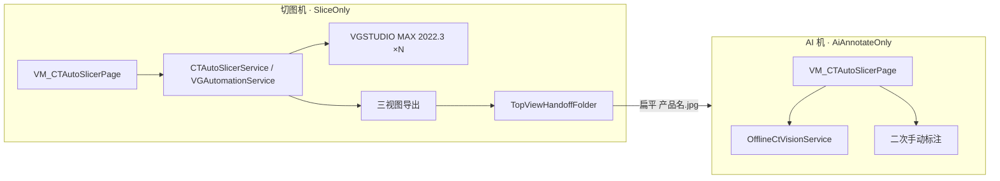

# CTAutoSlicer（惠州离线 CT 自动化切片）项目开发规划

> 文档版本：2026-09-08（标准三文档；旧深档已删除）  
> **角色：冷层详规** — 定位、范围、架构、阶段约定、目录/失败策略；**不要**在本文维护每日进度  
> **进度 / 待办 / 索引**：[CTAutoSlicer进度存档.md](./CTAutoSlicer进度存档.md)（新会话只拖进度存档）  
> 平台：SUNWODA SEVB（`develop`，.NET 8 WPF）  
> 维护人：接手开发者

---

## 0. 开发资料录入（工作流）

> **状态**：已录入（`开发资料/.swd-materials-status` = `ingested`）  
> **原始投放目录**：[开发资料/](./开发资料/)（后续现场包继续投放于此）  
> **整理后真相（本目录根）**：
>
> - [CT离线AI视觉接口文档.md](./CT离线AI视觉接口文档.md)
> - [离线CT_DLL接入说明.md](./离线CT_DLL接入说明.md)
> - [CTAutoCutImg接口文档V1.0.txt](./CTAutoCutImg接口文档V1.0.txt)
>
> 新原始资料放入 `开发资料/` 后按 [Agent协作开发规程](../Agent协作开发规程.md) §2.2 再走「开始录入」。  
> 注：历史上曾引用的 `CTAutoSlicer迁移说明.md`、`NJCT_1jpg失败原因分析.md` 当前仓库 **不存在**。

---

## 1. 项目定位与目标

### 1.1 业务定位

**CTAutoSlicer（业务名「CT 自动化切片」）**：惠州离线 CT 产线自动化切片上位机模块。通过 UI Automation 操作 **VGSTUDIO MAX 2022.3**，对批量 `.vgl` 执行「导入 → LUT → 直方图 → 厚板 → 简单 3-2-1 → 三视图导出」，并把「上」视图送检图交接给 **AI 视觉机**（`NJCT.dll` / `HZSwdCT`）做抓点与 L1～L5 标注。

| 维度 | 改造前（2024） | 改造后（2022，当前） |
|------|----------------|----------------------|
| VG | 2024，`Alt+F` Ribbon 导入 | **2022.3**，`Ctrl+F+I` 快速导入 |
| 输入 | 单个 DICOM 目录 | 多个 `.vgl`/`.vgi`（可 `.lnk` 快捷方式） |
| 导入 | 单进程串行 | **进程池**（`MaxVgProcesses` 默认 4） |
| 灰度 | 直方图拖拽 | **LUT 预设 + 峰谷红线 + 2c/2d** |
| 对齐 | 双视图截图算角 | **简单 3-2-1**（Local OpenCV 或 `CTAutoCutImg`） |
| AI | 无 | 阶段七独立模式（`PipelineRunMode`） |

### 1.2 本期范围

| 能力 / 阶段 | 状态 | 说明 |
|------|------|------|
| 阶段一：批量导入 | ✅ | `Ctrl+F+I`；快捷方式.lnk；中断弹窗 Drain |
| 阶段二：LUT + 直方图 | ✅ | 正/负极双预设；2c 中点；2d 按 Y |
| 阶段三：三象限厚板 | ✅ | Q1→Q2→Q3，「平均值」 |
| 阶段四：简单 3-2-1 | ✅ | Local / VisionDll；无旧 4b；Pre321 仅 Local |
| 对齐后捕捉拖拽 | ✅ | 主流程 + 单测 |
| 阶段五：三视图导出 | ✅ | 先上→前→右；亮度校验；覆盖「全部是」 |
| 上视图交接 | ✅ | `TopViewHandoffFolder` 扁平 `{产品名}.jpg` |
| 阶段七：AI 标注 | 🟡 代码已接入 | 两机拆分；真机联调待确认 |
| 二次手动标注 | ✅ | 测距；默认导出 `result/` |
| NJCT 远端更新 | 🟡 代码已接入 | 仅 AI 机 + 白名单 |
| 阶段六：删文件 / 监控跑批 | ❌ | 待产品确认 |

### 1.2.1 当前进度

**见 [CTAutoSlicer进度存档.md](./CTAutoSlicer进度存档.md)**，不在本文重复维护。

### 1.3 明确不做（当前阶段）

- **不改南昌 CTNCLX**：反射仍为 `NJCT.NJSwdCT`（与惠州 `HZSwdCT` 同 DLL 并存）。
- **不臆造工艺数值**：切片 mm、预设名、`BlackHeight`、L1～L5 语义等以现场/接口文档为准；未确认标 ⏸。
- 文件夹监控自动跑批、`.vgl` 删除/归档 —— 待产品确认。

### 1.4 完整业务链时序（当前目标链）

> 自改造期业务链固化；数值默认值以 `CTAutoSlicerSettings` 为准。

```text
【切图机 · SliceOnly（默认）】
✅ 1. 导入 .vgl（Ctrl+F+I → 图一～四）
✅ 2. 渲染 LUT 预设（按文件名 -Z/-F 选正/负极）
✅ 2b. 直方图灰度（截图→峰谷→拖红线；未标定 ROI 则跳过）
✅ 2c. LUT 关键段中点对齐红线（未标定两端则跳过）
✅ 2d. 按 Y=Target−Valley 非对称扩展两端（因子可配；未标定则跳过）
✅ 3. 三象限厚板（Q1→Q2→Q3，平均值）
✅ 4. 简单 3-2-1
      Local：⓪ Pre321（标定齐全时）→ 斜俯视 3D 找点 → Ctrl 三点 → 偏移置 0
            →「上」黄框向量 → Ctrl 原点 → 完成 → 警告「是」
      VisionDll：跳过 Pre321，默认视角截图 → CTAutoCutImg 两接口
✅ 4'. 对齐后捕捉按钮 + 箭头拖拽
✅ 5. 导出前亮度人工校验 → Alt+F+T 上/前/右导出 → 上视图交接 TopViewHandoffFolder
❌ 6. 阶段六可选：删 .vgl / 监控自动跑批

【AI 机 · AiAnnotateOnly】
✅ 7. 扫交接目录 → 竖图规则 + 可选内容上移 + 提亮 → NJCT → {结果根}/{产品名}/
✅ 7'. 二次手动标注（测距，独立 result/）
```

**象限约定**：第四象限 = 3D（平面三点+原点）；第二象限 =「上」视图（向量两点）。  
**无旧 4b**：向量两点即 3-2-1 中的「2」。

---

## 2. 现有资料盘点

### 2.1 项目文档（docs/CTAutoSlicer/）

| 文档 | 内容 | 角色 |
|------|------|------|
| [CTAutoSlicer进度存档.md](./CTAutoSlicer进度存档.md) | 状态 / 待办 / 入口 / §0 索引 | 热层 |
| [CTAutoSlicer版本变更记录.md](./CTAutoSlicer版本变更记录.md) | 里程碑变更 | 历史 |
| **本文** | 冷层必读约定 | 冷层 |
| [CT离线AI视觉接口文档.md](./CT离线AI视觉接口文档.md) | NJCT/CF 字段（至 V1.2） | 接口真相 |
| [离线CT_DLL接入说明.md](./离线CT_DLL接入说明.md) | 反射接入 / 依赖 / 待确认 | 接入真相 |
| [CTAutoCutImg接口文档V1.0.txt](./CTAutoCutImg接口文档V1.0.txt) | 阶段四 VisionDll | 接口真相 |
| [开发资料/](./开发资料/) | 原始投放区 | 已 ingested，可继续投放 |

### 2.2 外部接口真相（勿臆造）

- **AI**：`NJCT.dll` + `CF.dll`；类 `NJCT.HZSwdCT`；`ModelInit` / `ModelAction` / `ModelAction_origin`；模型 `Dlls\Models\CTOffline\model_500000_900.onnx`；远端 SysCenter `HZ_LianXianCT_Dll`（白名单 `10.215.111.1`）。
- **CutImg**：`CTAutoCutImg.dll` 类 `CT`；`GetSectionReferencePoints`（3D 四点）、`GetObjectTopBottomPoints`（向量两点）；点击前按屏幕 **Y 重排为上→下**。
- **ROI**：AI 输入硬裁剪约定与坐标增强倍率见接口文档；**origin / enhance 坐标勿混用**。

---

## 3. 总体架构设计



### 3.1 分层原则

| 层 | 职责 | 禁止 |
|----|------|------|
| View | 布局、标定/单测交互、绑定 | 业务计算、直接操作 VG |
| ViewModel | 命令、状态、Settings、流程入口 | 直接操作 VG / AI 细节 |
| Service | VG 自动化、反射、热键、监控 | 依赖具体 Page |
| Tool/Helper | 找点、标注、命名、提亮、直方图分析 | 引 WPF 业务 |
| Core | Settings、模式、接口契约 | 引 WPF |

### 3.2 服务清单

| 服务 | 职责 |
|------|------|
| `CTAutoSlicerService` | 门面；IsRunning / Cancel |
| `VGAutomationService`（partial） | 导入～导出～AI 批处理～进程池 |
| `OfflineCtVisionService` | 反射 `HZSwdCT` |
| `CutImgAlgorithmService` | `CTAutoCutImg` |
| `OfflineCtDllUpdateService` | SysCenter 远端 NJCT |
| `CTAutoSlicerLocalConfigService` | 本机 `local.json`（两机模式等） |
| `CTAutoSlicerInputHookService` | Alt+X 中断 / Alt+P 暂停 / Alt+O 锁键鼠 |
| `CTFolderMonitorService` | 目录监控（**仅日志，不触发跑批**） |
| `ProcessMonitorService` | CPU/内存/GPU CSV |
| `AngleAlgorithmService` | 旧角度 DLL（主链不用） |

DI：`AddCTAutoSlicerServices()`；参数 `project_setting`（`belong_to_vm = VM_CTAutoSlicerPage`）。

### 3.3 VG 进程池（要点）

> 调度细节以实现为准：`VGAutomationService.ProcessPool.cs`。

- 文件队列 + 最多 `MaxVgProcesses`（默认 4，钳 1～8）槽。
- **导入体积等待可并行**（按 PID 静默 UIA）；**后处理串行置前**。
- 成功：删排队文件 + Kill VG；失败：Kill、**保留文件**、`@@IMPORT_FAIL@@`。
- 主流程**禁止**附着已有 VG（冷启动）；单测可附着。

### 3.4 目录与命名约定

| 场景 | 约定 |
|------|------|
| 导出名 | 导入文件名主干前 **6** 字符（`SliceExportNamingHelper`） |
| 三视图路径 | `{导出根}/{名}/{名} 上\|前\|右/…` |
| 交接 | `{TopViewHandoffFolder}/{名}.jpg`（扁平，硬失败） |
| AI 输出 | `{SliceExportFolder}/{名}/`：`{名}.jpg`、annotation、`input/` |
| AI 交接备份 | `{Parent(结果根)}/交接备份/yyyy-MM-dd/`，保留 30 天 |
| 二次标注 | 默认 `{根}/result/`（兼容历史 `output/`） |
| 截图调试图 | `VisionCaptureDir` / `2Dxianglaing` / 直方图目录等，按日 **7 天** |

---

## 4. 关键代码入口

### 4.1 VM（partial）

| 文件 | 职责 |
|------|------|
| `VM_CTAutoSlicerPage.cs` | 字段/属性/命令/构造/切图入口 |
| `.Settings.cs` | Load/BuildSettings |
| `.Theme.cs` / `.RoiPreview.cs` | 主题 / ROI 预览 |
| `.Calibration.cs` | 直方图/LUT/3D/上视图/321/Pre321/PostAlign |
| `.StageTests.cs` | 单步测试 |
| `.CutImgDllTest.cs` / `.AiAnnotate.cs` / `.FlowControl.cs` / `.OfflineCtDllUpdate.cs` | DLL 离线测 / AI / 日志热键 / 远端 |

### 4.2 Services / Helpers（要点）

| 文件 | 说明 |
|------|------|
| `VGAutomationService.ProcessPool.cs` | 进程池 + 后处理编排 |
| `.Import.cs` / `.LutAndHistogram.cs` / `.ThickPlate.cs` | 阶段一～三 |
| `.Simple321.cs` / `.Pre321ViewPrep.cs` / `.HistogramAndPostAlign.cs` | 阶段四 + 直方图后处理 |
| `.SliceExport.cs` | 阶段五 + 交接 + 亮度校验 |
| `.OfflineCtVision.cs` | 阶段七批处理 |
| `Vision3dSectionPointsDetector` / `VisionTopViewVectorPointsDetector` | 本地找点 |
| `HistogramGrayScaleAnalyzer` | 峰谷 / 半坡 / 目标线 |
| `OfflineCt*Helper` / `SliceExportNamingHelper` | 标注 / 提亮 / 命名 |

更细方法名以实现文件为准（`VgAutomation/*` partial）。

### 4.3 单文件后处理顺序（代码真实顺序）

```csharp
// RunPostImportPipelineAsync / ImportSingleVglAsync 末尾语义：
await ApplyRenderingPresetAsync(...);
await ApplyHistogramGrayScaleAdjustAsync(...);      // 未标定 ROI 跳过
await ApplyThickPlateForQuadrantsAsync(...);
await TryRunVisionAlignmentInMainFlowAsync(...);    // EnableVisionAlignmentSteps
await TryRunPostAlignCaptureDragInMainFlowAsync(...);
await ExportImageStackSlicesAsync(...);             // 含亮度校验、交接
```

---

## 5. 配置与可运维性（要点）

| 配置 | 位置 | 说明 |
|------|------|------|
| 业务参数 | `project_setting` → `VM_CTAutoSlicerPage` | **默认值真相**：`CTAutoSlicerSettings.cs` |
| 流水线模式 | `Config/CTAutoSlicer/local.json` → `PipelineRunMode` | 不落共享 DB |
| NJCT 远端 | `EnableOfflineCtRemoteDllDownload`；`OfflineCtDllCachedVersion` | 仅 AI 机 |
| VG 并发 | `MaxVgProcesses` 默认 4 | 导入参数页 |

**正负极选型**：文件名含 `-Z`→正极预设/`testlut_Z`；含 `-F` 或无法识别→负极/`testlut_F`（默认）。  
**直方图目标线**：`TargetX = Valley + (RightPeak−Valley)×3/4`（靠右约 1/4，2026-08-31）。  
**2d 扩展**：`Y=Target−Valley`；左×`LutExpandLeftYFactor`（默认 2）、右×`LutExpandRightYFactor`（默认 3）。

遗留未用参数（2024：`VolumeRenderWaitTime`、灰度锚点等）见 Settings 字段注释；清理见进度存档待办 #10。

---

## 6. 风险与待确认事项（台账）

> 接口疑问全文见 [离线CT_DLL接入说明.md §11](./离线CT_DLL接入说明.md)。

| # | 事项 | 影响 | 建议 | 状态 |
|---|------|------|------|------|
| 1 | AI 工艺参数（BlackHeight、分辨率、L1～L5、PrintfValue、OK/NG） | 标注正确性 | 向现场确认 | ⏸ |
| 2 | 两机真机联调 | 上线前提 | 规划 §9.5 | 🔄 |
| 3 | 斜俯视四点/原点与人工一致性 | 对齐精度 | 真机核对 | ⏸ |
| 4 | VisionDll 默认视角找点 | DLL 路径可用性 | 与离线单测对照 | ⏸ |
| 5 | 黄框 HSV / 直方图峰谷真机微调 | 找点/红线 | 现场调参 | ⏸ |
| 6 | 内容上移 px / 亮度校验节奏 | 送检图质量 | 真机调参 | ⏸ |
| 7 | NJCT 与 CTNCLX 同名 DLL / 远端网络 | 联调串扰 | 白名单 + 类名确认 | ⏸ |
| 8 | Halcon 22.11 / ONNX CUDA 部署 | 推理失败 | 接入文档 §8/§11 | ⏸ |
| 9 | `.vgl` 删除 / 监控跑批 | 产品未定 | 阶段六 | ❌ |

### 6.1 已知问题与已处理（摘要）

| 问题 | 处理结论 |
|------|----------|
| 冷启动等待过短 | `ResolveVgOpenWaitTime` 升级旧库 ≤10s → 180s |
| 快速导入空等数秒 | 禁止 Root 整树 Descendants；窄范围查找（见 §8） |
| Qt ComboBox Select 仅高亮 | Win32 点击 + Enter；以下拉关闭判成败 |
| 厚板 UIA 读数滞后 | 不以读数判成败 |
| Q3 底缘菜单反向 | `ViewportQuadrant3ClickOffsetY=-100` |
| Halcon/CutImg 加载失败 | `Dlls\` 同目录 + `SetDllDirectory` |
| 「简单对齐」下拉不可靠 | 绝对坐标 `Simple321ToolbarClick*` |
| Pre321 在 VisionDll 误跑 | 服务层门控（2026-08-04） |
| AI 二次旋转变横图 | 统一「宽>高才 CW90」 |

表内为改造期已固化结论；排障时优先对照对应 Service/Helper 实现与流程日志。

---

## 7. 阶段与里程碑

| 里程碑 | 内容 | 状态 |
|--------|------|------|
| 2026-07-15 | 2022 基础流程 + 快速导入重写 | ✅ |
| 2026-07-17 | 直方图灰度阈值 | ✅ |
| 2026-07-22～23 | 本地找点 + 3-2-1 终版 + 真机单测 | ✅ |
| 2026-07-24 | 进程池 + partial 拆分 | ✅ |
| 2026-07-28～31 | AI 接入、两机拆分、二次标注、Pre321、LUT 2c | ✅ |
| 2026-08-04～07 | mm 单位、result/、双预设、竖图/内容上移、Alt+X | ✅ |
| 2026-08-12～31 | 2d 按 Y、覆盖「全部是」、NJCT 远端、亮度校验、峰谷平滑 | ✅ |
| 2026-09-08 | 标准三文档就绪；删除旧改造进度存档 | ✅ |
| 待办 | 真机联调 / 调参 / 工艺确认 / 阶段六 | 🔄 |

历史条目见 [版本变更记录](./CTAutoSlicer版本变更记录.md)。

---

## 8. 开发约定（对齐平台）

1. **单测与主流程共用同一核心方法**：差异仅限入口包装（附着 VG / 未标定抛错 vs 跳过 / 是否尊重开关）。
2. `Simple321PointSource`：Local 可跑 Pre321；**VisionDll 一律跳过 Pre321**（服务层再判，勿只靠 UI）。
3. 送检图必须**竖图**（高≥宽）；宽>高才 CW90；切图交接与 AI 预处理同一规则。
4. `List<HObject>` 逐索引释放；`ModelInit` 整机一次；反射前 `SetDllDirectory(Dlls)`。
5. 工艺阈值/预设名/切片 mm **勿臆造**；未确认标 ⏸。
6. 中文日志；关键步骤与异常走 `ILoggerService`；主流程 `Try*` 跳过、单测抛错便于排障。
7. 查找 VG 控件：**禁止**对桌面 Root 做 Descendants 全树扫描（快速导入/预设/厚板/导出一律窄范围查找）。
8. 收尾：先更新进度存档，再在版本变更**顶部追加**；改约定改本文；改默认值改 `CTAutoSlicerSettings`。

---

## 9. 阶段详规摘要（冷层必读约定）

> 本节足以支撑后续联调与功能改动；**逐步实现与默认数值以对应源码为准**（Settings / Helper / `VgAutomation/*`）。

### 9.1 直方图灰度与 LUT 2c/2d

| 项 | 约定 |
|----|------|
| 触发位置 | LUT 预设之后、厚板之前 |
| 峰谷 | 柱高先中值+高斯平滑；两最高尖峰；谷深≥18%；防毛边 |
| 红线目标 | 谷→右峰的 **3/4**（靠右约 1/4） |
| 2c | 标定关键段两端 → 中点水平拖到 `TargetScreenX` |
| 2d | `Y=Target−Valley`；左×左因子、右×右因子；Y&lt;2 或因子 0 跳过 |
| 跳过 | 未标定 ROI → 整步跳过；未标定对应电极 LUT 两端 → 跳过 2c/2d |
| 落点 | `HistogramGrayScaleAnalyzer`；`ApplyHistogramGrayScaleAdjustAsync`；`DragLutSegmentMidpoint…`；`ExpandLutSegment…` |

### 9.2 阶段四：简单 3-2-1 与 Pre321

| 项 | 约定 |
|----|------|
| 范围 | **仅**对话框内 3+2+1；**无独立旧 4b** |
| 找点 | `Local`（默认，OpenCV）或 `VisionDll`（`CTAutoCutImg`） |
| Local 3D | 斜俯视 FloodFill/凸包四点：`[0]左上 [1]右上 [2]右下 [3]原点` |
| Local 向量 | **黄框右缘旁侧**优先，失败回退剪影右缘；上→下 |
| VisionDll | `GetSectionReferencePoints` + `GetObjectTopBottomPoints`；向量按 Y 重排上→下 |
| 对话框顺序 | 重置 → Ctrl 三点 → **偏移 Edit 置 0** → Ctrl 向量 → Ctrl 原点 → 完成 → 警告「是」 |
| Pre321 | 点击切换视图 + 箭头拖拽；**仅 Local 且标定齐全**；VisionDll 保持默认视角 |
| Local 额外 | Pre321 前可截默认视角 3D 初始图到 `3D初始`（失败不阻断） |
| 截图前等待 | `VisionCaptureWaitMs`（默认 2s）；3D ROI **勿框进「上」视图** |
| 开关 | `EnableVisionAlignmentSteps`（默认开）；未标定齐全主流程跳过打日志 |
| 日志 | 前缀 `【找点算法】` 标明 Local / VisionDll |

### 9.3 对齐后捕捉拖拽

- 位置：3-2-1 之后、导出之前。
- 点视口底部无名捕捉按钮 → 按标定直线拖拽。
- 开关 `EnablePostAlignCaptureDragSteps`；标定不全主流程跳过。

### 9.4 阶段五：切片导出

| 项 | 约定 |
|----|------|
| 打开 | `Alt+F+T` →「保存影片/图像堆栈」 |
| 顺序 | **上 → 前 → 右**（先上便于早交接） |
| 范围 | UI 各视角 mm（或共用起止，以现场配置为准） |
| 亮度校验 | 导出入口遮罩确认；**独立门闩**，不走 Alt+P；期间 Alt+P 忽略 |
| JPEG 后 | 若「VGSTUDIO MAX 警告」含 **「全部是(A)」** 则点击（与仅「是(Y)」区分） |
| 交接 | 第 `OfflineCtTopViewSliceIndex` 张（默认 50）→ 交接目录扁平改名；**硬失败** |

### 9.5 阶段七：AI 标注（两机）与二次手动

| 项 | 约定 |
|----|------|
| 模式 | `SliceOnly` / `AiAnnotateOnly`，本机 `local.json` |
| 切图终点 | 交接扁平图；**不再**串行 NJCT |
| AI 批处理 | 扫交接根一层图 → 竖图规则 → 可选 `OfflineCtContentShiftUpPx` 上移 → 提亮 → `{产品}/input/` → NJCT → `{结果根}/{产品}/` |
| 失败 | 切图交接硬失败；AI **单张软失败**继续 |
| 备份 | 成功后移到 `交接备份/yyyy-MM-dd/`，删交接源；保留 30 天 |
| 反射类 | 惠州 `NJCT.HZSwdCT`（南昌 `NJSwdCT` 不改） |
| 远端 DLL | 仅 AI 机开关；双路径落盘 `Dlls\NJCT.dll` + exe 同级 |
| 尺寸展示 | 统一 **mm**（F4） |
| 二次标注 | 侧栏独立；两点测距；默认 `result/`；不并入 AI annotation.json |
| 检测统计 Demo | 假数据 KPI（可选增强，非上线阻断） |

接口字段以 [CT离线AI视觉接口文档.md](./CT离线AI视觉接口文档.md) 为准。

---

## 10. 验证清单（未勾项摘要）

> 与进度存档待办对照；联调通过后勾掉对应待办即可。

- [ ] 两机联调：交接扁平名 + AI 落盘 + 备份清理
- [ ] 真机：Pre321 后 `*_points.png` 与人工标注一致（尤其原点）
- [ ] 真机：VisionDll 默认视角找点与离线单测一致
- [ ] 真机：LUT 2c 中点对齐 + 2d 扩展观感；直方图目标线
- [ ] 真机：`OfflineCtContentShiftUpPx` 调参
- [ ] 真机：导出前亮度校验操作节奏
- [ ] 真机：NJCT 远端下载 + 白名单
- [ ] 现场确认 AI 工艺参数（接入文档 §11）
- [ ] （可选）阶段六：删 `.vgl` / 监控跑批 / 清理 2024 UI

---

## 11. 相关资料索引

| 资料 | 路径 |
|------|------|
| 进度存档（热层） | [CTAutoSlicer进度存档.md](./CTAutoSlicer进度存档.md) |
| 版本变更 | [CTAutoSlicer版本变更记录.md](./CTAutoSlicer版本变更记录.md) |
| AI 接口 | [CT离线AI视觉接口文档.md](./CT离线AI视觉接口文档.md) |
| DLL 接入 | [离线CT_DLL接入说明.md](./离线CT_DLL接入说明.md) |
| CutImg 接口 | [CTAutoCutImg接口文档V1.0.txt](./CTAutoCutImg接口文档V1.0.txt) |
| 原始投放 | [开发资料/](./开发资料/) |
| 参数默认值 | `Core/Models/Project/CTAutoSlicer/CTAutoSlicerSettings.cs` |
| 平台 | `docs/项目架构说明.md`、`docs/新增业务模块上手指南.md`、`docs/Agent协作开发规程.md` |

---

*本文档随约定同步；默认值变更改 Settings；现场联调结论写入 §6 / 进度存档待办。*
