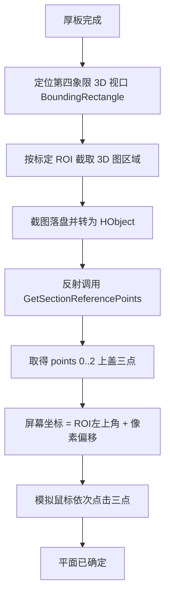
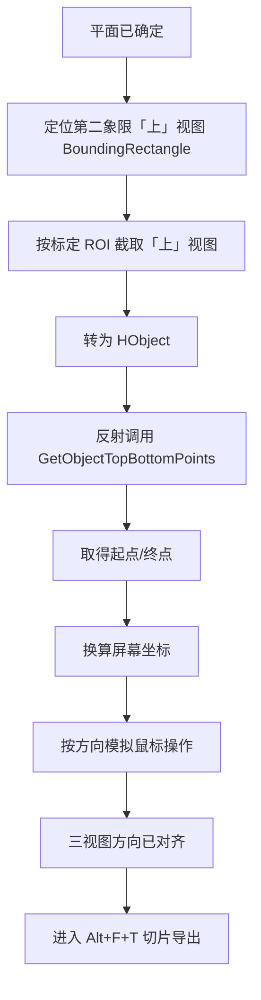

# CTAutoSlicer 2022 改造进度存档

> **文档版本**：2026-07-21（阶段四流程已按视觉 `CTAutoCutImg.dll` 接口重写细化；直方图灰度阈值已接入主流程）  
> **状态**：阶段一（多文件 `.vgl` 导入）**流程可跑通**；阶段二 **渲染预设** ✅；阶段三 **三象限厚板** ✅；直方图灰度阈值 ✅；阶段五 **三视图切片导出** ✅（范围暂用默认）；**阶段四视觉对齐** 🟡 算法 DLL 已交付，流程文档已明确，**代码尚未接入**  
> **用途**：供下一上下文快速接手，无需重读全部会话历史  
> **关联文档**：`docs/CTAutoSlicer迁移说明.md`（平台分层与文件职责）、`docs/update_ctautoslicer_wait_settings.sql`（数据库等待参数）

**进度图例**：✅ 已接入主流程　🟡 下一步可开发（算法/UI 已就绪待编码）　⏸ 阻塞（依赖外部未交付）　❌ 未开始

---

## 0. 直方图灰度阈值（2026-07-17 起）

> 背景：LUT 预设不保存直方图中间红色阈值竖线位置，需截图分析后拖拽。  
> 半坡目标约定：取**高度最高的两个尖峰**；左线=两峰间波谷，右线=右侧尖峰，中线=\((左线+右线)/2\)（红线拖到中线）。

| 阶段 | 状态 | 说明 |
|------|------|------|
| ROI 框选标定 | 🟡 UI 已实现 | 「截图标定」→ 上位机最小化 → 全屏灰遮罩框选 → ✓提交 / ✕重选 / Esc 取消；坐标写入 DB |
| 掩膜取色 | 🟡 UI 已实现 | 「取色」→ 9×9 放大格 + HEX/RGB → 左键填入 `HistogramMaskColor`（默认 `#6E6E6E`） |
| 按坐标截图 + 颜色替换 | 🟡 单步可测 | 目标色→纯绿 → **去全宽绿带 + 下填接回** → 峰谷 → `histogram_compare_*.png` |
| 红线初始位置 | 🟡 单步可测 | `HistogramRedLineDetector`；拖拽起点 |
| 峰谷 / 半坡 | 🟡 单步可测 | 两最高尖峰 → 左线=谷、右线=右尖、中线=(左+右)/2；调试图 `histogram_peaks_*.png` |
| 拖拽红线 | ✅ 单步 + 主流程 | `MouseDragPressMoveRelease` 水平拖到 T* |
| 接入主流程 | ✅ | `ImportSingleVglAsync`：预设之后、厚板之前；未标定 ROI 则跳过 |

**关键入口**：

| 文件 | 说明 |
|------|------|
| `ScreenColorPickerOverlayWindow` | 全屏取色（先截虚拟屏再采样，避免取到预览窗） |
| `HistogramRoiCalibrationOverlayWindow` | 全屏 ROI 标定 |
| `HistogramGrayScaleAnalyzer` | 目标色→纯绿 + 峰谷半坡 + 对比/峰谷调试图 |
| `VGAutomationService.CaptureHistogramRoiAsync` / `TestHistogramGrayScaleAdjustAsync` | 截图→分析→拖拽 |
| Settings：`HistogramMaskColor` / `HistogramMaskTolerance` / ROI / 截图目录（按日子目录，保留 3 天） | |
| Settings：`Vision3dRoi*` / `VisionTopViewRoi*` | 阶段四 3D /「上」视图截图 ROI（UI 已可标定，主流程待接入） |

**真机步骤**：露出直方图 → 取色对准填充灰 → 截图标定 ROI → 「测试直方图灰度调整」→ 核对 `compare`/`peaks` 图中「左/右/中」线 → 观察红线是否拖到中线。

---

## 1. 改造背景

| 维度 | 改造前（2024 流程） | 改造后（2022 流程，当前） |
|------|---------------------|---------------------------|
| VG 版本 | VGSTUDIO MAX 2024，`Alt+F` → Ribbon 后台导入 | VGSTUDIO MAX **2022.3**，**`Ctrl+F+I`** 快速导入（按住 Ctrl，依次按 F、I；真机标定） |
| 输入数据 | 单个 **DICOM 文件夹**（`CTFileFolder` 填目录路径） | 文件夹内多个 **`.vgl` 工程文件**（直接子级） |
| 单次点击处理量 | 1 个 DICOM 体数据 | N 个 `.vgl`，按创建时间升序循环 |
| 导入后步骤 | 体积渲染等待 → 灰度直方图拖拽 → 简单对齐 → 双视图截图算角旋转 | 导入完成 → **渲染 LUT 预设** ✅ → 四象限厚板/对齐/切片（见 §7） |
| 进程名 | 曾硬编码 `vgstudiomax20241` | 从 UI 配置的 `VGAppPath` 推导 |

**业务名称**仍为「CT 自动化切片」。当前已跑通：**批量 `.vgl` 导入 → 应用渲染预设（LUT）→ 直方图灰度阈值 → 三象限厚板 → 三视图切片导出**。  
**阶段四（视觉对齐）** 为下一优先开发项：视觉已交付 `CTAutoCutImg.dll`（2026-07-21），流程见 **§7.1 / §8 阶段四 / §16**；主流程代码仍跳过该段，切片范围暂用默认 20～70 mm。

---

## 2. 当前已跑通的整体流程（阶段一 + 阶段二 + 阶段三）

用户选择 **CT 体素文件夹** → 点击 **「流程模拟」** → 自动执行：

```mermaid
flowchart TD
    Start[流程开始] --> Launch[连接/启动 VG 进程]
    Launch --> Step1[WaitForVgOpen<br/>轮询队列弹窗或「文件(F)」]
    Step1 -->|命中队列「自动保存恢复」| Skip[Drain：点「跳过」]
    Skip --> Step1
    Step1 -->|「文件(F)」可点| Front[后续步骤]
    Front --> StepN[ExecuteStepWithRetry]
    StepN -->|异常/失败| Drain[Drain 中断弹窗队列]
    Drain -->|已处理| StepN
    Drain -->|无弹窗| Fail[抛出步骤失败]
```

另：延迟出现的「自动保存恢复」不靠固定等待；登记在 `_interruptDialogQueue`，任意步骤异常或未达标时先 Drain 再重试。

另提供独立按钮：

- **「测试应用渲染预设」**：假定 VG 中**已导入体积**，仅执行预设应用（不重跑导入）。
- **「测试厚板设置(三象限)」**：假定 VG 中**已导入体积且已应用 LUT**，依次执行象限 1→2→3 厚板设置（不重跑导入）。

### 2.1 单文件导入子流程（`ImportSingleVglAsync`）

| 步骤 | 动作 | 完成判定 / 备注 |
|------|------|-----------------|
| 1 | `Ctrl+N` 新建/清空工程 | 固定等待 `NewProjectDialogWaitTime` |
| 2 | 处理保存提示 | 窗口 `VGSTUDIO MAX 问题` → `否(N)` / Enter |
| 3 | **`Ctrl+F+I`** 打开快速导入（图一） | 轮询 `快速导入...` 出现即返回；见 §15 |
| 4 | 点击 Edit `文件名(N):` 输入路径（图二）→ 点击 `打开(O)`（图三） | 不再用 `Alt+O` 为主路径；对话框关闭后交图四 |
| 5 | 等待文件选择向导（图四） | Button `完成(F)` 且 Enabled（**原逻辑保留**） |
| 6 | 向导内 Edit 再输入同一路径 | ValuePattern 或键盘 fallback |
| 7 | `Alt+F` 完成文件选择 | 向导消失 |
| 8 | 等待 `请耐心等待...` 出现 | 确认导入已开始 |
| 9 | 轮询进度框消失 | 超时上限 `ImportTimeoutMinutes` |
| 10 | `PostImportWaitTime` 稳定等待 | 默认 3000ms |
| 11 | `ApplyRenderingPresetAsync` | 等待 `PresetApplyWaitTime` → 打开「渲染」面板 ComboBox → 选中 `RenderingPresetName` 列表项 |
| 11b | `ApplyHistogramGrayScaleAdjustAsync` | 已标定 ROI 时：截图→峰谷半坡→拖红线；未标定则跳过 |
| 12 | `ApplyThickPlateForQuadrantsAsync` | 象限 1→2→3：视口右键 →「厚板」→ 启用厚板模式 → 组合模式「平均值」→ 确定 |

**失败策略**：单文件任意步骤超时/异常 → `@@IMPORT_FAIL@@文件名|原因` → **跳过继续**下一个文件。

> **2026-07-15 起**：图一～图三已按 Accessibility Insights 重写；图四 `ConfirmFileSelectionAsync` 保持原操作。细节与 Q&A 见 **§15**。

### 2.2 渲染预设应用子流程（`ApplyRenderingPresetAsync`）— 阶段二 ✅

| 步骤 | 动作 | 完成判定 / 备注 |
|------|------|-----------------|
| 1 | `PresetApplyWaitTime` 等待 | 默认 2000ms（导入进度消失 + `PostImportWaitTime` 之后） |
| 2 | `ActivateVgWindowAsync` 置前 VG | 与导入阶段一致 |
| 3 | 定位「渲染」窗口 + ComboBox | Automation：`Window「渲染」` → `ControlType.ComboBox` |
| 4 | 打开下拉 | **Expand**（每步最多 800ms）→ **Alt+Down** → 点击组合框；任一步检测到子 `List` 可见即继续，不再每步耗满 `PresetDropdownWaitTime` |
| 5 | 查找 `ListItem`（Name = 预设名） | `ComboBox → List` → 渲染面板 → 同进程顶层；100ms 轮询 |
| 6 | Win32 点击 + Enter 确认 | Qt：`Select` 仅高亮；**立即** Win32 点击 + 回车 |
| 7 | 完成判定 | **下拉已关闭** 或 ValuePattern 读数匹配；读数滞后时不失败（仅 UIA 诊断日志） |

**等待策略（预设，2026-07-16）**：跳过 `TrySetComboBoxValue` + 5s 读数等待（Qt 常误报成功却读数不变）；打开下拉每步最多 **800ms**；选中后以**下拉关闭**为主判据，与厚板组合模式一致。

**单步测试**：`TestRenderingPresetAsync` / 页面按钮「测试应用渲染预设」（不执行导入）。

**实现说明**：2022 真机验证后，灰度调整改为 **直接应用已保存的 LUT 预设**（如 `testlut`），不再拖拽直方图；页面参数「渲染预设名称」填 Insights 中 `ListItem` 的 Name。若 ValuePattern 已是目标预设名则**跳过**打开下拉。

### 2.3 三象限厚板设置子流程（`ApplyThickPlateForQuadrantsAsync`）— 阶段三 ✅

| 步骤 | 动作 | 完成判定 / 备注 |
|------|------|-----------------|
| 1 | 按视口中心点四象限划分定位 Q1～Q3 | `UIAutomationHelper.FindViewportQuadrants`（左上/右上/左下/右下）；Q3 右键点额外上移 `ViewportQuadrant3ClickOffsetY`（默认 -100px，避免靠近屏幕底缘菜单反向弹出） |
| 2 | 右键前 `ThickPlateStepDelayMs`（默认 500ms） | 固定步间等待 |
| 3 | 视口中心右键 → 偏移点击「厚板」 | 菜单不可见于 UIA，用 `ThickPlateMenuOffsetX/Y`（真机标定 90/127）；右键后等待 `ThickPlateMenuAfterRightClickDelayMs`（默认 200ms）再点菜单 |
| 4 | 等待「厚板设置」对话框 | `WaitForElementAsync` 轮询（找到即继续，非固定多等） |
| 5 | `TogglePattern` 勾选「启用厚板模式」 | 失败则 Win32 点击复选框中心 |
| 6 | 展开组合模式 → 选「平均值」 | `ExpandCollapse` + `WaitForElementAsync` 等 ListItem（100ms 轮询，找到即点）；Win32 点击 + Enter |
| 7 | Invoke / 点击「确定」 | 等待对话框消失 |

**等待策略（厚板）**：**混合模式** — 控件出现类步骤用轮询「找到即触发」；关键动作之间用 `ThickPlateStepDelayMs`（500ms）固定步间等待。组合模式**不以 UIA 组合框读数判成败**（Qt 读数滞后），以点击+回车后继续点「确定」、对话框关闭为准。

**单步测试**：`TestThickPlateAsync` / 页面按钮「测试厚板设置(三象限)」（不执行导入，一次跑完 Q1→Q2→Q3）。

---

## 3. 真机 UI Automation 标定（Accessibility Insights）

| 场景 | 窗口/控件 Name | 触发方式 |
|------|----------------|----------|
| 保存提示 | `VGSTUDIO MAX 问题` / `否(N)` | Enter 或 Invoke |
| **快速导入（图一～三，2026-07-15）** | 对话框 `快速导入...`；Edit `文件名(N):`（`Edit(50004)` / 亦可为 ComboBox 内 Edit）；Button `打开(O)`（AccessKey Alt+O） | **`Ctrl+F+I`**；点击输入框写路径；**点击「打开(O)」**（Invoke → Win32 点击） |
| 文件选择向导（图四） | 窗口 Name 含 `来自 .vgl 文件的体积`；内文「文件选择」；`完成(F)` / `下一步(N)` 等 | 检查窗口存在后按原 `ConfirmFileSelectionAsync`（向导内再输路径 → `Alt+F`） |
| 导入进度 | `请耐心等待...`（内文「正在导入体积」/「正在写入图像」） | 出现→**可见**进度框消失后再继续；仅离屏 UIA 残留可忽略 |
| 渲染预设下拉 | `渲染` 窗口 / `ComboBox` / `List` / `ListItem` Name=预设名 | Expand 或 Alt+Down；选中用 SelectionItem + Win32 点击 |
| 象限视口 | 四宫格 `Group`/`Pane`，按中心点划分 Q1～Q4 | 右键菜单「厚板」用相对偏移点击；Q3 右键点上移 100px |
| 厚板设置对话框 | 窗口 `厚板设置` / CheckBox `启用厚板模式` / ComboBox + ListItem `平均值` / Button `确定` | 组合模式：Win32 点击 + Enter；不以 UIA 读数判成败 |
| 切片导出对话框 | 窗口 `保存切片/图像堆栈` / Group `2D 视图`+ComboBox / Group `图像大小`+Edit / Group `堆栈设置` 内 Text `切片图数量：` + **Custom** 输入框 / Group `切片图范围` 内 Text `开始 [mm]`/`结束 [mm]` + **Custom** 输入框 / Button `保存...` | **Alt+F+T** |
| 保存图像对话框 | 嵌套 `对话框 保存图像...` / Edit `文件名:`（Alt+N）/ Button `保存(S)` | 保存后弹出 |
| JPEG 质量对话框 | 嵌套 `窗口 JPEG 质量` / Button `确定`（AccessKey **Enter**） | Invoke → Win32 点击 → Enter |
| 导出写入进度 | 嵌套 `窗口 请耐心等待...` / Text `正在写入图像` | 消失后再导出下一视图；默认超时 60s |
| ~~菜单 Plan B~~ | ~~`文件(F)` / `快速导入(I) Ctrl+I`~~ | **2026-07-15 已从主路径删除**（曾作为 Ctrl+I 失败后备） |
| VG 启动就绪 | `文件(F)` MenuItem 可交互 | `IsEnabled` + 非离屏 + 有尺寸 |

---

## 4. 关键代码入口（下一上下文从这里读）

### 4.1 主流程编排

| 文件 | 方法 | 说明 |
|------|------|------|
| `SUNWODA_SEVB/ViewModels/Pages/CTAutoSlicer/VM_CTAutoSlicerPage.cs` | `ExecuteRunSimulationAsync` | 页面按钮入口；校验 `.vgl`；写流程日志 |
| `SUNWODA_SEVB/Services/Project/CTAutoSlicer/CTAutoSlicerService.cs` | `RunSimulationAsync` | 门面；管理 `IsRunning` / Cancel |
| `SUNWODA_SEVB/Services/Project/CTAutoSlicer/VGAutomationService.cs` | `RunSimulationAsync` | **核心**：启动→就绪→循环导入 |
| `SUNWODA_SEVB/Services/Project/CTAutoSlicer/VGAutomationService.cs` | `ImportSingleVglAsync` | 单文件导入 + 预设 + 厚板 |
| `SUNWODA_SEVB/Services/Project/CTAutoSlicer/VGAutomationService.cs` | `OpenQuickImportAsync` / `QuickImportFillAndOpenAsync` / `FindQuickImportDialog` | **图一～三**（2026-07-15 重写，见 §15） |
| `SUNWODA_SEVB/Services/Project/CTAutoSlicer/VGAutomationService.cs` | `ConfirmFileSelectionAsync` | **图四**（文件选择向导，原逻辑保留） |
| `SUNWODA_SEVB/Services/Project/CTAutoSlicer/VGAutomationService.cs` | `ApplyRenderingPresetAsync` | **阶段二**：渲染 LUT 预设选择与应用 |
| `SUNWODA_SEVB/Services/Project/CTAutoSlicer/VGAutomationService.cs` | `ApplyThickPlateForQuadrantsAsync` | **阶段三**：象限 1→2→3 厚板 + 平均值 |
| `SUNWODA_SEVB/Services/Project/CTAutoSlicer/VGAutomationService.cs` | `TestRenderingPresetAsync` | 单步测试预设（无需重跑导入） |
| `SUNWODA_SEVB/Services/Project/CTAutoSlicer/VGAutomationService.cs` | `TestThickPlateAsync` | 单步测试厚板三象限（无需重跑导入） |
| `SUNWODA_SEVB/Services/Project/CTAutoSlicer/VGAutomationService.cs` | `WaitForVgOpenAsync` + `_interruptDialogQueue` | **第一步**：轮询打开；「自动保存恢复」登记在中断队列，步骤异常时 Drain 后重试 |
| `SUNWODA_SEVB/Services/Project/CTAutoSlicer/VGAutomationService.cs` | `ExecuteStepWithRetryAsync` | 通用步骤重试 |
| `SUNWODA_SEVB/Services/Project/CTAutoSlicer/VGAutomationService.cs` | `OnImportSucceededAsync` | **占位**：仅打日志，不删文件 |

### 4.2 UI Automation 工具

| 文件 | 关键 API |
|------|----------|
| `SUNWODA_SEVB.Tool/Helper/UIAutomationHelper.cs` | `FindFileMenuForProcess`、`WaitForElementAsync`、`FindViewportQuadrants`、`TryToggleCheckBox`、`TrySelectListItem`、`GetComboBoxDisplayText` |
| `SUNWODA_SEVB.Tool/Helper/AutomationWinAPIHelper.cs`（`WinAPIHelper`） | `ClickScreen`（`SetCursorPos` + `mouse_event`）用于 Qt 下拉确认点击 |
| `SUNWODA_SEVB.Tool/Helper/MouseSimulationHelper.cs` | 点击/移动/拖拽（**TestOffset 用，主流程未用**） |
| `SUNWODA_SEVB.Tool/Helper/ScreenCaptureHelper.cs` | 区域截图（**主流程未用**） |
| `SUNWODA_SEVB.Tool/Helper/PathGenerationHelper.cs` | 直线/圆弧拖拽路径（**主流程未用**） |

### 4.3 参数模型

`SUNWODA_SEVB.Core/Models/Project/CTAutoSlicer/CTAutoSlicerSettings.cs`

- 文件后缀常量：`VglFileExtension = ".vgl"`
- 默认 VG 就绪等待：`DefaultVGOpenWaitTime = 180000`
- 旧库值自动升级阈值：`LegacyVGOpenWaitTimeThreshold = 10000`（≤10000 视为过短，升为 180000）

---

## 5. 已实现的基础设施（非导入主链，但已可用）

| 能力 | 文件 | 状态 |
|------|------|------|
| 流程日志 UI（200 行、智能滚动、可清除） | `VM_CTAutoSlicerPage` + `CTAutoSlicerPage.xaml` | ✅ 已用 |
| 文件日志 `Assets/CTAutoSlicer/import_log.txt` | `VM_CTAutoSlicerPage.WriteFlowLogToFile` | ✅ 已用 |
| 全局 Esc 中断（单击锁输入 / 双击取消） | `CTAutoSlicerInputHookService` | ✅ 已用 |
| CT 文件夹监控（仅记日志，**不触发流程**） | `CTFolderMonitorService` | ✅ 已挂载 |
| 进程 CPU/内存/GPU CSV | `ProcessMonitorService` | ✅ 页面初始化启动 |
| 角度算法 DLL 加载 | `AngleAlgorithmService.InitializeAsync` | ✅ 页面初始化；**阶段四主链改用 `CTAutoCutImg`，本 DLL 暂不参与对齐** |
| 切图视觉 DLL | `CTAutoCutImg.dll`（Demo 已交付） | 🟡 待拷入 `Dlls\` 并封装 `CutImgAlgorithmService`（§16） |
| 偏移量测试按钮 | `VGAutomationService.TestOffsetAsync` | ✅ 灰度锚点/开始菜单等（主流程灰度已改为预设，锚点测试可逐步废弃） |
| 渲染预设单步测试 | `TestRenderingPresetAsync` +「测试应用渲染预设」按钮 | ✅ 已用 |
| 厚板三象限单步测试 | `TestThickPlateAsync` +「测试厚板设置(三象限)」按钮 | ✅ 已用 |
| DI 注册 | `ProjectServiceCollectionExtensions.AddCTAutoSlicerServices` | ✅ |

---

## 6. 运行参数一览（`project_setting`，`belong_to_vm = VM_CTAutoSlicerPage`）

### 6.1 阶段一 / 阶段二（预设）/ 阶段三（厚板）已生效

| 参数 | 默认值 | 用途 |
|------|--------|------|
| `VGAppPath` | 用户配置 | VG exe 路径；进程名由此推导 |
| `VGOpenWaitTime` | 180000 ms | 「文件(F)」就绪检测上限；每秒轮询 |
| `VGShowFrontWaitTime` | 2000 ms | 置前后等待（厚板单测已改用 `EnsureVgForeground`，不重复等 2s） |
| `CTFileFolder` | 用户选择 | 扫描 `.vgl` 的文件夹 |
| `QuickImportDialogWaitTime` | 10000 ms | **Ctrl+F+I** 后轮询「快速导入...」出现的上限（找到即继续） |
| `NewProjectDialogWaitTime` | 5000 ms | Ctrl+N 后等保存框 |
| `FileSelectionDialogWaitTime` | 15000 ms | 等「完成(F)」/ 进度框出现 |
| `ImportTimeoutMinutes` | 30 | 单文件导入进度框消失超时 |
| `PostImportWaitTime` | 3000 ms | 导入完成后稳定等待 |
| `RenderingPresetName` | `testlut` | 「渲染」面板下拉列表项 Name，须与 VG 内预设名完全一致 |
| `PresetApplyWaitTime` | 2000 ms | 导入完成后、打开预设下拉前的等待 |
| `PresetDropdownWaitTime` | 5000 ms | 打开下拉后等待 `ListItem` 出现的超时 |
| `ThickPlateMenuOffsetX` / `Y` | 90 / 127 | 右键点后相对偏移，点击「厚板」菜单项 |
| `ThickPlateMenuAfterRightClickDelayMs` | 200 ms | 右键后、点「厚板」菜单前的等待（防卡顿） |
| `ThickPlateStepDelayMs` | 500 ms | 厚板流程关键动作之间的固定步间等待 |
| `ThickPlateStepRetryCount` | 1 | 厚板单象限失败重试次数 |
| `ViewportClickOffsetY` | 0 | 视口右键点相对中心的 Y 偏移 |
| `ViewportQuadrant3ClickOffsetY` | -100 | 第三象限（左下）额外上移，避免底缘菜单反向 |
| `ViewportMinWidth` / `MinHeight` | 400 / 300 | 四宫格视口候选最小尺寸 |
| `ThickPlateDialogWaitTime` | 3000 ms | 等待「厚板设置」出现/关闭的超时（轮询上限，非固定多等） |
| `ThickPlateDropdownWaitTime` | 3000 ms | 组合模式下拉 ListItem 出现超时（轮询上限） |
| `StepRetryCount` | 3 | 关键步骤重试次数（厚板用独立 `ThickPlateStepRetryCount`） |
| `StepRetryIntervalMs` | 2000 ms | 重试间隔 |

### 6.1.1 阶段五（切片导出）已生效

| 参数 | 默认值 | 用途 |
|------|--------|------|
| `SliceExportFolder` | 用户配置 | 切片导出目标目录 |
| `SliceExportImageWidth` | 3000 | 导出对话框「图像大小-宽」 |
| `SliceExportQuantity` | 100 | 局部图像（非 QJ）导出数量 |
| `SliceExportQuantityQj` | 150 | QJ 全局图像导出数量（运行时同步 UI） |
| `SliceRangeStartMm` | 20 | 切片范围开始 [mm] — 阶段四主链不定此值；暂用配置默认 |
| `SliceRangeEndMm` | 70 | 切片范围结束 [mm] — 同上 |
| `SliceExportDialogWaitTime` | 8000 ms | 等待导出/质量确认对话框超时 |
| `SliceExportWriteTimeoutMs` | 60000 ms | 等待「正在写入图像」进度框消失（默认 1 分钟） |
| `SliceExportViewFrontName` | `前 1` | 2D 视图下拉项（前） |
| `SliceExportViewRightName` | `右 1` | 2D 视图下拉项（右） |
| `SliceExportViewTopName` | `上 1` | 2D 视图下拉项（上） |

### 6.2 仍在 UI/模型中，但主流程未使用（多为 2024 遗留）

| 参数 | 原用途 | 下一阶段建议 |
|------|--------|--------------|
| `SelectCTFileFolderWaitTime` | 2024 DICOM 选目录等待 | 2022 导入后若不用可隐藏或复用 |
| `ImportFinishWaitTime` | 2024 导入完成等待 | 可能被 `PostImportWaitTime` 替代 |
| `VolumeRenderWaitTime` | 2024 体积渲染完成等待 | **2022 未使用**；无独立渲染等待，导入后直接应用 LUT 预设 |
| `ImportMenuItemOffset` | 2024 Ribbon 导入菜单 Y 偏移 | 菜单 Plan B 已删除；可废弃 |
| `StartMenuXOffset` / `StartMenuYOffset` | 2024 开始菜单位置 | 待确认 2022 是否仍需要 |
| `GrayScaleGraphAnchor*Offset` | 2024 灰度直方图拖拽锚点 | **已由渲染预设替代**；UI 保留，可后续隐藏 |
| `RotationRadius` | 视图旋转拖拽半径 | 2024 遗留；**阶段四新主链不以角度拖拽定方向**（见 §16），可暂保留 |
| `EnableVisionAlignmentSteps` | （建议新增）是否执行阶段四视觉对齐 | 默认 `false`；DLL 接入联调时开启 |

---

## 7. 2022 真机完整业务流程（目标链 vs 当前进度）

### 7.1 实验室确认的完整切片流程（预设之后）

VG 四象限布局下，单个体积从 **导入 + LUT 预设** 到 **切片完成** 的目标顺序如下（与早期文档中「仅前/右双视图截图算角」的 2024 描述不同，以本节为准；**阶段四细节以 §16 为准**）：

```text
✅ 1. 导入 .vgl 体积（Ctrl+F+I 快速导入 → 图一～四，见 §15）
✅ 2. 应用渲染 LUT 预设（「渲染」面板 ComboBox）
✅ 2b. 直方图灰度阈值（截图→峰谷半坡→拖红线；未标定 ROI 则跳过）

✅ 3. 第一、二、三象限：各视口右键 → 选择「厚板」→ 启用厚板模式 → 组合模式「平均值」→ 确定
      （`ApplyThickPlateForQuadrantsAsync`，已接入主流程与单步测试按钮）

🟡 4. 阶段四 · 上盖平面三点选面（视觉 DLL #1）
      直方图完成后，对 **3D 图（第四象限）图像范围** 截图 → 转 HObject
      → 调用 `CTAutoCutImg.dll` / `GetSectionReferencePoints`
      → 得到上盖平面三个点（+ 原点）像素坐标
      → 按截图 ROI 与屏幕的相对位置，模拟鼠标依次点击三点，确定对齐平面
      （详见 §16.2；代码尚未接入）

🟡 5. 阶段四 · 切面方向两点对齐（视觉 DLL #2）
      对 **第二象限「上」视图** 图像范围截图 → 转 HObject
      → 调用 `GetObjectTopBottomPoints`
      → 得到起点/终点像素坐标（及由此确定的切面方向）
      → 按相对位置模拟鼠标操作，完成方向对齐
      → 至此三个视图方向均已对齐，可进入切片导出
      （详见 §16.3；代码尚未接入）

✅ 6. Alt+F+T 三视图切片导出（`ExportImageStackSlicesAsync`，已接入主流程与单测按钮；
      切片范围暂用默认 20~70 mm；阶段四接入后可按视觉结果覆盖）

❌ 7. 收尾：导入成功后 .vgl 处理、文件夹监控自动跑批等（见 §8 阶段六）
```

**说明**：

- **象限编号**：指 VG 主工作区四宫格视口（左上=一、右上=二、左下=三、右下=四）。阶段四约定：**第四象限 = 3D 图**（截图喂接口一）；**第二象限 =「上」视图**（截图喂接口二）。与「前/右/俯」导出视图名的对应关系仍须真机用 Insights 标定并写入配置。
- **步骤 4～5** 依赖 `CTAutoCutImg.dll`（2026-07-21 已交付）。接入前主流程应 **显式跳过并打日志**，不得阻塞步骤 6 联调（可用「人工预先对齐好的工程」做导出单测）。
- **与旧「三切面切片范围点位」表述的关系**：旧文档将「范围点位」单列为一步；当前确认的主链是 **平面三点 + 方向两点** 完成对齐后直接切片，范围参数仍可用配置默认值，待后续是否由视觉再输出 mm 范围另议。
- **步骤顺序注意**：当前代码主链为「直方图 → 厚板 → 导出」。阶段四应插在 **厚板之后、导出之前**（直方图已完成是前提；3D/「上」视图截图依赖体积已可见）。若真机发现须紧挨直方图、厚板之后再对齐，以真机为准微调，但截图对象与 DLL 调用顺序不变。

### 7.2 任务流程：已改造步骤 vs 未改造步骤

**说明**：2022 **无**独立「体积渲染完成等待」步骤；导入进度消失后，以 `PostImportWaitTime` + `PresetApplyWaitTime` 等待，再应用 LUT 预设。

#### 已改造步骤（主流程已接入）

```text
✅ 锁定/解锁输入
✅ 启动/附着 VG 进程
✅ 「文件(F)」就绪检测（替代盲目固定等待）
✅ 多 .vgl 顺序导入（Ctrl+F+I 快速导入 →「请耐心等待」消失；检测禁止桌面整树扫描）
✅ 导入后短暂稳定等待（PostImportWaitTime，默认 3000ms）
✅ 渲染 LUT 预设应用（PresetApplyWaitTime 后 →「渲染」面板 ComboBox 选 RenderingPresetName）
✅ 直方图灰度阈值（预设后：截图→峰谷半坡→拖红线；未标定 ROI 则跳过）
✅ 三象限厚板设置（`ApplyThickPlateForQuadrantsAsync`，象限 1→2→3）
✅ 三视图切片导出（`ExportImageStackSlicesAsync`，前/右/上 + 命名/QJ 数量）
✅ 「测试应用渲染预设」单步按钮（已导入体积前提下单独测预设，不重跑导入）
✅ 「测试厚板设置(三象限)」单步按钮（已导入+已预设前提下测厚板，不重跑导入）
✅ 「测试切片导出(三视图)」单步按钮（已导入+预设+厚板前提下测导出）
✅ 失败跳过、批次统计、流程日志
⏸ 批次结束 Ctrl+N（开发阶段暂注释，保留工程状态）
```

#### 未改造步骤（按真机流程重新排列）

| 状态 | 步骤 | 说明 |
|------|------|------|
| 🟡 | **阶段四 · 3D 截图 + 上盖三点选面** | DLL `GetSectionReferencePoints` 已交付；需：ROI 截图 → HObject → 反射调用 → 像素点换算屏幕坐标 → 模拟点击三点；见 §16 |
| 🟡 | **阶段四 · 「上」视图截图 + 方向两点对齐** | DLL `GetObjectTopBottomPoints` 已交付；需：第二象限「上」视图截图 → 调用 → 按点位/方向模拟操作；见 §16 |
| — | ~~三切面切片范围（视觉 mm）~~ | **不再作为阶段四主链必做项**；导出暂用配置默认 20～70 mm，后续若视觉另出范围接口再补 |
| ✅ | **Alt+F+T 保存影片/图像堆栈** | 三视图依次选参并导出；已接入主流程 |
| ❌ | 导入成功后删除 `.vgl` | `OnImportSucceededAsync` 仍为占位 |
| ❌ | 文件夹监控触发自动跑批 | 可选产品需求 |

#### §7.2 附：与旧文档「双视图截图算角」的关系

| 旧描述（2024 迁移稿 / 早期阶段四草稿） | 当前结论（2026-07-21） |
|--------------------------------------|------------------------|
| `Ctrl+Alt+J` 简单对齐 + 前/右视图截图 + `MeasureAngle` + 拖拽旋转 | **不是 2022 当前主链** |
| 「简单 1,2,3 对齐选面 / 旋转角度 / 三切面范围」三句空描述 | **已具体化为**：3D 截图→三点点击定平面 → 「上」视图截图→两点定方向 → 导出 |
| `AngleAlgorithmService` / `Secondary_positioning` | **仍保留**（页面初始化加载），**阶段四主链改用新 DLL** `CTAutoCutImg`；旧角度 DLL 不参与本节流程 |
| `ScreenCaptureHelper` | **阶段四必用**：3D ROI、「上」视图 ROI 区域截图 |
| 视口放大按钮 `M`（Accessibility 同名不可区分） | 若截图前需最大化某视口，应 **按象限容器 BoundingRectangle 定位**，勿全局 `FindByName("M")` |

---

## 8. 下一阶段改造建议（推荐顺序）

### 阶段三：三象限厚板设置（✅ 已完成）

真机已验证：`ApplyThickPlateForQuadrantsAsync` 已接入 `ImportSingleVglAsync`；页面提供「测试厚板设置(三象限)」单步按钮。

### 阶段四：视觉对齐（🟡 算法已交付 — 流程见 §16 — 代码待接入）

> **2026-07-21 更新**：视觉已交付 `CTAutoCutImg.dll`（放置于 Demo：`C:\AutoSlice\CT自动切片Demo\AutoCTSlicer\dll\CTAutoCutImg.dll`）。  
> 旧草稿中「选面 / 转角 / 三切面范围」三句空描述已废弃，以下为确认后的主流程。完整时序、坐标换算、接口约定见 **§16**。

**在总流程中的位置**（`ImportSingleVglAsync`）：

```text
… → 直方图灰度调整 → 三象限厚板 → 【阶段四视觉对齐】→ Alt+F+T 切片导出 → …
```

**两步子流程（不可颠倒）**：

| 顺序 | 子步骤 | 采图对象 | DLL 方法 | 自动化动作 | 完成判据 |
|:----:|--------|----------|----------|------------|----------|
| 4a | 上盖平面选面 | **第四象限 3D 图** ROI 截图 | `GetSectionReferencePoints` | 像素点 → 屏幕坐标 → 模拟鼠标依次点击**上盖三个点**，确定平面 | 三点点击完成；VG 进入已选平面状态（真机观察确认） |
| 4b | 切面方向对齐 | **第二象限「上」视图** ROI 截图 | `GetObjectTopBottomPoints` | 像素点 → 屏幕坐标 → 按起点/终点（方向）模拟鼠标操作 | 方向对齐完成；三视图方向一致，可导出 |

**代码侧落地清单（下一上下文实现）**：

1. 将 `CTAutoCutImg.dll` 复制到程序 `Dlls\`（`csproj` 增加 `None Update` 复制），按接口文档用 **`Assembly.LoadFrom`** 反射（非项目引用）。
2. 新建 `ICutImgAlgorithmService` / `CutImgAlgorithmService`：加载类型 `CT`，封装两方法；入参 `HObject`，出参 `Point[]`。
3. `ScreenCaptureHelper` 按标定 ROI 截 3D / 「上」视图 → 读图为 `HObject`（`HOperatorSet.ReadImage` 或等价）。
4. 坐标换算：`screenX = roiLeft + point.X`，`screenY = roiTop + point.Y`（若算法坐标原点/轴向与截图不一致，真机标定后修正）。
5. `MouseSimulationHelper` / `WinAPIHelper.ClickScreen` 依次点击。
6. `EnableVisionAlignmentSteps`（默认 `false`）：未开启或 DLL 未就绪时打跳过日志，不中断导出。
7. 页面初始化调用新服务 `Initialize`；提供「测试阶段四视觉对齐」单步按钮便于联调。

**接入点模板**：

```csharp
// ImportSingleVglAsync：厚板之后、导出之前
await ApplyThickPlateForQuadrantsAsync(...);

if (settings.EnableVisionAlignmentSteps)
{
    await RunVisionAlignmentAsync(settings, ctViewerProcess, mainWindow, cancellationToken, progress);
    // 内含：Capture3dRoi → GetSectionReferencePoints → ClickThreePoints
    //     → CaptureTopViewRoi → GetObjectTopBottomPoints → AlignDirection
}
else
{
    progress?.Report("跳过：阶段四视觉对齐（3D 三点选面 / 「上」视图方向对齐）");
}

await ExportImageStackSlicesAsync(...);
```

**下一优先**：按 §16 实现服务层 + 主流程接入 + 真机标定 ROI / 点击偏移。

### 阶段五：切片导出（✅ 已接入 — 待真机联调）

- **`OpenSaveImageStackDialogAsync`** — **Alt+F+T**（按住 Alt 依次按 F、T），等待「保存影片/图像堆栈」对话框。
- **`ExportImageStackSlicesAsync`** — 循环前/右/上三视图：选 2D 视图 → 填宽度/数量/范围 → 保存 → JPEG 质量窗 Invoke/Win32/Enter「确定」→ 等待「正在写入图像」进度框消失 → 重开对话框。
- 命名规则见 `SliceExportNamingHelper`：文件夹 `{型号-FD/QJ} {当前时间} {前|右|上}`，文件夹内图片为 `1`、`2`、`3`…；QJ 文件数量 150 并同步 UI。
- 页面「切片导出参数」Expander +「测试切片导出(三视图)」按钮。

**说明**：阶段五已可在「人工预先对齐」工程上联调；阶段四接入后，导出前三视图方向应由视觉对齐保证。

### 阶段六：收尾与自动化增强

5. **`OnImportSucceededAsync`** — `.vgl` 删除或移至备份目录（需业务确认）。  
6. **失败文件策略** — 可扩展 `failed/` 子目录。  
7. **`CTFolderMonitorService`** — 新 `.vgl` 进目录自动跑批（与 `IsRunning` 互斥）。  
8. **清理遗留 UI** — `VolumeRenderWaitTime`、灰度锚点偏移、`ImportMenuItemOffset` 等 2024 专用项，按 2022 实测隐藏或重命名。

### 已废弃 / 降级的旧建议

~~**`WaitForVolumeReadyAsync`（可选）**~~ — 当前导入链已稳定，非必需。  
~~**`AdjustGrayScaleAsync`（灰度直方图拖拽）**~~ — 已由 `ApplyRenderingPresetAsync` 替代。  
~~**阶段三旧版：`OpenSimpleAlignmentAsync` + `CaptureAndRotateViewAsync(前/右视图)`**~~ — 与 §7.1 / §16 不一致。  
~~**阶段四旧草稿：仅写「选面 / 转角 / 三切面范围」三句且依赖旧角度 DLL**~~ — **2026-07-21 起以 §16 + `CTAutoCutImg.dll` 为准**。

### 阶段二（续）：可选优化

- 若导入完成信号不稳，可再加条件轮询（树节点/进度条）；**当前不做**。

---

## 9. 实现阶段三～五时的代码模板（建议）

在 `VGAutomationService.cs` 中扩展单文件流程（**与当前真实顺序对齐**）：

```csharp
// ImportSingleVglAsync 末尾：
await ApplyRenderingPresetAsync(...);
await ApplyHistogramGrayScaleAdjustAsync(...);   // 已实现；未标定 ROI 则跳过
await ApplyThickPlateForQuadrantsAsync(...);     // 阶段三 ✅

// 阶段四：视觉对齐 — 默认跳过，EnableVisionAlignmentSteps=true 时执行（见 §16）
if (settings.EnableVisionAlignmentSteps)
{
    await RunVisionAlignmentAsync(settings, ctViewerProcess, mainWindow, cancellationToken, progress);
}
else
{
    progress?.Report("跳过：阶段四视觉对齐（3D 三点选面 / 「上」视图方向对齐）");
}

// 阶段五：Alt+F+T 三视图切片导出 ✅
await ExportImageStackSlicesAsync(...);
```

阶段四若跳过，阶段五联调时可使用 **人工已在 VG 中完成对齐** 的工程文件。

**可复用依赖**：

- 象限定位：`UIAutomationHelper.FindViewportQuadrants` + 视口 `BoundingRectangle`（勿全局 `FindByName("M")`）
- 截图：`ScreenCaptureHelper.CaptureRegionAndSave`（3D ROI、「上」视图 ROI）
- 点击：`MouseSimulationHelper` / `WinAPIHelper.ClickScreen`
- 新算法：`CutImgAlgorithmService` → `CTAutoCutImg.dll` / 类型 `CT`（**不是**旧 `AngleAlgorithmService`）
- 旧角度 DLL / `PathGenerationHelper` / `RotationRadius`：阶段四新主链 **不依赖**；可保留供兼容

---

## 10. 已知问题与已处理项

| 问题 | 处理 |
|------|------|
| 冷启动 7s 就超时、不触发导入快捷键 | DB 旧值 7000；代码 `ResolveVgOpenWaitTime` + 页面加载自动升级 |
| 快速导入弹窗已开却空等 ~6～9s 才输入 | 旧 `FindQuickImportDialog` 对 `RootElement` 做 `FindAll(Descendants)`；已改为 VG 主窗 Children / 同进程顶层；见 §15 |
| 预设/厚板/导出步骤体感略卡 | 阶段二～四仍有多处 `RootElement.FindAll(Descendants)` 兜底；**2026-07-16** 已统一为 `Find*Scoped` |
| 预设步骤日志空等 ~15s（打开下拉→找到列表项） | 旧逻辑：`TrySetComboBoxValue` 后 `WaitForPresetApplied` 5s + 打开下拉每步 5s + 等 ListItem 5s；**2026-07-16** 已改为跳过 ValuePattern、打开每步 800ms、Win32 点击后以**下拉关闭**判成败 |
| 输入路径前无故放大快速导入窗 | 旧 `EnsureAutomationForeground` 调用 `ShowWindow(3)=SW_MAXIMIZE`；已改为仅 `SetForegroundWindow`；见 §15 |
| 后缀 `.vgi` → 实测为 `.vgl` | `VglFileExtension` |
| 首次点击只开 VG 不导入 | 旧逻辑已移除；启动段重写为 `WaitForVgOpenAndDismissAutoSaveAsync`（弹窗按主窗**子窗口**查找，对齐 Insights 树） |
| NuGet NU1102（`System.ServiceModel.Security`） | 与 CTAutoSlicer 无关；需加 nuget.org 源 |
| `TestOffset` 中「导入菜单」仍用 2024 Qtitan Ribbon | 主流程已不用；测试按钮待 2022 更新或删除 |
| Qt 预设下拉 `Select` 仅高亮、不应用 | `SelectionItemPattern.Select` 后须 Win32 `ClickScreen`；点击前短暂 `Unlock` |
| Qt 厚板组合框 UIA 读数滞后 | 不以 `GetComboBoxDisplayText` 判成败；点击+回车后直接点「确定」，以对话框关闭为准 |
| 第三象限靠近屏幕底缘右键菜单反向 | `ViewportQuadrant3ClickOffsetY = -100`，右键点上移 |
| 预设测试结束跨线程异常 | `ExecuteTestRenderingPresetAsync` 去掉 `ConfigureAwait(false)`；`finally` 用 `Dispatcher.Invoke` |

---

## 11. 验证清单

### 阶段一回归

- [ ] 页面「VG启动就绪最大等待」显示 **180000**（或用户自定义 ≥30000）
- [ ] 冷启动：`文件(F)` 就绪后即使晚几秒才出「自动保存恢复」，后续步骤异常日志应出现「检测到中断弹窗」→「已点击跳过」→ 重试成功
- [ ] 自动 **`Ctrl+F+I`** → 检测到「快速导入...」后**立即**输入路径（日志上 Ctrl+F+I 与「已检测到」应接近，不应空等数秒）→ 点击「打开(O)」→ 文件选择向导 → `请耐心等待` 消失
- [ ] 输入路径时**不应**最大化「快速导入」对话框（仅置前即可）
- [ ] 文件夹内 2+ `.vgl` 按创建时间顺序处理
- [ ] 故意损坏一个文件路径，验证失败跳过且批次继续
- [ ] 流程日志 + `import_log.txt` 有完整步骤
- [ ] 双击 Esc 可中断

### 阶段二（渲染预设）回归

- [x] VG 已导入体积后，「测试应用渲染预设」可将组合框设为配置的预设名（如 `testlut`）
- [x] 「流程模拟」单文件链：导入完成 → 日志出现 `渲染预设「xxx」已应用`
- [ ] 换用其他 Insights 中存在的 `ListItem` Name，改「渲染预设名称」后仍能应用
- [ ] 预设名为空时跳过预设步骤（不报错中断）

### 阶段三（厚板 + 平均值）— 已完成

- [x] Insights 标定：象限一～三视口矩形、右键菜单偏移、组合模式「平均值」
- [x] 单步测试按钮「测试厚板设置(三象限)」：已导入 + 已预设前提下 Q1→Q2→Q3
- [x] 主流程 `ImportSingleVglAsync` 已接入 `ApplyThickPlateForQuadrantsAsync`
- [x] 第三象限底缘菜单反向弹出：右键点上移 100px

### 阶段四（视觉对齐）— 🟡 算法已交付，代码待接入（详见 §16）

- [x] 视觉交付：`CTAutoCutImg.dll`（`GetSectionReferencePoints` / `GetObjectTopBottomPoints`）
- [x] 流程文档：阶段四时序、采图对象、点击换算、接入点已写入 §7.1 / §8 / §16
- [x] 标定：第四象限 3D ROI、第二象限「上」视图 ROI（页面 Expander「阶段四视觉对齐」框选标定，坐标写入 DB）
- [ ] 部署：DLL 复制到程序 `Dlls\` + csproj 复制项
- [ ] `ICutImgAlgorithmService` / 反射加载类型 `CT` + 两方法封装
- [ ] 4a：截 3D → `GetSectionReferencePoints` → 三点换算屏幕坐标并模拟点击
- [ ] 4b：截「上」视图 → `GetObjectTopBottomPoints` → 按点位完成方向对齐操作
- [ ] `EnableVisionAlignmentSteps=false` 时主流程不报错并打跳过日志
- [ ] 主流程接入：厚板之后、导出之前；单步测试按钮
- [ ] 真机确认：原点坐标是否参与点击；方向两点对应的具体鼠标手势（点击/拖拽）

### 阶段五（Alt+F+T 切片导出）— ✅ 已接入，待真机联调巩固

- [x] Insights 标定：`Alt+F` + `T` 打开「保存影片/图像堆栈」
- [x] 三视图依次选择 + 参数填写 + 导出流程已接入主流程/单测
- [ ] 真机巩固：堆栈 Edit、保存对话框、JPEG 质量窗、写入进度
- [x] 输出路径与命名规则可配置（`SliceExportNamingHelper`）

---

## 12. 相关文件速查（Git 未提交状态截至 2026-07-21）

```
SUNWODA_SEVB.Core/Interfaces/Project/CTAutoSlicer/
  ICTAutoSlicerService.cs
  IAngleAlgorithmService.cs          ← 旧角度 DLL（保留，阶段四主链不用）
  ICutImgAlgorithmService.cs         ← 【待建】CTAutoCutImg 封装
SUNWODA_SEVB.Core/Models/Project/CTAutoSlicer/
  CTAutoSlicerSettings.cs            ← 待增：CutImg DLL 路径、EnableVisionAlignmentSteps、3D/上视图 ROI
SUNWODA_SEVB/Services/Project/CTAutoSlicer/
  CTAutoSlicerService.cs
  VGAutomationService.cs             ← 主战场；阶段四接入点：厚板后、导出前
  AngleAlgorithmService.cs           ← 旧角度；保留
  CutImgAlgorithmService.cs          ← 【待建】反射 CT / GetSectionReferencePoints / GetObjectTopBottomPoints
  CTFolderMonitorService.cs
  CTAutoSlicerInputHookService.cs
  ProcessMonitorService.cs
SUNWODA_SEVB.Core/Dlls/
  CTAutoCutImg.dll                   ← 【待拷入】现位于 Demo\AutoCTSlicer\dll\
  V.NJ.L246.01.01.03.240924.dll      ← 旧角度
  halcondotnet.dll
SUNWODA_SEVB/ViewModels/Pages/CTAutoSlicer/
  VM_CTAutoSlicerPage.cs
SUNWODA_SEVB/Views/Pages/CTAutoSlicer/
  CTAutoSlicerPage.xaml
  CTAutoSlicerPage.xaml.cs
SUNWODA_SEVB.Tool/Helper/
  UIAutomationHelper.cs
  MouseSimulationHelper.cs
  ScreenCaptureHelper.cs             ← 阶段四截图必用
  PathGenerationHelper.cs
  AutomationWinAPIHelper.cs
  CsvFileHelper.cs
docs/
  CTAutoSlicer迁移说明.md
  CTAutoSlicer_2022改造进度存档.md   ← 本文档（§16 = 阶段四详规）
```

---

## 13. 给下一上下文的阅读顺序

1. **本文档** — 知道做到哪、还差什么（§7.1 总序；**阶段四详规看 §16**；导入细节看 §15）  
2. `VGAutomationService.OpenQuickImportAsync` + `QuickImportFillAndOpenAsync` + `ConfirmFileSelectionAsync` — 图一～四  
3. `VGAutomationService.ImportSingleVglAsync` — 当前主链（直方图 → 厚板 → **缺阶段四** → 导出）  
4. 视觉接口：`CTAutoCutImg.dll` / 类型 `CT` / `GetSectionReferencePoints` + `GetObjectTopBottomPoints`（见 §16.1）  
5. `ScreenCaptureHelper` + `MouseSimulationHelper` — 阶段四采图与点击  
6. `docs/CTAutoSlicer迁移说明.md` §6 调用链 — 页面生命周期  

---

## 14. 一句话总结

**阶段一、二、三、五已完成**（导入 + LUT + 直方图 + 厚板 + Alt+F+T 导出）。**阶段四已明确**：直方图/厚板之后，截第四象限 3D 图 → `GetSectionReferencePoints` → 点击上盖三点定平面 → 截第二象限「上」视图 → `GetObjectTopBottomPoints` → 按点位定方向 → 三视图对齐后切片。视觉 DLL 已交付，**代码尚未接入**；下一优先按 **§16** 实现。

---

## 15. 2026-07-15 快速导入（图一～三）重写与 Q&A

> 目标：按 Accessibility Insights 真机标定重写「打开快速导入 → 输入路径 → 点打开」；图四文件选择向导 **`ConfirmFileSelectionAsync` 不删，按原操作保留**。  
> 主战场：`VGAutomationService.cs`（`OpenQuickImportAsync` / `QuickImportFillAndOpenAsync` / `FindQuickImportDialog` / `BringAutomationElementToFront` / `SimulateCtrlFi`）。

### 15.1 标定流程（与人工操作一致）

```text
前置：VG 已打开，「文件(F)」可交互（含中断弹窗 Drain）
  → Ctrl+F+I（按住 Ctrl，依次按 F、I）
  → 图一：检查对话框「快速导入...」是否出现
  → 图二：点击 Edit「文件名(N):」，写入 .vgl 全路径
  → 图三：点击按钮「打开(O)」（Invoke，失败则 Win32 点击）
  → 等待「快速导入」对话框关闭
  → 图四：ConfirmFileSelectionAsync（原逻辑：等「完成(F)」→ 向导内再输路径 → Alt+F）
  → WaitForImportCompleteAsync …
```

Insights 要点：

| 图 | Name / ControlType | 备注 |
|----|-------------------|------|
| 图一 | Window `快速导入...` | 父窗常见为 `新建项目 - VGSTUDIO MAX 2022.3 64 bit` |
| 图二 | Edit `文件名(N):`（亦可为 ComboBox 内 Edit） | AccessKey Alt+N；须先点击再写入 |
| 图三 | Button `打开(O)` | AccessKey Alt+O；主路径改为点击按钮，不再以 Alt+O 为主 |
| 图四 | Window Name 含 `来自 .vgl 文件的体积`；标题区「文件选择」 | 保留原确认/完成逻辑 |

### 15.2 相对旧实现删除 / 变更清单

| 项 | 旧 | 新（2026-07-15） |
|----|----|------------------|
| 打开快捷键 | `Ctrl+I`；失败 Plan B 菜单 | **`Ctrl+F+I`**（`SimulateCtrlFi`）；**删除**菜单 Plan B / `OpenQuickImportViaMenuPlanBAsync` |
| 打开文件 | 优先 `Alt+O`，失败再点「打开」 | **优先点击「打开(O)」**；删除对 Alt+O 主路径依赖 |
| 图三与图四耦合 | `QuickImportFillAndOpen` 内等待「完成(F)」 | 图三只等「快速导入」关闭；图四单独 `ConfirmFileSelectionAsync` |
| 二次等待弹窗 | Open 已找到后 Fill 再 `WaitForQuickImportDialog` | Open **返回**对话框句柄，Fill **不再二次等弹窗** |
| 置前 | `ShowWindow(hwnd, 3)` 最大化 | **仅 `SetForegroundWindow`**（`BringAutomationElementToFront`） |
| 查找范围 | 常先扫 `AutomationElement.RootElement` + `TreeScope.Descendants` | **VG 主窗 Children → Descendants → 同进程桌面顶层 Children**；禁止 Root 整树 Descendants（**含**预设 ListItem、厚板对话框/组合模式、导出对话框/另存为/JPEG 质量窗，2026-07-16） |
| 检测时取主窗 | `GetFreshMainWindow`（内含最大化主窗 + 抢焦点） | 轮询用 **`TryGetMainWindowElement`**（只取句柄，不最大化、不抢焦点） |

### 15.3 查找 / 轮询 / 失败策略（Q&A 固化）

**Q1：何时进行查找？**  
A：`OpenQuickImportAsync` 内 **先发送 `Ctrl+F+I`，立即**用 `WaitForElementAsync` 轮询 `FindQuickImportDialog`。找到即返回并立刻进入输入，不是固定干等满超时。

**Q2：轮询多久？多少次？**  

| 层级 | 参数 | 默认值 | 说明 |
|------|------|--------|------|
| 单次轮询上限 | `QuickImportDialogWaitTime` | **10000 ms** | 找到提前结束 |
| 轮询间隔 | `UiPollIntervalMs`（=`DefaultConditionPollIntervalMs`） | **100 ms** | 代码常量，非 DB 项 |
| 单次理论轮询次数 | — | 约 **≤100 次**（10s/100ms） | 实际以找到为准 |
| 步骤重试次数 | `StepRetryCount` | **3** | `ExecuteStepWithRetryAsync` |
| 重试间隔 | `StepRetryIntervalMs` | **2000 ms** | 第 2、3 次前等待 |
| 每次重试动作 | — | 再发 `Ctrl+F+I` + 再轮询最多 10s | — |

最坏约：`3 × 10s + 2 × 2s ≈ 34s`（另加中断弹窗 Drain）。

图二「文件名」控件另有短等：`min(QuickImportDialogWaitTime, 3000)`，间隔仍 100 ms。

**Q3：查找不到怎么办？**  
A：单次 10s 返回 `null` → 本轮未达标 → 间隔 2s 后重试（最多 3 次）。全部失败抛：`打开快速导入 在 3 次尝试后仍未完成` → 该 `.vgl` `@@IMPORT_FAIL@@` **跳过继续**下一批文件。

**Q4：为什么以前输入路径前要放大快速导入窗口？不放大能不能输入？**  
A：**放大不是输入前提**。旧代码 `EnsureAutomationForeground` 误用 `ShowWindowAsync(hwnd, 3)`（`SW_MAXIMIZE`），把对话框最大化。输入只需窗口置前并可点；已改为只 `SetForegroundWindow`。

**Q5：弹窗已经出现，为什么还空等好几秒才输入？是不是没检测「快速导入」？**  
A：**有检测，但旧检测极慢**。旧 `FindQuickImportDialog()` 在无主窗时（或兜底路径）对整个桌面 `RootElement.FindAll(TreeScope.Descendants)` 扫所有 Window/Pane，再校验按钮，单次查找可卡 **6～9 秒**。日志表现如：

```text
10:38:37  Ctrl+F+I 打开快速导入
10:38:46  已检测到「快速导入...」，立即输入路径   ← 空等约 9s = UIA 全桌面扫描
```

对话框视觉上已开，UIA 还在扫桌面。修复：只在 VG 范围内查找；Open 成功后把对话框传入 Fill，立即点「文件名」写入。

**Q6：检测时为何不能调用 `GetFreshMainWindow`？**  
A：`GetFreshMainWindow` 会 `EnsureVgForeground` → 主窗 `ShowWindow(3)` 最大化并抢焦点，可能干扰刚弹出的对话框。检测轮询改用 `TryGetMainWindowElement`。

### 15.4 代码落点速查

| 方法 | 职责 |
|------|------|
| `SimulateCtrlFi` | 按住 Ctrl，依次 F、I |
| `OpenQuickImportAsync` | 图一：发快捷键 + 轮询返回对话框 |
| `QuickImportFillAndOpenAsync` | 图二+三：点输入框、写路径、点打开、等对话框关 |
| `FillQuickImportFileNameByClickAsync` | 先点击再 ValuePattern / 键盘 |
| `ClickQuickImportOpenButtonAsync` | Invoke「打开(O)」→ Win32 |
| `FindQuickImportDialog` | 窄范围查找（见 §15.2） |
| `BringAutomationElementToFront` | 仅置前，不最大化 |
| `ConfirmFileSelectionAsync` | 图四（未改语义） |

### 15.5 建议回归日志特征

成功且体感正常时，相邻两条日志时间应接近（亚秒～一两秒内，视 VG 响应）：

```text
Ctrl+F+I 打开快速导入
已检测到「快速导入...」，立即输入路径
点击「文件名(N):」并输入路径：…
点击「打开(O)」按钮
「快速导入」对话框已关闭，等待文件选择向导
文件选择向导已出现，输入路径
Alt+F 完成文件选择
```

若「Ctrl+F+I」与「已检测到」再次相差数秒，优先怀疑查找范围又扫到桌面整树，或主窗句柄/子窗层级与 Insights 不一致。

---

## 16. 阶段四详规：视觉对齐（2026-07-21）

> **状态**：🟡 算法 DLL 已交付，流程已确认，**自动化代码未接入**。  
> **目标**：直方图与厚板完成后，用视觉点位驱动 VG「定平面 → 定方向」，使三视图对齐，再进入阶段五切片导出。  
> **废弃**：早期「简单 1,2,3 选面 / 旋转角度 / 三切面范围 mm」空描述；旧 `MeasureAngle` 双视图算角链。

### 16.1 视觉算法接口（`CTAutoCutImg.dll`）

| 项目 | 说明 |
|------|------|
| 协议 | 反射动态调用（DLL 放服务器/程序目录，**非项目引用**） |
| DLL | `CTAutoCutImg.dll`（当前 Demo 路径：`C:\AutoSlice\CT自动切片Demo\AutoCTSlicer\dll\CTAutoCutImg.dll`） |
| 类型名 | `CT`（无命名空间前缀，与接口文档一致） |
| 运行时 | .NET 8.0 + `halcondotnet`（文档写 20.11；宿主工程已引用 Core\Dlls 下 halcondotnet） |
| 加载方式 | 推荐 `Assembly.LoadFrom(dllPath)`（便于解析同目录依赖） |

**接口一：`GetSectionReferencePoints(HObject image, out Point[] points)`**

| 索引 | 含义 |
|:----:|------|
| 0 | 上盖第一个点 `(X, Y)` 像素 |
| 1 | 上盖第二个点 |
| 2 | 上盖第三个点 |
| 3 | 原点坐标 |

**接口二：`GetObjectTopBottomPoints(HObject image, out Point[] points)`**

| 索引 | 含义 |
|:----:|------|
| 0 | 起点 `(X, Y)` 像素 |
| 1 | 终点 `(X, Y)` 像素 |

坐标单位：像素；相对**输入截图像素坐标系**（通常左上为原点，与 Windows 屏幕坐标轴方向一致时直接平移即可）。

### 16.2 子步骤 4a — 3D 上盖三点定平面

**前置**：单文件已导入、LUT 已应用、直方图红线已处理（或跳过）、厚板 Q1～Q3 已完成；VG 主窗四象限可见。



**操作要点**：

1. **采图对象**：第四象限 **3D 图** 的图像有效范围（建议独立配置 `Vision3dRoiX/Y/Width/Height`，或先用视口矩形再减边距；可用类似直方图的「截图标定」）。
2. **交付算法**：`HObject`（`ReadImage` 读截图文件，或内存构造；须与 Halcon 约定格式一致）。
3. **点击**：人工流程等价于在 VG「简单对齐 / 选面」语境下点三个上盖点以确定平面。自动化用 `ClickScreen` 依次点 `points[0..2]` 换算后的屏幕坐标；点间加短延时（建议可配置，默认 200～500 ms）。
4. **原点 `points[3]`**：接口有返回；**当前主链「点击定平面」只用三个上盖点**。原点是否用于后续对齐参考或校验，待真机与视觉确认后再用，勿擅自点击。
5. **失败策略**：算法异常 / 点数不足 / 点击后状态不对 → 记 `@@VISION_FAIL@@` 日志；是否跳过导出由产品策略定（建议开发期可配置「失败仍导出」便于联调）。

### 16.3 子步骤 4b — 「上」视图两点定方向

**前置**：4a 平面已确定。



**操作要点**：

1. **采图对象**：第二象限 **「上」视图**（不是 3D，不是第一/三象限）。ROI 独立配置 `VisionTopViewRoi*`。
2. **算法输出**：起点 + 终点 → 表示切面方向（两点连线方向）。
3. **鼠标动作**：与人工在 VG 中「选择对齐方向」一致——可能是点击两点、或沿方向拖拽。**具体手势以真机人工操作录像/现场确认为准**；编码时先实现「换算后点击起点、再点击终点」，若不够再改为拖拽。
4. **完成含义**：方向对齐后，**三个视图的方向都已对齐**，即可执行阶段五切片；无需再单独跑旧角度 DLL。

### 16.4 与主流程 / 直方图 / 厚板的时序关系

| 顺序 | 步骤 | 状态 |
|:----:|------|------|
| 1 | 导入 `.vgl` | ✅ |
| 2 | LUT 预设 | ✅ |
| 2b | 直方图拖红线 | ✅（未标定则跳过） |
| 3 | Q1～Q3 厚板 + 平均值 | ✅ |
| **4a** | **3D 截图 → 三点 → 点击定平面** | 🟡 待编码 |
| **4b** | **「上」视图截图 → 两点 → 定方向** | 🟡 待编码 |
| 5 | Alt+F+T 三视图导出 | ✅（对齐依赖 4a/4b 或人工预对齐） |

说明：业务描述常说「直方图拖拽完毕之后」开始做 3D 截图——**语义上直方图是视觉对齐的前提**；实现上仍建议放在 **厚板之后**（与现有主链一致，且 Q1～Q3 厚板不影响 Q4 3D / Q2「上」采图）。若真机要求「必须紧挨直方图、厚板插在对齐之后」，再调换 3 与 4 的顺序，**4a→4b 内部顺序不变**。

### 16.5 坐标换算约定

设截图 ROI 屏幕左上角为 `(Rx, Ry)`，算法返回像素 `(Px, Py)`（相对截图像素）：

```text
screenX = Rx + Px
screenY = Ry + Py
```

注意：

- 若截图含 DPI / 多显示器虚拟桌面偏移，须与 `ScreenCaptureHelper` 所用坐标系一致（与直方图 ROI 同一套）。
- 若算法输出为 Halcon 习惯的 `(Row, Column)` 而接口文档写成 `(X, Y)`，联调时用一帧调试图标注三点验证；不符则交换轴或改映射。
- 点击前建议短时 Unlock 输入钩子（与预设下拉 Win32 点击同样处理），避免钩子吞掉鼠标。

### 16.6 配置项建议（待加入 `CTAutoSlicerSettings`）

| 参数 | 建议默认 | 用途 |
|------|----------|------|
| `EnableVisionAlignmentSteps` | `false` | 总开关；未开则打跳过日志 |
| `CutImgDllFileName` | `CTAutoCutImg.dll` | 相对 `Dlls\` |
| `Vision3dRoiX/Y/Width/Height` | 真机标定 | 第四象限 3D 截图范围 |
| `VisionTopViewRoiX/Y/Width/Height` | 真机标定 | 第二象限「上」视图截图范围 |
| `VisionClickIntervalMs` | `300` | 多点点击间隔 |
| `VisionCaptureDir` | 与直方图类似按日目录 | 调试图落盘 |

### 16.7 建议实现文件与方法名

| 落点 | 职责 |
|------|------|
| `ICutImgAlgorithmService` | `Initialize` / `GetSectionReferencePoints(HObject)` / `GetObjectTopBottomPoints(HObject)` |
| `CutImgAlgorithmService` | `LoadFrom` + 反射 `CT` |
| `VGAutomationService.RunVisionAlignmentAsync` | 编排 4a + 4b |
| `CaptureVisionRoiAsync` | 按 ROI 截图 → 路径 / HObject |
| `ClickVisionPointsAsync` | 像素数组 → 屏幕点击 |
| `VM_CTAutoSlicerPage` | 初始化 DLL；「测试阶段四视觉对齐」按钮；开关绑定 |

### 16.8 联调检查清单

- [ ] 单独测：给定一张 3D 截图，反射调用接口一，日志打印四点坐标
- [ ] 单独测：给定一张「上」视图截图，调用接口二，打印起终点
- [ ] 真机：ROI 截图与人手选区一致（对比落盘 PNG）
- [ ] 真机：三点点击落在上盖目标位置（可先慢速、点间加长延时观察）
- [ ] 真机：方向两点操作后三视图方向正确，再跑「测试切片导出」
- [ ] `EnableVisionAlignmentSteps=false` 时全流程仍可导出（人工预对齐工程）

### 16.9 待真机确认的开放项

1. 进入「选三点定平面」前，VG 是否还需快捷键/菜单（如打开简单对齐模式）——若需要，补 UIA/快捷键步骤到 4a 截图之前。  
2. `points[3]` 原点是否参与任何点击或校验。  
3. 4b 方向对齐是「点两点」还是「拖拽」或其它手势。  
4. 失败时是否允许继续导出。  
5. 切片范围 20～70 mm 是否长期用配置，或后续视觉再给 mm 接口。

---