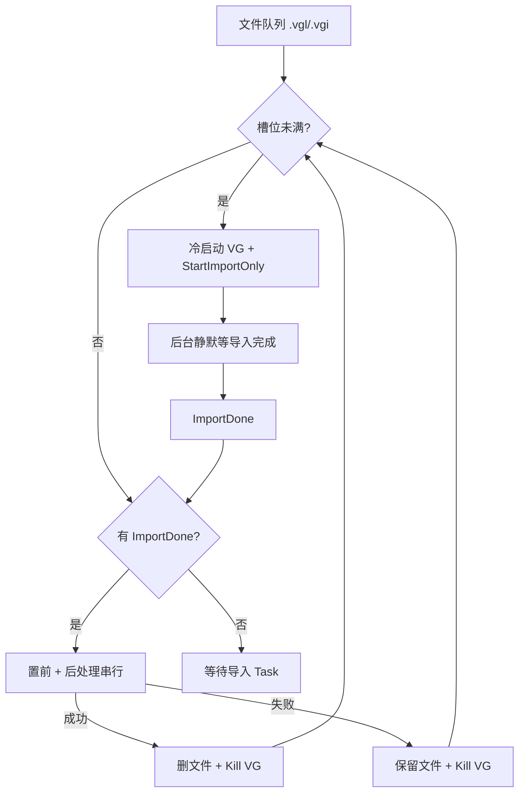

# CTAutoSlicer 2022 改造进度存档

> **文档版本**：2026-07-31（切图 / AI 标注两机拆分：`PipelineRunMode` + `TopViewHandoffFolder`；阶段七脱离切图主链）  
> **状态**：**阶段一～五全部 ✅**；**阶段七 ✅ 独立 AI 标注模式**（扫描交接目录批量 NJCT；CW90° + 预提亮）；进程池并行导入 ✅。  
> **待确认**：两机真机联调（切图机交接 → AI 机批处理）；视觉 DLL 找点路径。  
> **用途**：供下一上下文快速接手，无需重读全部会话历史  
> **关联文档**：`docs/CTAutoSlicer迁移说明.md`、`docs/CT离线AI视觉接口文档.md`、**`docs/离线CT_DLL接入说明.md`**、**`docs/CTAutoCutImg接口文档V1.0.txt`**

**进度图例**：✅ 已完成　🟡 可选增强　⏸ 阻塞　❌ 未开始

> **2026-07-31 增量（切图 / AI 两机拆分）**：  
> 1. 流水线模式 `PipelineRunMode`：`SliceOnly`（默认）/ `AiAnnotateOnly`；调试顶栏单选胶囊切换；**本机** `Config/CTAutoSlicer/local.json` 持久化（不落共享 DB，避免两机互盖）。  
> 2. 切图终点：三视图导出后复制「上」视图第 `OfflineCtTopViewSliceIndex` 张到 `TopViewHandoffFolder`（硬失败），**不再**串行 NJCT。  
> 3. AI 模式：「开始流程」扫描交接目录一层图像 → CW90/预提亮/NJCT → `{SliceExportFolder}/{文件名}/AI标注/`（不启 VG）。  
> 4. 侧栏按模式显隐；同一「开始流程」按模式分发。

> **重要更正（2026-07-22）**：早期文档将阶段四拆成「4a / 4b」是误解。  
> **阶段四 = 简单 3-2-1 对齐本身**（对话框内：Ctrl+三点定平面 → 偏移 Edit 置 0 →「上」视图 Ctrl+两点定向量 → Ctrl+原点 → 完成）。  
> 「3-2-1」中的「2」即「上」视图向量两点：本地用 `VisionTopViewVectorPointsDetector`（**优先黄框右缘**）；选视觉 DLL 时用 `GetObjectTopBottomPoints`。

> **2026-07-30 增量（阶段四找点二选一）**：  
> 1. 配置项 `Simple321PointSource`：`Local`（默认，上位机 OpenCV）/ `VisionDll`（`CTAutoCutImg.dll` V1.0）。  
> 2. 界面：阶段四「找点算法」下拉；主流程与「测试简单 3-2-1」共用。  
> 3. DLL：`GetSectionReferencePoints`（3D 四点）+ `GetObjectTopBottomPoints`（向量两点）；封装仍为 `CutImgAlgorithmService`。  
> 4. 接口文档副本：`docs/CTAutoCutImg接口文档V1.0.txt`。

> **2026-07-23 增量（真机已单测跑通）**：  
> 1. 三点后、向量前：左侧无名偏移 Edit 点击 → 输入 `0` → Enter（`Simple321OffsetEdit*`）。  
> 2. 向量两点：优先检测 VG **黄色对齐框**右缘旁侧取点（与黄框平行、基线更长）；未检出则回退剪影右缘。  
> 3. 3-2-1 完成后、切片导出前：**对齐后捕捉按钮 + 箭头拖拽**（`PostAlign*`；单测「测试对齐后捕捉拖拽」）。  
> 4. **主流程与单测共用同一核心方法**（见 **§21**）。

> **2026-07-30 增量（AI 标注参数）**：  
> 1. 「上」视图送检图序号改为可配：`OfflineCtTopViewSliceIndex`（1～100，默认 50，兼容原 N/2）。  
> 2. 新增像素精度：`OfflineCtPixelSizeUm`（μm/px，默认 1.0）；界面展示 1 mm = 1000 μm 及 L_μm / L_mm 公式；写入 annotation.json。

> **2026-07-28 增量（界面 + AI 输入朝向）**：  
> 1. 主界面底部「截取3D标定图 / 截取上视图标定图」**迁入调试模式 → 单步测试**「标定采图」区；可输入存放路径（持久化）。  
> 2. 默认路径：`C:\AutoSlice\cutpicture\3D`、`C:\AutoSlice\cutpicture\上视图`（`VisionLearn3dSampleDir` / `VisionLearnTopViewSampleDir`）。  
> 3. AI 标注：送入 NJCT 前将「上」视图 **顺时针旋转 90°**（内存）+ 条件提亮，仅落盘 `AI标注/input_for_njct.*`；JSON/CSV 仍记原始上视图路径。

---

## 0.1 VG 进程池并行导入（2026-07-23）

> 瓶颈在单文件导入等待（十余分钟）。采用 **文件队列 + 最多 N 个进程槽**：导入启动/后处理串行置前；导入体积等待按 PID 静默 UIA 轮询（可并行）。

| 项 | 说明 |
|----|------|
| UI 参数 | `MaxVgProcesses`（默认 **4**，钳制 1～8），页面「导入参数」→「最大VG进程数」 |
| 调度 | 优先后处理 `ImportDone` → 槽未满则 `Process.Start` 新 VG 开导入 → 否则等待导入任务 |
| 拆分 | `StartImportOnlyAsync` / `WaitForImportCompleteAsync(activateWhenDone:false)` / `RunPostImportPipelineAsync` |
| 成功 | 删除该 `.vgl/.vgi`，`Kill` 对应 VG，腾槽 |
| 失败 | `Kill` 对应 VG，**保留文件**，记 `@@IMPORT_FAIL@@` |
| 附着 | 主流程**禁止**附着已有 VG（始终冷启动）；单步测试仍可用 `GetCTViewerProcess` |



---

## 0. 直方图灰度阈值（2026-07-17 起；2026-07-22 修订目标线）

> 背景：LUT 预设不保存直方图中间红色阈值竖线位置，需截图分析后拖拽。  
> 半坡目标约定：取**高度最高的两个尖峰**；左线=两峰间波谷，右线=右侧尖峰；  
> **目标线（红线）** = 左线 + (右线−左线)×**2/3**（靠右约三分之一，利于压掉左侧噪点灰阶；**2026-07-22 起不再用左右中点**）。

| 阶段 | 状态 | 说明 |
|------|------|------|
| ROI 框选标定 | 🟡 UI 已实现 | 「截图标定」→ 上位机最小化 → 全屏灰遮罩框选 → ✓提交 / ✕重选 / Esc 取消；坐标写入 DB |
| 掩膜取色 | 🟡 UI 已实现 | 「取色」→ 9×9 放大格 + HEX/RGB → 左键填入 `HistogramMaskColor`（默认 `#6E6E6E`） |
| 按坐标截图 + 颜色替换 | 🟡 单步可测 | 目标色→纯绿 → **去全宽绿带 + 下填接回** → 峰谷 → `histogram_compare_*.png` |
| 红线初始位置 | 🟡 单步可测 | `HistogramRedLineDetector`；拖拽起点 |
| 峰谷 / 半坡 | ✅ 单步 + 主流程 | 两最高尖峰 → 左线=谷、右线=右尖、**目标=靠右 2/3**；调试图 `histogram_peaks_*.png` |
| 拖拽红线 | ✅ 单步 + 主流程 | `MouseDragPressMoveRelease` 水平拖到 T*（目标线） |
| 接入主流程 | ✅ | `ImportSingleVglAsync`：预设之后、厚板之前；未标定 ROI 则跳过 |

**关键入口**：

| 文件 | 说明 |
|------|------|
| `ScreenColorPickerOverlayWindow` | 全屏取色（先截虚拟屏再采样，避免取到预览窗） |
| `HistogramRoiCalibrationOverlayWindow` | 全屏 ROI 标定 |
| `HistogramGrayScaleAnalyzer` | 目标色→纯绿 + 峰谷半坡 + 对比/峰谷调试图；**TargetX = 左+(右−左)×2/3** |
| `VGAutomationService.CaptureHistogramRoiAsync` / `TestHistogramGrayScaleAdjustAsync` | 截图→分析→拖拽 |
| Settings：`HistogramMaskColor` / `HistogramMaskTolerance` / ROI / 截图目录（按日子目录，**保留 7 天**） | |
| Settings：`Vision3dRoi*` / `VisionTopViewRoi*` / `Simple321ToolbarClickX/Y` / `Simple321OffsetEditX/Y` / `VisionCaptureDir`（`jietu`） / `Vision2dVectorCaptureDir`（`2Dxianglaing`） / **`EnableVisionAlignmentSteps`（默认开）** | 阶段四标定与主流程开关；均按日保留 **7 天** |
| Settings：`PostAlignCaptureButton*` / `PostAlignDrag*` / **`EnablePostAlignCaptureDragSteps`（默认开）** | 对齐后捕捉按钮 + 箭头拖拽；主流程在 3-2-1 后、导出前 |

**真机步骤**：露出直方图 → 取色对准填充灰 → 截图标定 ROI → 「测试直方图灰度调整」→ 核对 `compare`/`peaks` 图中「左/右/**目标**」线 → 观察红线是否拖到目标线（靠右约 1/3）。

---

## 1. 改造背景

| 维度 | 改造前（2024 流程） | 改造后（2022 流程，当前） |
|------|---------------------|---------------------------|
| VG 版本 | VGSTUDIO MAX 2024，`Alt+F` → Ribbon 后台导入 | VGSTUDIO MAX **2022.3**，**`Ctrl+F+I`** 快速导入（按住 Ctrl，依次按 F、I；真机标定） |
| 输入数据 | 单个 **DICOM 文件夹**（`CTFileFolder` 填目录路径） | 文件夹内多个 **`.vgl` 工程文件**（直接子级） |
| 单次点击处理量 | 1 个 DICOM 体数据 | N 个 `.vgl`，按创建时间升序循环 |
| 导入后步骤 | 体积渲染等待 → 灰度直方图拖拽 → 简单对齐 → 双视图截图算角旋转 | 导入完成 → **渲染 LUT 预设** ✅ → 四象限厚板/对齐/切片（见 §7） |
| 进程名 | 曾硬编码 `vgstudiomax20241` | 从 UI 配置的 `VGAppPath` 推导 |

**业务名称**仍为「CT 自动化切片」。当前已跑通全流程：  
**批量 `.vgl` 导入 → LUT 预设 → 直方图灰度阈值 → 三象限厚板 → 简单 3-2-1 对齐 → 对齐后捕捉拖拽 → 前/右/上三视图切片导出**。  

**阶段四（视觉对齐）**：✅ **全部完成**（即简单 3-2-1，无独立「4b」）。  
- 单测 + 主流程（`EnableVisionAlignmentSteps`，默认开；厚板后、导出前）  
- 本地找点：`Vision3dSectionPointsDetector`（三点+原点）+ `VisionTopViewVectorPointsDetector`（**黄框优先**向量两点）  
- 顺序：Ctrl+三点 → **偏移 Edit 置 0** →「上」Ctrl+两点（上→下）→ Ctrl+原点 → 完成 → 警告「是」  
- 之后：**捕捉按钮 + 箭头拖拽**（`EnablePostAlignCaptureDragSteps`）  
- 未标定齐全时跳过并对该文件打日志  

**阶段五切片范围**：UI「切片导出参数」中按视角分别配置（`SliceRangeFront*Mm` / `Right*` / `Top*`）；导出时写入对应视图。见 §7.1 / §11 / §16～§21。

---

## 2. 当前已跑通的整体流程（阶段一～五）

用户选择 **CT 体素文件夹** → 点击 **「流程模拟」** → 自动执行：

```mermaid
flowchart TD
    Start[流程开始] --> Launch[连接/启动 VG 进程]
    Launch --> Step1[WaitForVgOpen<br/>轮询队列弹窗或「文件(F)」]
    Step1 -->|命中队列「自动保存恢复」| Skip[Drain：点「跳过」]
    Skip --> Step1
    Step1 -->|「文件(F)」可点| Front[后续步骤]
    Front --> StepN[ExecuteStepWithRetry]
    StepN -->|异常/失败| Drain[Drain 中断弹窗队列]
    Drain -->|已处理| StepN
    Drain -->|无弹窗| Fail[抛出步骤失败]
```

另：延迟出现的「自动保存恢复」不靠固定等待；登记在 `_interruptDialogQueue`，任意步骤异常或未达标时先 Drain 再重试。

另提供独立按钮：

- **「测试应用渲染预设」**：假定 VG 中**已导入体积**，仅执行预设应用（不重跑导入）。
- **「测试厚板设置(三象限)」**：假定 VG 中**已导入体积且已应用 LUT**，依次执行象限 1→2→3 厚板设置（不重跑导入）。

### 2.1 单文件导入子流程（`ImportSingleVglAsync`）

| 步骤 | 动作 | 完成判定 / 备注 |
|------|------|-----------------|
| 1 | `Ctrl+N` 新建/清空工程 | 固定等待 `NewProjectDialogWaitTime` |
| 2 | 处理保存提示 | 窗口 `VGSTUDIO MAX 问题` → `否(N)` / Enter |
| 3 | **`Ctrl+F+I`** 打开快速导入（图一） | 轮询 `快速导入...` 出现即返回；见 §15 |
| 4 | 点击 Edit `文件名(N):` 输入路径（图二）→ 点击 `打开(O)`（图三） | 不再用 `Alt+O` 为主路径；对话框关闭后交图四 |
| 5 | 等待文件选择向导（图四） | Button `完成(F)` 且 Enabled（**原逻辑保留**） |
| 6 | 向导内 Edit 再输入同一路径 | ValuePattern 或键盘 fallback |
| 7 | 点击「完成(F)」元素完成文件选择 | 向导消失；**勿用 Alt+F/Alt+N**（Alt+N=下一步） |
| 8 | 等待 `请耐心等待...` 出现 | 确认导入已开始 |
| 9 | 轮询进度框消失 | 超时上限 `ImportTimeoutMinutes` |
| 10 | `PostImportWaitTime` 稳定等待 | 默认 3000ms |
| 11 | `ApplyRenderingPresetAsync` | 等待 `PresetApplyWaitTime` → 打开「渲染」面板 ComboBox → 选中 `RenderingPresetName` 列表项 |
| 11b | `ApplyHistogramGrayScaleAdjustAsync` | 已标定 ROI 时：截图→峰谷半坡→拖红线；未标定则跳过 |
| 12 | `ApplyThickPlateForQuadrantsAsync` | 象限 1→2→3：视口右键 →「厚板」→ 启用厚板模式 → 组合模式「平均值」→ 确定 |

**失败策略**：单文件任意步骤超时/异常 → `@@IMPORT_FAIL@@文件名|原因` → **跳过继续**下一个文件。

> **2026-07-15 起**：图一～图三已按 Accessibility Insights 重写；图四 `ConfirmFileSelectionAsync` 保持原操作。细节与 Q&A 见 **§15**。

### 2.2 渲染预设应用子流程（`ApplyRenderingPresetAsync`）— 阶段二 ✅

| 步骤 | 动作 | 完成判定 / 备注 |
|------|------|-----------------|
| 1 | `PresetApplyWaitTime` 等待 | 默认 2000ms（导入进度消失 + `PostImportWaitTime` 之后） |
| 2 | `ActivateVgWindowAsync` 置前 VG | 与导入阶段一致 |
| 3 | 定位「渲染」窗口 + ComboBox | Automation：`Window「渲染」` → `ControlType.ComboBox` |
| 4 | 打开下拉 | **Expand**（每步最多 800ms）→ **Alt+Down** → 点击组合框；任一步检测到子 `List` 可见即继续，不再每步耗满 `PresetDropdownWaitTime` |
| 5 | 查找 `ListItem`（Name = 预设名） | `ComboBox → List` → 渲染面板 → 同进程顶层；100ms 轮询 |
| 6 | Win32 点击 + Enter 确认 | Qt：`Select` 仅高亮；**立即** Win32 点击 + 回车 |
| 7 | 完成判定 | **下拉已关闭** 或 ValuePattern 读数匹配；读数滞后时不失败（仅 UIA 诊断日志） |

**等待策略（预设，2026-07-16）**：跳过 `TrySetComboBoxValue` + 5s 读数等待（Qt 常误报成功却读数不变）；打开下拉每步最多 **800ms**；选中后以**下拉关闭**为主判据，与厚板组合模式一致。

**单步测试**：`TestRenderingPresetAsync` / 页面按钮「测试应用渲染预设」（不执行导入）。

**实现说明**：2022 真机验证后，灰度调整改为 **直接应用已保存的 LUT 预设**（如 `testlut`），不再拖拽直方图；页面参数「渲染预设名称」填 Insights 中 `ListItem` 的 Name。若 ValuePattern 已是目标预设名则**跳过**打开下拉。

### 2.3 三象限厚板设置子流程（`ApplyThickPlateForQuadrantsAsync`）— 阶段三 ✅

| 步骤 | 动作 | 完成判定 / 备注 |
|------|------|-----------------|
| 1 | 按视口中心点四象限划分定位 Q1～Q3 | `UIAutomationHelper.FindViewportQuadrants`（左上/右上/左下/右下）；Q3 右键点额外上移 `ViewportQuadrant3ClickOffsetY`（默认 -100px，避免靠近屏幕底缘菜单反向弹出） |
| 2 | 右键前 `ThickPlateStepDelayMs`（默认 500ms） | 固定步间等待 |
| 3 | 视口中心右键 → 偏移点击「厚板」 | 菜单不可见于 UIA，用 `ThickPlateMenuOffsetX/Y`（真机标定 90/127）；右键后等待 `ThickPlateMenuAfterRightClickDelayMs`（默认 200ms）再点菜单 |
| 4 | 等待「厚板设置」对话框 | `WaitForElementAsync` 轮询（找到即继续，非固定多等） |
| 5 | `TogglePattern` 勾选「启用厚板模式」 | 失败则 Win32 点击复选框中心 |
| 6 | 展开组合模式 → 选「平均值」 | `ExpandCollapse` + `WaitForElementAsync` 等 ListItem（100ms 轮询，找到即点）；Win32 点击 + Enter |
| 7 | Invoke / 点击「确定」 | 等待对话框消失 |

**等待策略（厚板）**：**混合模式** — 控件出现类步骤用轮询「找到即触发」；关键动作之间用 `ThickPlateStepDelayMs`（500ms）固定步间等待。组合模式**不以 UIA 组合框读数判成败**（Qt 读数滞后），以点击+回车后继续点「确定」、对话框关闭为准。

**单步测试**：`TestThickPlateAsync` / 页面按钮「测试厚板设置(三象限)」（不执行导入，一次跑完 Q1→Q2→Q3）。

---

## 3. 真机 UI Automation 标定（Accessibility Insights）

| 场景 | 窗口/控件 Name | 触发方式 |
|------|----------------|----------|
| 保存提示 | `VGSTUDIO MAX 问题` / `否(N)` | Enter 或 Invoke |
| **快速导入（图一～三，2026-07-15）** | 对话框 `快速导入...`；Edit `文件名(N):`（`Edit(50004)` / 亦可为 ComboBox 内 Edit）；Button `打开(O)`（AccessKey Alt+O） | **`Ctrl+F+I`**；点击输入框写路径；**点击「打开(O)」**（Invoke → Win32 点击） |
| 文件选择向导（图四） | 窗口 Name 含 `来自 .vgl 文件的体积`；内文「文件选择」；`完成(F)` / `下一步(N)` 等 | 等「完成(F)」→ 向导内输路径 → **直接点击「完成(F)」元素**（禁用 Alt+N/Alt+F，Alt+N=下一步） |
| 导入进度 | `请耐心等待...`（内文「正在导入体积」/「正在写入图像」） | 出现→**可见**进度框消失后再继续；仅离屏 UIA 残留可忽略 |
| 渲染预设下拉 | `渲染` 窗口 / `ComboBox` / `List` / `ListItem` Name=预设名 | Expand 或 Alt+Down；选中用 SelectionItem + Win32 点击 |
| 象限视口 | 四宫格 `Group`/`Pane`，按中心点划分 Q1～Q4 | 右键菜单「厚板」用相对偏移点击；Q3 右键点上移 100px |
| 厚板设置对话框 | 窗口 `厚板设置` / CheckBox `启用厚板模式` / ComboBox + ListItem `平均值` / Button `确定` | 组合模式：Win32 点击 + Enter；不以 UIA 读数判成败 |
| 切片导出对话框 | 窗口 `保存切片/图像堆栈` / Group `2D 视图`+ComboBox / Group `图像大小`+Edit / Group `堆栈设置` 内 Text `切片图数量：` + **Custom** 输入框 / Group `切片图范围` 内 Text `开始 [mm]`/`结束 [mm]` + **Custom** 输入框 / Button `保存...` | **Alt+F+T** |
| 保存图像对话框 | 嵌套 `对话框 保存图像...` / Edit `文件名:`（Alt+N）/ Button `保存(S)` | 保存后弹出 |
| JPEG 质量对话框 | 嵌套 `窗口 JPEG 质量` / Button `确定`（AccessKey **Enter**） | Invoke → Win32 点击 → Enter |
| 导出写入进度 | 嵌套 `窗口 请耐心等待...` / Text `正在写入图像` | 消失后再导出下一视图；默认超时 60s |
| ~~菜单 Plan B~~ | ~~`文件(F)` / `快速导入(I) Ctrl+I`~~ | **2026-07-15 已从主路径删除**（曾作为 Ctrl+I 失败后备） |
| VG 启动就绪 | `文件(F)` MenuItem 可交互 | `IsEnabled` + 非离屏 + 有尺寸 |

---

## 4. 关键代码入口（下一上下文从这里读）

### 4.1 主流程编排

| 文件 | 方法 | 说明 |
|------|------|------|
| `SUNWODA_SEVB/ViewModels/Pages/CTAutoSlicer/VM_CTAutoSlicerPage.cs` | `ExecuteRunSimulationAsync` | 页面按钮入口；校验 `.vgl`；写流程日志 |
| `SUNWODA_SEVB/Services/Project/CTAutoSlicer/CTAutoSlicerService.cs` | `RunSimulationAsync` | 门面；管理 `IsRunning` / Cancel |
| `SUNWODA_SEVB/Services/Project/CTAutoSlicer/VGAutomationService.cs` | （partial 核心） | 字段/常量/构造/`WaitUntil*`；对外类型仍为 `VGAutomationService` |
| `.../VgAutomation/VGAutomationService.ProcessPool.cs` | `RunSimulationAsync` / `RunPostImportPipelineAsync` | **核心**：进程池调度 + 后处理串行编排 |
| `.../VgAutomation/VGAutomationService.InterruptAndWait.cs` | `WaitForVgOpenAsync` / 中断弹窗 | 启动等待、自动保存恢复、后处理独占、文件队列 |
| `.../VgAutomation/VGAutomationService.Import.cs` | `OpenQuickImportAsync` / `WaitForImportCompleteAsync` | 阶段一：快速导入 |
| `.../VgAutomation/VGAutomationService.LutAndHistogram.cs` | `ApplyRenderingPresetAsync` | 阶段二：LUT 预设 |
| `.../VgAutomation/VGAutomationService.ThickPlate.cs` | `ApplyThickPlateForQuadrantsAsync` | 阶段三：厚板 |
| `.../VgAutomation/VGAutomationService.Simple321.cs` | `RunSimple321AlignmentAsync` | 阶段四：简单 3-2-1 |
| `.../VgAutomation/VGAutomationService.HistogramAndPostAlign.cs` | `ApplyHistogramGrayScaleAdjustAsync` / `RunPostAlignCaptureDragAsync` | 直方图灰度 + 对齐后捕捉拖拽 |
| `.../VgAutomation/VGAutomationService.SliceExport.cs` | `ExportImageStackSlicesAsync` | 阶段五：切片导出 |
| `.../VgAutomation/VGAutomationService.UiPrimitives.cs` | 点击/重试/键盘/`Find*` 包装 | UIA 原语；通用查找转发至 `VgElementFinder` |
| `.../VgAutomation/VgElementFinder.cs` | `FindWindowByNameScoped` 等 | **内部**通用查找类（不改动 `Tool/Helper`） |
| `.../VgAutomation/VGAutomationService.StageTests.cs` / `PublicApi.cs` | `Test*` / `CaptureHistogramRoiAsync` / Lock | 单测入口与公开辅助 API |

> **拆分说明（2026-07-24）**：原约 7000 行单文件已按阶段拆为 `partial class`（零行为变更，DI/`ICTAutoSlicerService` 不变）。Phase 2 已抽出 `VgElementFinder`；Import/导出/3-2-1 等仍以 partial 文件为边界（共享 UIA 宿主私有方法，暂不强行拆独立类以免改公共可见性）。

### 4.2 UI Automation 工具

| 文件 | 关键 API |
|------|----------|
| `SUNWODA_SEVB.Tool/Helper/UIAutomationHelper.cs` | `FindFileMenuForProcess`、`WaitForElementAsync`、`FindViewportQuadrants`、`TryToggleCheckBox`、`TrySelectListItem`、`GetComboBoxDisplayText` |
| `SUNWODA_SEVB.Tool/Helper/AutomationWinAPIHelper.cs`（`WinAPIHelper`） | `ClickScreen`（`SetCursorPos` + `mouse_event`）用于 Qt 下拉确认点击 |
| `SUNWODA_SEVB.Tool/Helper/MouseSimulationHelper.cs` | 点击/移动/拖拽（**TestOffset 用，主流程未用**） |
| `SUNWODA_SEVB.Tool/Helper/ScreenCaptureHelper.cs` | 区域截图（**主流程未用**） |
| `SUNWODA_SEVB.Tool/Helper/PathGenerationHelper.cs` | 直线/圆弧拖拽路径（**主流程未用**） |

### 4.3 参数模型

`SUNWODA_SEVB.Core/Models/Project/CTAutoSlicer/CTAutoSlicerSettings.cs`

- 文件后缀常量：`VglFileExtension = ".vgl"` / `VgiFileExtension = ".vgi"` / `ShortcutFileExtension = ".lnk"`
- 排队识别：`IsImportVolumeExtension`（真实文件）+ `LooksLikeImportVolumeShortcut` / `IsImportVolumeQueueEntry`（如「xxx.vgi - 快捷方式.lnk」）
- 快捷方式解析：`ShellLinkHelper.TryGetShortcutTarget` → VG 导入用目标路径；成功删除仅删 `.lnk`
- 进程池：`MaxVgProcesses`（默认 4）/ `DefaultMaxVgProcesses` / `AbsoluteMaxVgProcesses = 8`
- 默认 VG 就绪等待：`DefaultVGOpenWaitTime = 180000`
- 旧库值自动升级阈值：`LegacyVGOpenWaitTimeThreshold = 10000`（≤10000 视为过短，升为 180000）

---

## 5. 已实现的基础设施（非导入主链，但已可用）

| 能力 | 文件 | 状态 |
|------|------|------|
| 流程日志 UI（200 行、智能滚动、可清除） | `VM_CTAutoSlicerPage` + `CTAutoSlicerPage.xaml` | ✅ 已用 |
| 文件日志 `Assets/CTAutoSlicer/import_log.txt` | `VM_CTAutoSlicerPage.WriteFlowLogToFile` | ✅ 已用 |
| 全局 Esc 中断（单击锁输入 / 双击取消） | `CTAutoSlicerInputHookService` | ✅ 已用 |
| CT 文件夹监控（仅记日志，**不触发流程**） | `CTFolderMonitorService` | ✅ 已挂载 |
| 进程 CPU/内存/GPU CSV | `ProcessMonitorService` | ✅ 页面初始化启动 |
| 角度算法 DLL 加载 | `AngleAlgorithmService.InitializeAsync` | ✅ 页面初始化；**阶段四主链用本地找点，不依赖本 DLL** |
| 切图视觉 DLL | `CTAutoCutImg.dll` + `CutImgAlgorithmService` | ✅ 已拷入 `Dlls\` 并封装反射调用（§16）；Halcon 依赖同目录 + `SetDllDirectory` |
| 偏移量测试按钮 | `VGAutomationService.TestOffsetAsync` | ✅ 灰度锚点/开始菜单等（主流程灰度已改为预设，锚点测试可逐步废弃） |
| 渲染预设单步测试 | `TestRenderingPresetAsync` +「测试应用渲染预设」按钮 | ✅ 已用 |
| 厚板三象限单步测试 | `TestThickPlateAsync` +「测试厚板设置(三象限)」按钮 | ✅ 已用 |
| DI 注册 | `ProjectServiceCollectionExtensions.AddCTAutoSlicerServices` | ✅ |

---

## 6. 运行参数一览（`project_setting`，`belong_to_vm = VM_CTAutoSlicerPage`）

### 6.1 阶段一 / 阶段二（预设）/ 阶段三（厚板）已生效

| 参数 | 默认值 | 用途 |
|------|--------|------|
| `VGAppPath` | 用户配置 | VG exe 路径；进程名由此推导 |
| `VGOpenWaitTime` | 180000 ms | 「文件(F)」就绪检测上限；每秒轮询 |
| `VGShowFrontWaitTime` | 2000 ms | 置前后等待（厚板单测已改用 `EnsureVgForeground`，不重复等 2s） |
| `CTFileFolder` | 用户选择 | 扫描 `.vgl`/`.vgi`，以及「xxx.vgi - 快捷方式.lnk」（解析目标导入，成功只删快捷方式） |
| `MaxVgProcesses` | 4（1～8） | **进程池最大 VG 并发数**；导入可重叠，后处理串行 |
| `QuickImportDialogWaitTime` | 10000 ms | **Ctrl+F+I** 后轮询「快速导入...」出现的上限（找到即继续） |
| `NewProjectDialogWaitTime` | 5000 ms | Ctrl+N 后等保存框 |
| `FileSelectionDialogWaitTime` | 15000 ms | 等「完成(F)」/ 进度框出现 |
| `ImportTimeoutMinutes` | 30 | 单文件导入进度框消失超时 |
| `PostImportWaitTime` | 3000 ms | 导入完成后稳定等待 |
| `RenderingPresetName` | `testlut` | 「渲染」面板下拉列表项 Name，须与 VG 内预设名完全一致 |
| `PresetApplyWaitTime` | 2000 ms | 导入完成后、打开预设下拉前的等待 |
| `PresetDropdownWaitTime` | 5000 ms | 打开下拉后等待 `ListItem` 出现的超时 |
| `ThickPlateMenuOffsetX` / `Y` | 90 / 127 | 右键点后相对偏移，点击「厚板」菜单项 |
| `ThickPlateMenuAfterRightClickDelayMs` | 200 ms | 右键后、点「厚板」菜单前的等待（防卡顿） |
| `ThickPlateStepDelayMs` | 500 ms | 厚板流程关键动作之间的固定步间等待 |
| `ThickPlateStepRetryCount` | 1 | 厚板单象限失败重试次数 |
| `ViewportClickOffsetY` | 0 | 视口右键点相对中心的 Y 偏移 |
| `ViewportQuadrant3ClickOffsetY` | -100 | 第三象限（左下）额外上移，避免底缘菜单反向 |
| `ViewportMinWidth` / `MinHeight` | 400 / 300 | 四宫格视口候选最小尺寸 |
| `ThickPlateDialogWaitTime` | 3000 ms | 等待「厚板设置」出现/关闭的超时（轮询上限，非固定多等） |
| `ThickPlateDropdownWaitTime` | 3000 ms | 组合模式下拉 ListItem 出现超时（轮询上限） |
| `StepRetryCount` | 3 | 关键步骤重试次数（厚板用独立 `ThickPlateStepRetryCount`） |
| `StepRetryIntervalMs` | 2000 ms | 重试间隔 |

### 6.1.1 阶段五（切片导出）已生效

| 参数 | 默认值 | 用途 |
|------|--------|------|
| `SliceExportFolder` | 用户配置 | 切片导出目标目录 |
| `SliceExportImageWidth` | 3000 | 导出对话框「图像大小-宽」 |
| `SliceExportQuantity` | 100 | 局部图像（非 QJ）导出数量 |
| `SliceExportQuantityQj` | 150 | QJ 全局图像导出数量（运行时同步 UI） |
| `SliceRangeStartMm` | 20 | 切片范围开始 [mm] — **UI 配置**；前/右/上三视图导出共用 |
| `SliceRangeEndMm` | 70 | 切片范围结束 [mm] — **UI 配置**；前/右/上三视图导出共用 |
| `SliceExportDialogWaitTime` | 8000 ms | 等待导出/质量确认对话框超时 |
| `SliceExportWriteTimeoutMs` | 60000 ms | 等待「正在写入图像」进度框消失（默认 1 分钟） |
| `SliceExportViewFrontName` | `前 1` | 2D 视图下拉项（前） |
| `SliceExportViewRightName` | `右 1` | 2D 视图下拉项（右） |
| `SliceExportViewTopName` | `上 1` | 2D 视图下拉项（上） |

### 6.2 仍在 UI/模型中，但主流程未使用（多为 2024 遗留）

| 参数 | 原用途 | 下一阶段建议 |
|------|--------|--------------|
| `SelectCTFileFolderWaitTime` | 2024 DICOM 选目录等待 | 2022 导入后若不用可隐藏或复用 |
| `ImportFinishWaitTime` | 2024 导入完成等待 | 可能被 `PostImportWaitTime` 替代 |
| `VolumeRenderWaitTime` | 2024 体积渲染完成等待 | **2022 未使用**；无独立渲染等待，导入后直接应用 LUT 预设 |
| `ImportMenuItemOffset` | 2024 Ribbon 导入菜单 Y 偏移 | 菜单 Plan B 已删除；可废弃 |
| `StartMenuXOffset` / `StartMenuYOffset` | 2024 开始菜单位置 | 待确认 2022 是否仍需要 |
| `GrayScaleGraphAnchor*Offset` | 2024 灰度直方图拖拽锚点 | **已由渲染预设替代**；UI 保留，可后续隐藏 |
| `RotationRadius` | 视图旋转拖拽半径 | 2024 遗留；**阶段四新主链不以角度拖拽定方向**（见 §16），可暂保留 |
| `EnableVisionAlignmentSteps` | 是否执行阶段四简单 3-2-1 | 默认 `true`；关则跳过对齐直接导出 |

---

## 7. 2022 真机完整业务流程（目标链 vs 当前进度）

### 7.1 实验室确认的完整切片流程（预设之后）

VG 四象限布局下，单个体积从 **导入 + LUT 预设** 到 **切片完成** 的顺序如下（**以本节为准**）：

```text
✅ 1. 导入 .vgl 体积（Ctrl+F+I 快速导入 → 图一～四，见 §15）
✅ 2. 应用渲染 LUT 预设（「渲染」面板 ComboBox）
✅ 2b. 直方图灰度阈值（截图→峰谷半坡→拖红线；未标定 ROI 则跳过）

✅ 3. 第一、二、三象限：各视口右键 →「厚板」→ 启用 → 组合模式「平均值」→ 确定
      （`ApplyThickPlateForQuadrantsAsync`）

✅ 4. 阶段四 · 简单 3-2-1 对齐（全部完成，无独立 4b）
      第四象限 3D ROI 截图 → Vision3dSectionPointsDetector（三点+原点）
      → 绝对坐标打开「简单对齐」→ 重置
      → Ctrl+三点（左上→右上→右下）
      → **偏移 Edit 置 0 + Enter**（`Simple321OffsetEdit*`；否则「上」视图非预期）
      → 「上」视图 ROI 截图 → VisionTopViewVectorPointsDetector（**黄框右缘优先**）→ Ctrl+两点（上→下）
      → Ctrl+原点 → 完成(F) → 警告「是(Y)」
      （`RunSimple321AlignmentAsync`；主流程开关 `EnableVisionAlignmentSteps`）

✅ 4b'. 对齐后捕捉与拖拽（非旧「4b」）
      点视口底部无名捕捉按钮（UIA 索引/Invoke，失败绝对坐标）→ 按箭头标定直线拖拽
      （`RunPostAlignCaptureDragAsync`；开关 `EnablePostAlignCaptureDragSteps`）

✅ 5. Alt+F+T 三视图切片导出（`ExportImageStackSlicesAsync`）
      依次导出「前 / 右 / 上」；切片范围取自 UI 各视角 mm
      → **上视图交接**（`MirrorTopViewHandoffAsync`）：复制第 OfflineCtTopViewSliceIndex 张到 TopViewHandoffFolder
      （切图模式终点；硬失败）

✅ 6. 阶段七 · AI 图像标注（独立模式，见 §22）
      `PipelineRunMode=AiAnnotateOnly` → `RunAiAnnotationBatchAsync`
      扫描 TopViewHandoffFolder → CW90° → NJCT → `{结果根}/{文件名}/AI标注/`
      （不启 VG；与切图主链解耦）

❌ 7. 收尾：导入成功后 .vgl 处理、文件夹监控自动跑批等（见 §8 阶段六，可选）
```

**说明**：

- **象限**：第四象限 = 3D（平面三点+原点）；第二象限 =「上」视图（向量两点）。  
- **无旧 4b**：早期文档的「4b 定方向」已取消；向量两点即 3-2-1 中的「2」。  
- **切图主链时序**：直方图 → 厚板 → 简单 3-2-1（含偏移置0）→ 对齐后捕捉拖拽 → 导出 → **交接上视图送检图**。  
- **AI 独立机**：读交接目录批量标注，与 VG 无关。  

### 7.2 任务流程：已改造步骤 vs 未改造步骤

**说明**：2022 **无**独立「体积渲染完成等待」步骤；导入进度消失后，以 `PostImportWaitTime` + `PresetApplyWaitTime` 等待，再应用 LUT 预设。

#### 已改造步骤（主流程已接入）

```text
✅ 锁定/解锁输入
✅ 启动/附着 VG 进程
✅ 「文件(F)」就绪检测（替代盲目固定等待）
✅ 多 .vgl 顺序导入（Ctrl+F+I 快速导入 →「请耐心等待」消失；检测禁止桌面整树扫描）
✅ 导入后短暂稳定等待（PostImportWaitTime，默认 3000ms）
✅ 渲染 LUT 预设应用（PresetApplyWaitTime 后 →「渲染」面板 ComboBox 选 RenderingPresetName）
✅ 直方图灰度阈值（预设后：截图→峰谷半坡→拖红线；未标定 ROI 则跳过）
✅ 三象限厚板设置（`ApplyThickPlateForQuadrantsAsync`，象限 1→2→3）
✅ 简单 3-2-1 对齐（含偏移置0 + 黄框向量；`RunSimple321AlignmentAsync` + `EnableVisionAlignmentSteps`）
✅ 对齐后捕捉拖拽（`TryRunPostAlignCaptureDragInMainFlowAsync` + `EnablePostAlignCaptureDragSteps`）
✅ 三视图切片导出（`ExportImageStackSlicesAsync`；前/右/上）
✅ 上视图交接（`MirrorTopViewHandoffAsync` → `TopViewHandoffFolder`）
✅ AI 图像标注批处理（`RunAiAnnotationBatchAsync`；独立模式，扫描交接目录）
✅ 「测试应用渲染预设」单步按钮
✅ 「测试直方图灰度调整」单步按钮
✅ 「测试厚板设置(三象限)」单步按钮
✅ 「测试简单 3-2-1 对齐」单步按钮
✅ 「测试对齐后捕捉拖拽」单步按钮
✅ 「测试切片导出(三视图)」单步按钮
✅ 「测试 AI 图像标注」单步按钮
✅ 单步测试「标定采图」：截取 3D / 上视图标定图 + 可配置存放路径
✅ 失败跳过、批次统计、流程日志
⏸ 批次结束 Ctrl+N（开发阶段暂注释，保留工程状态）
```

#### 可选 / 未做（非阶段四）

| 状态 | 步骤 | 说明 |
|------|------|------|
| ✅ | **阶段四 · 简单 3-2-1 对齐** | **已完成**（单测+主流程）。含三点+偏移置0+黄框向量+原点；**无独立旧 4b**。见 §16～§21 |
| ✅ | **对齐后捕捉拖拽** | **已完成**（单测+主流程）。见 §20 |
| ✅ | **切片范围（UI mm）** | 按前/右/上分视角配置 |
| ✅ | **Alt+F+T 保存影片/图像堆栈** | 三视图依次选参并导出；已接入主流程 |
| ✅ | **阶段七 · AI 图像标注** | **代码已接入**（主流程+UI+单测；推理前上视图 CW90°）；真机联调待确认。见 §22 |
| ❌ | 导入成功后删除 `.vgl` | 进程池路径已删排队文件；策略见 §0.1 |
| ❌ | 文件夹监控触发自动跑批 | 可选产品需求 |
| ~~🟡~~ | ~~阶段四 · 旧 4b~~ | **已取消** |

#### §7.2 附：与旧文档「双视图截图算角」的关系

| 旧描述（2024 迁移稿 / 早期阶段四草稿） | 当前结论（2026-07-21） |
|--------------------------------------|------------------------|
| `Ctrl+Alt+J` 简单对齐 + 前/右视图截图 + `MeasureAngle` + 拖拽旋转 | **不是 2022 当前主链** |
| 「简单 1,2,3 对齐选面 / 旋转角度 / 三切面范围」三句空描述 | **已具体化为**：3D 截图→三点点击定平面 → 「上」视图截图→两点定方向 → 导出 |
| `AngleAlgorithmService` / `Secondary_positioning` | **仍保留**（页面初始化加载）；阶段四主链用本地找点；旧角度 DLL 不参与 |
| `ScreenCaptureHelper` | **阶段四必用**：3D ROI、「上」视图 ROI 区域截图 |
| 视口放大按钮 `M`（Accessibility 同名不可区分） | 若截图前需最大化某视口，应 **按象限容器 BoundingRectangle 定位**，勿全局 `FindByName("M")` |

---

## 8. 下一阶段改造建议（推荐顺序）

### 阶段三：三象限厚板设置（✅ 已完成）

真机已验证：`ApplyThickPlateForQuadrantsAsync` 已接入 `ImportSingleVglAsync`；页面提供「测试厚板设置(三象限)」单步按钮。

### 阶段四：简单 3-2-1 对齐（✅ 全部完成；无独立 4b）

> **结论（2026-07-22）**：阶段四 **仅**「简单 3-2-1 对齐」，已全部完成（单测 + 主流程）。  
> 早期文档的「4a / 4b」拆分是误解——「3 / 2 / 1」三步都在同一对话框内完成。  
> ~~4b / `GetObjectTopBottomPoints` 另做定方向~~ → **已取消，不再开发**。

**在总流程中的位置**（`ImportSingleVglAsync`）：

```text
… → 直方图灰度调整 → 三象限厚板 → 【简单 3-2-1（含偏移置0）】→ 【对齐后捕捉拖拽】→ Alt+F+T 切片导出 → …
```

**对话框内步骤（不可颠倒；仅原点完成后点「完成」）**：

| 步 | 含义 | 采图 / 找点 | 动作 | 状态 |
|:--:|------|-------------|------|:----:|
| 3 | 定平面 | 3D ROI → `Vision3dSectionPointsDetector` | Ctrl+左上→右上→右下 | ✅ |
| 1.5 | 偏移置0 | — | 点击左侧无名 Edit → `0` → Enter | ✅ |
| 2 | 定向量 | 「上」ROI → `VisionTopViewVectorPointsDetector`（黄框优先） | Ctrl+上点→下点 | ✅ |
| 1 | 定原点 | 同上 3D 四点之原点 | Ctrl+原点 → 完成 → 警告「是」 | ✅ |

**已落地清单**：

1. ✅ 本地 3D 找点 +「上」视图向量找点（黄框优先，§18 / §19）  
2. ✅ `RunSimple321AlignmentAsync` / `ResetSimple321PlaneOffsetEditAsync` / `ClickTopViewVectorPointsAsync` / `TryRunVisionAlignmentInMainFlowAsync`  
3. ✅ Settings + UI：ROI、下拉、**偏移 Edit**、`VisionCaptureDir`、`Vision2dVectorCaptureDir`、`EnableVisionAlignmentSteps`  
4. ✅ 对齐后捕捉拖拽：标定 + `RunPostAlignCaptureDragAsync` + 主流程 + 单测（§20）  
5. ✅ 单测按钮 + 离线探针  
6. ✅ 主流程接入（厚板后 → 3-2-1 → 捕捉拖拽 → 导出）

**接入点（已落地）**：

```csharp
await ApplyThickPlateForQuadrantsAsync(...);
await TryRunVisionAlignmentInMainFlowAsync(...);      // EnableVisionAlignmentSteps + 标定齐全时跑 3-2-1
await TryRunPostAlignCaptureDragInMainFlowAsync(...); // EnablePostAlignCaptureDragSteps + 标定齐全
await ExportImageStackSlicesAsync(...);
```

**阶段五**：切片导出已完成；范围取自 UI。可选巩固项见 §11。

### 阶段五：切片导出（✅ 已完成）

- **`OpenSaveImageStackDialogAsync`** — **Alt+F+T**，等待「保存影片/图像堆栈」对话框。
- **`ExportImageStackSlicesAsync`** — 循环 **前 / 右 / 上** 三视图：选 2D 视图 → 填宽度/数量/**切片范围（UI `SliceRangeStartMm`～`SliceRangeEndMm`）** → 保存 → JPEG → 等待写入进度 → 重开对话框。
- 命名规则见 `SliceExportNamingHelper`：`{导出根}/{主文件夹}/{主文件夹} 前|右|上/1…`（三视图套一层主文件夹）。
- 页面「切片导出参数」Expander（含切片范围起止 mm）+「测试切片导出(三视图)」按钮。

**说明**：主流程在简单 3-2-1 之后导出；三视图共用同一 UI 切片范围。

### 阶段七：AI 图像标注（✅ 代码已接入；真机联调待确认）

> **2026-07-28**：已按惠州正极接口 V1.0 接入主流程与 UI。详规见 **§22**、`docs/CT离线AI视觉接口文档.md`、`docs/离线CT_DLL接入说明.md`。  
> **位置**：阶段五切片导出 **之后**；输入为「上」视图文件夹第 **OfflineCtTopViewSliceIndex** 张图（默认 50）。  
> **输出**：`{SliceExportFolder}/{exportBaseName}/AI标注/`（与前/右/上同级）。

**已落地**：

| 项 | 说明 |
|----|------|
| 服务 | `ICTOfflineVisionService` / `OfflineCtVisionService`（反射 `NJCT.NJSwdCT`） |
| 选图/落盘 | `OfflineCtAnnotationHelper`（`TryPickTopViewImageByIndex`） |
| 主流程 | `TryRunOfflineCtVisionAnnotationAsync`（软失败） |
| UI | 侧栏「AI图像标注」；单测「测试 AI 图像标注」 |
| 资源 | `Dlls\NJCT.dll`、`CF.dll`、`Dlls\Models\CTOffline\model_500000_900.onnx` |

**UI 配置**（默认值）：

| 参数 | 默认 | 说明 |
|------|------|------|
| `EnableOfflineCtVisionAnnotation` | `true` | 主流程开关 |
| `OfflineCtTopViewSliceIndex` | `50` | 「上」视图送检图序号（1～100） |
| `OfflineCtPixelSizeUm` | `1.0` | 像素精度（μm/px）；1 mm = 1000 μm |
| `OfflineCtModelPath` | 空→默认 onnx | ONNX 路径 |
| `OfflineCtIsRunCuda` | `true` | CUDA |
| `OfflineCtBlackHeight` | `1500` | 打黑高度 |
| `OfflineCtResultImageMode` | 增强图 | 增强 / 原图 / 两者 |
| `OfflineCtExportJson` / `Csv` | `true` | 坐标尺寸落盘 |

### 阶段六：收尾与自动化增强

5. **`OnImportSucceededAsync`** — `.vgl` 删除或移至备份目录（需业务确认）。  
6. **失败文件策略** — 可扩展 `failed/` 子目录。  
7. **`CTFolderMonitorService`** — 新 `.vgl` 进目录自动跑批（与 `IsRunning` 互斥）。  
8. **清理遗留 UI** — `VolumeRenderWaitTime`、灰度锚点偏移、`ImportMenuItemOffset` 等 2024 专用项，按 2022 实测隐藏或重命名。

### 已废弃 / 降级的旧建议

~~**`WaitForVolumeReadyAsync`（可选）**~~ — 当前导入链已稳定，非必需。  
~~**`AdjustGrayScaleAsync`（灰度直方图拖拽）**~~ — 已由 `ApplyRenderingPresetAsync` 替代。  
~~**阶段三旧版：`OpenSimpleAlignmentAsync` + `CaptureAndRotateViewAsync(前/右视图)`**~~ — 与 §7.1 / §16 不一致。  
~~**阶段四旧草稿：仅写「选面 / 转角 / 三切面范围」三句且依赖旧角度 DLL**~~ — **2026-07-22 起以 §16～§18 为准（4a 本地找点；DLL 封装保留）**。

### 阶段二（续）：可选优化

- 若导入完成信号不稳，可再加条件轮询（树节点/进度条）；**当前不做**。

---

## 9. 实现阶段三～五时的代码模板（建议）

在 `VGAutomationService.cs` 中扩展单文件流程（**与当前真实顺序对齐**）：

```csharp
// ImportSingleVglAsync 末尾：
await ApplyRenderingPresetAsync(...);
await ApplyHistogramGrayScaleAdjustAsync(...);   // 已实现；未标定 ROI 则跳过
await ApplyThickPlateForQuadrantsAsync(...);     // 阶段三 ✅

// 阶段四：视觉对齐 — 默认跳过，EnableVisionAlignmentSteps=true 时执行（见 §16）
if (settings.EnableVisionAlignmentSteps)
{
    await RunVisionAlignmentAsync(settings, ctViewerProcess, mainWindow, cancellationToken, progress);
}
else
{
    progress?.Report("跳过：阶段四视觉对齐（3D 三点选面 / 「上」视图方向对齐）");
}

// 阶段五：Alt+F+T 三视图切片导出 ✅
await ExportImageStackSlicesAsync(...);
```

阶段四若跳过，阶段五联调时可使用 **人工已在 VG 中完成对齐** 的工程文件。

**可复用依赖**：

- 象限定位：`UIAutomationHelper.FindViewportQuadrants` + 视口 `BoundingRectangle`（勿全局 `FindByName("M")`）
- 截图：`ScreenCaptureHelper.CaptureRegionAndSave`（3D ROI、「上」视图 ROI）
- 点击：`MouseSimulationHelper` / `WinAPIHelper.ClickScreen`
- 新算法：`CutImgAlgorithmService` → `CTAutoCutImg.dll` / 类型 `CT`（**不是**旧 `AngleAlgorithmService`）
- 旧角度 DLL / `PathGenerationHelper` / `RotationRadius`：阶段四新主链 **不依赖**；可保留供兼容

---

## 10. 已知问题与已处理项

| 问题 | 处理 |
|------|------|
| 冷启动 7s 就超时、不触发导入快捷键 | DB 旧值 7000；代码 `ResolveVgOpenWaitTime` + 页面加载自动升级 |
| 快速导入弹窗已开却空等 ~6～9s 才输入 | 旧 `FindQuickImportDialog` 对 `RootElement` 做 `FindAll(Descendants)`；已改为 VG 主窗 Children / 同进程顶层；见 §15 |
| 预设/厚板/导出步骤体感略卡 | 阶段二～四仍有多处 `RootElement.FindAll(Descendants)` 兜底；**2026-07-16** 已统一为 `Find*Scoped` |
| 预设步骤日志空等 ~15s（打开下拉→找到列表项） | 旧逻辑：`TrySetComboBoxValue` 后 `WaitForPresetApplied` 5s + 打开下拉每步 5s + 等 ListItem 5s；**2026-07-16** 已改为跳过 ValuePattern、打开每步 800ms、Win32 点击后以**下拉关闭**判成败 |
| 输入路径前无故放大快速导入窗 | 旧 `EnsureAutomationForeground` 调用 `ShowWindow(3)=SW_MAXIMIZE`；已改为仅 `SetForegroundWindow`；见 §15 |
| 后缀 `.vgi` → 实测为 `.vgl` | `VglFileExtension`；现同时支持 `.vgl`/`.vgi` |
| 体素文件夹不想复制巨大 `uint16_scv` | **支持「xxx.vgi - 快捷方式.lnk」**：解析目标路径导入，成功只删文件夹内快捷方式 |
| 点「完成」后很久才开下一 VG | 旧逻辑死等向导「完成」按钮 UIA 消失；**已改为**检测内文「**正在导入体积**」（或向导消失）即交手填下一槽 |
| 后处理中仍切换 VG 窗口 | 根因：`GetFreshMainWindow` 每次 `EnsureVgForeground`（最大化+置前），后台「导入体积中」轮询抢焦点；**已改为**取窗不置前 + 后处理独占暂停其他槽 UIA |
| 首次点击只开 VG 不导入 | 旧逻辑已移除；启动段重写为 `WaitForVgOpenAndDismissAutoSaveAsync`（弹窗按主窗**子窗口**查找，对齐 Insights 树） |
| NuGet NU1102（`System.ServiceModel.Security`） | 与 CTAutoSlicer 无关；需加 nuget.org 源 |
| `TestOffset` 中「导入菜单」仍用 2024 Qtitan Ribbon | 主流程已不用；测试按钮待 2022 更新或删除 |
| Qt 预设下拉 `Select` 仅高亮、不应用 | `SelectionItemPattern.Select` 后须 Win32 `ClickScreen`；点击前短暂 `Unlock` |
| Qt 厚板组合框 UIA 读数滞后 | 不以 `GetComboBoxDisplayText` 判成败；点击+回车后直接点「确定」，以对话框关闭为准 |
| 第三象限靠近屏幕底缘右键菜单反向 | `ViewportQuadrant3ClickOffsetY = -100`，右键点上移 |
| 预设测试结束跨线程异常 | `ExecuteTestRenderingPresetAsync` 去掉 `ConfigureAwait(false)`；`finally` 用 `Dispatcher.Invoke` |
| Halcon / `CTAutoCutImg` 加载失败 | 须 **`Dlls\` 同目录** + 调用前 **`SetDllDirectory`**；`halcon*.dll` 与 `CTAutoCutImg.dll` 一并部署，勿仅从 Demo 路径 Load |
| 「简单对齐」下拉 UIA 不可靠 | 使用 **`Simple321ToolbarClickX/Y` 屏幕绝对坐标** 点开下拉，再选菜单项（Insights 标定） |
| 4a「完成(F)」等待超时 | 流程中可能弹出 **警告**；自动化须穿插点击 **「是(Y)」** 后再继续判定完成 |
| 3D ROI 标定框错象限 | **勿框进第二象限「上」视图**；仅第四象限 3D 有效像素区，否则 DLL 点位与点击全偏 |

---

## 11. 验证清单

### 阶段一回归

- [ ] 页面「VG启动就绪最大等待」显示 **180000**（或用户自定义 ≥30000）
- [ ] 冷启动：`文件(F)` 就绪后即使晚几秒才出「自动保存恢复」，后续步骤异常日志应出现「检测到中断弹窗」→「已点击跳过」→ 重试成功
- [ ] 自动 **`Ctrl+F+I`** → 检测到「快速导入...」后**立即**输入路径（日志上 Ctrl+F+I 与「已检测到」应接近，不应空等数秒）→ 点击「打开(O)」→ 文件选择向导 → `请耐心等待` 消失
- [ ] 输入路径时**不应**最大化「快速导入」对话框（仅置前即可）
- [ ] 文件夹内 2+ `.vgl` 按创建时间顺序处理
- [ ] 故意损坏一个文件路径，验证失败跳过且批次继续
- [ ] 流程日志 + `import_log.txt` 有完整步骤
- [ ] 双击 Esc 可中断

### 阶段二（渲染预设）回归

- [x] VG 已导入体积后，「测试应用渲染预设」可将组合框设为配置的预设名（如 `testlut`）
- [x] 「流程模拟」单文件链：导入完成 → 日志出现 `渲染预设「xxx」已应用`
- [ ] 换用其他 Insights 中存在的 `ListItem` Name，改「渲染预设名称」后仍能应用
- [ ] 预设名为空时跳过预设步骤（不报错中断）

### 阶段三（厚板 + 平均值）— 已完成

- [x] Insights 标定：象限一～三视口矩形、右键菜单偏移、组合模式「平均值」
- [x] 单步测试按钮「测试厚板设置(三象限)」：已导入 + 已预设前提下 Q1→Q2→Q3
- [x] 主流程 `ImportSingleVglAsync` 已接入 `ApplyThickPlateForQuadrantsAsync`
- [x] 第三象限底缘菜单反向弹出：右键点上移 100px

### 阶段四（简单 3-2-1）— ✅ 全部完成（无旧 4b）

- [x] 流程文档：时序、采图、点击换算、主流程接入（§7.1 / §8 / §16～§21）
- [x] 标定：3D ROI、「上」视图 ROI、`Simple321ToolbarClickX/Y`、**`Simple321OffsetEditX/Y`**
- [x] 落盘：`VisionCaptureDir`（jietu）、`Vision2dVectorCaptureDir`（2Dxianglaing），均 **7 天**
- [x] 本地找点：`Vision3dSectionPointsDetector` + `VisionTopViewVectorPointsDetector`（**黄框优先**）+ 探针
- [x] 完整 3-2-1：重置 → Ctrl+三点 → **偏移置0** → Ctrl+向量两点 → Ctrl+原点 → 完成 → 警告「是」
- [x] 单测按钮「测试简单 3-2-1 对齐」
- [x] `EnableVisionAlignmentSteps` 主流程接入（默认开）
- [x] 对齐后捕捉拖拽：标定 UI + 单测「测试对齐后捕捉拖拽」+ 主流程（§20）
- [x] **主流程 ↔ 单测一致性核对**（§21，2026-07-23）
- [x] ~~独立旧 4b~~ **已取消**（非需求）

### 阶段五（Alt+F+T 切片导出）— ✅ 已完成

- [x] Insights 标定：`Alt+F` + `T` 打开「保存影片/图像堆栈」
- [x] 三视图依次选择 + 参数填写 + 导出（前/右/上）
- [x] **切片范围取自 UI**（按视角 Front/Right/Top）
- [x] 输出路径与命名规则可配置（`SliceExportNamingHelper`）
- [ ] 真机巩固（可选）：堆栈 Edit、保存对话框、JPEG 质量窗、写入进度

### 阶段七（AI 图像标注）— ✅ 代码已接入；真机联调待确认

- [x] 反射封装 `OfflineCtVisionService`（`ModelInit` / `ModelAction` / `ModelAction_origin`）
- [x] UI 侧栏「AI图像标注」+ Settings Load/Save
- [x] 主流程：导出后取「上」视图配置序号图 → **CW90°** → 落盘 `{主文件夹}/AI标注/`
- [x] 单测：「测试 AI 图像标注」（手动选图或按目录规则；同样先旋转）
- [x] JSON/CSV 可配置（默认勾选）；结果图模式三选一（默认增强图）
- [x] 推理前上视图顺时针 90°（内存）+ `input_for_njct.*`
- [x] **上视图切片序号可配（1～100）+ 像素精度 μm/px + 换算公式展示**
- [x] 工程编译通过（2026-07-28）
- [ ] 真机：日志出现选用配置序号（默认 `50.*`），`AI标注/` 含旋转图 + 结果图与 json/csv

### UI 增量（2026-07-28）— ✅ 标定采图迁入单步测试

- [x] 底部栏去掉「截取3D标定图 / 截取上视图标定图」
- [x] 调试模式 → 单步测试 →「标定采图」：路径输入 + 浏览 + 截取
- [x] 默认 `C:\AutoSlice\cutpicture\3D` / `C:\AutoSlice\cutpicture\上视图`（Settings 持久化）

---

## 12. 相关文件速查（实现状态截至 **2026-07-28 下午**）

```
SUNWODA_SEVB.Core/Interfaces/Project/CTAutoSlicer/
  ICTAutoSlicerService.cs
  IAngleAlgorithmService.cs          ← 旧角度 DLL（保留，阶段四主链不用）
  ICutImgAlgorithmService.cs         ← ✅ CTAutoCutImg 封装接口
  ICTOfflineVisionService.cs         ← ✅ 阶段七 NJCT 反射接口
SUNWODA_SEVB.Core/Models/Project/CTAutoSlicer/
  CTAutoSlicerSettings.cs            ← ✅ OfflineCt*；VisionLearn*SampleDir 默认路径
  OfflineCtResultImageMode.cs        ← ✅ Enhance/Origin/Both
  OfflineCtInferResult.cs            ← ✅ 推理结果 DTO
SUNWODA_SEVB/Services/Project/CTAutoSlicer/
  CTAutoSlicerService.cs
  VGAutomationService.cs             ← ✅ 构造注入 ICTOfflineVisionService
  VgAutomation/VGAutomationService.OfflineCtVision.cs  ← ✅ 主流程/单测：CW90° + 预提亮 + NJCT
  OfflineCtVisionService.cs          ← ✅ NJCT 反射实现
  AngleAlgorithmService.cs
  CutImgAlgorithmService.cs
  CTFolderMonitorService.cs
  CTAutoSlicerInputHookService.cs
  ProcessMonitorService.cs
SUNWODA_SEVB.Core/Dlls/
  NJCT.dll / CF.dll                  ← ✅ 惠州正极包（2026-07-28 覆盖）
  Models/CTOffline/model_500000_900.onnx  ← ✅ ONNX
  CTAutoCutImg.dll                   ← 阶段四对照保留
  halcondotnet.dll / halcon*.dll
SUNWODA_SEVB.Tool/Helper/
  OfflineCtAnnotationHelper.cs       ← ✅ 按序号选图 + CW90° + JSON/CSV（含像素精度）
  OfflineCtPreBrightenHelper.cs      ← ✅ 方案B：ROI 亮度计算 + 条件提亮 + input_for_njct
  SliceExportNamingHelper.cs
  Vision3dSectionPointsDetector.cs
  VisionTopViewVectorPointsDetector.cs
  ScreenCaptureHelper.cs
  …
SUNWODA_SEVB/ViewModels/Pages/CTAutoSlicer/
  VM_CTAutoSlicerPage.cs             ← ✅ NavAiAnnotate=8；标定采图路径/命令；预提亮开关
SUNWODA_SEVB/Views/Pages/CTAutoSlicer/
  CTAutoSlicerPage.xaml              ← ✅ 「AI图像标注」；「调用前条件提亮」
docs/
  CTAutoSlicer迁移说明.md
  CT离线AI视觉接口文档.md
  离线CT_DLL接入说明.md
  CTAutoSlicer_2022改造进度存档.md
  NJCT_1jpg失败原因分析.md
```

---

## 13. 给下一上下文的阅读顺序

1. **本文档** — 知道做到哪、还差什么（§7.1 总序；**§16**；**§19～§21**；**§22 AI 图像标注**；导入 §15）  
2. **`docs/CT离线AI视觉接口文档.md`** + **`docs/离线CT_DLL接入说明.md`** — 接口与依赖  
3. **`docs/NJCT_1jpg失败原因分析.md`** — 样本 `1.jpg` 失败根因（CF→`Threshold(200)` / 非 ROI&lt;100 硬伤）  
4. `VGAutomationService` — `RunPostImportPipelineAsync` / `RunOfflineCtVisionAnnotationAsync`  
5. `OfflineCtVisionService` + `OfflineCtAnnotationHelper` + **`OfflineCtPreBrightenHelper`** — 反射推理、CW90°、**预提亮**、落盘  
6. `ImportSingleVglAsync` / 进程池 — 主链：… → 导出 → **AI 标注**  
7. `docs/CTAutoSlicer迁移说明.md` §6 — 页面生命周期  

---

## 14. 一句话总结

**阶段一～五已跑通；阶段七 AI 图像标注代码已接入**（「上」视图配置序号图 → **CW90°** → NJCT → `AI标注/`；序号/像素精度可配）。标定采图已迁入单步测试并可配路径。主/单测路径见 §21 / §22。待真机联调确认旋转后识别与落盘。可选后续：文件夹监控跑批等（阶段六）。

---

## 15. 2026-07-15 快速导入（图一～三）重写与 Q&A

> 目标：按 Accessibility Insights 真机标定重写「打开快速导入 → 输入路径 → 点打开」；图四文件选择向导 **`ConfirmFileSelectionAsync` 不删，按原操作保留**。  
> 主战场：`VGAutomationService.cs`（`OpenQuickImportAsync` / `QuickImportFillAndOpenAsync` / `FindQuickImportDialog` / `BringAutomationElementToFront` / `SimulateCtrlFi`）。

### 15.1 标定流程（与人工操作一致）

```text
前置：VG 已打开，「文件(F)」可交互（含中断弹窗 Drain）
  → Ctrl+F+I（按住 Ctrl，依次按 F、I）
  → 图一：检查对话框「快速导入...」是否出现
  → 图二：点击 Edit「文件名(N):」，写入 .vgl 全路径
  → 图三：点击按钮「打开(O)」（Invoke，失败则 Win32 点击）
  → 等待「快速导入」对话框关闭
  → 图四：ConfirmFileSelectionAsync（等「完成(F)」→ 向导内输路径 → **点击「完成(F)」元素**）
  → WaitForImportCompleteAsync …
```

Insights 要点：

| 图 | Name / ControlType | 备注 |
|----|-------------------|------|
| 图一 | Window `快速导入...` | 父窗常见为 `新建项目 - VGSTUDIO MAX 2022.3 64 bit` |
| 图二 | Edit `文件名(N):`（亦可为 ComboBox 内 Edit） | AccessKey Alt+N；须先点击再写入 |
| 图三 | Button `打开(O)` | AccessKey Alt+O；主路径改为点击按钮，不再以 Alt+O 为主 |
| 图四 | Window Name 含 `来自 .vgl 文件的体积`；标题区「文件选择」 | 保留原确认/完成逻辑 |

### 15.2 相对旧实现删除 / 变更清单

| 项 | 旧 | 新（2026-07-15） |
|----|----|------------------|
| 打开快捷键 | `Ctrl+I`；失败 Plan B 菜单 | **`Ctrl+F+I`**（`SimulateCtrlFi`）；**删除**菜单 Plan B / `OpenQuickImportViaMenuPlanBAsync` |
| 打开文件 | 优先 `Alt+O`，失败再点「打开」 | **优先点击「打开(O)」**；删除对 Alt+O 主路径依赖 |
| 图三与图四耦合 | `QuickImportFillAndOpen` 内等待「完成(F)」 | 图三只等「快速导入」关闭；图四单独 `ConfirmFileSelectionAsync` |
| 二次等待弹窗 | Open 已找到后 Fill 再 `WaitForQuickImportDialog` | Open **返回**对话框句柄，Fill **不再二次等弹窗** |
| 置前 | `ShowWindow(hwnd, 3)` 最大化 | **仅 `SetForegroundWindow`**（`BringAutomationElementToFront`） |
| 查找范围 | 常先扫 `AutomationElement.RootElement` + `TreeScope.Descendants` | **VG 主窗 Children → Descendants → 同进程桌面顶层 Children**；禁止 Root 整树 Descendants（**含**预设 ListItem、厚板对话框/组合模式、导出对话框/另存为/JPEG 质量窗，2026-07-16） |
| 检测时取主窗 | `GetFreshMainWindow`（内含最大化主窗 + 抢焦点） | 轮询用 **`TryGetMainWindowElement`**（只取句柄，不最大化、不抢焦点） |

### 15.3 查找 / 轮询 / 失败策略（Q&A 固化）

**Q1：何时进行查找？**  
A：`OpenQuickImportAsync` 内 **先发送 `Ctrl+F+I`，立即**用 `WaitForElementAsync` 轮询 `FindQuickImportDialog`。找到即返回并立刻进入输入，不是固定干等满超时。

**Q2：轮询多久？多少次？**  

| 层级 | 参数 | 默认值 | 说明 |
|------|------|--------|------|
| 单次轮询上限 | `QuickImportDialogWaitTime` | **10000 ms** | 找到提前结束 |
| 轮询间隔 | `UiPollIntervalMs`（=`DefaultConditionPollIntervalMs`） | **100 ms** | 代码常量，非 DB 项 |
| 单次理论轮询次数 | — | 约 **≤100 次**（10s/100ms） | 实际以找到为准 |
| 步骤重试次数 | `StepRetryCount` | **3** | `ExecuteStepWithRetryAsync` |
| 重试间隔 | `StepRetryIntervalMs` | **2000 ms** | 第 2、3 次前等待 |
| 每次重试动作 | — | 再发 `Ctrl+F+I` + 再轮询最多 10s | — |

最坏约：`3 × 10s + 2 × 2s ≈ 34s`（另加中断弹窗 Drain）。

图二「文件名」控件另有短等：`min(QuickImportDialogWaitTime, 3000)`，间隔仍 100 ms。

**Q3：查找不到怎么办？**  
A：单次 10s 返回 `null` → 本轮未达标 → 间隔 2s 后重试（最多 3 次）。全部失败抛：`打开快速导入 在 3 次尝试后仍未完成` → 该 `.vgl` `@@IMPORT_FAIL@@` **跳过继续**下一批文件。

**Q4：为什么以前输入路径前要放大快速导入窗口？不放大能不能输入？**  
A：**放大不是输入前提**。旧代码 `EnsureAutomationForeground` 误用 `ShowWindowAsync(hwnd, 3)`（`SW_MAXIMIZE`），把对话框最大化。输入只需窗口置前并可点；已改为只 `SetForegroundWindow`。

**Q5：弹窗已经出现，为什么还空等好几秒才输入？是不是没检测「快速导入」？**  
A：**有检测，但旧检测极慢**。旧 `FindQuickImportDialog()` 在无主窗时（或兜底路径）对整个桌面 `RootElement.FindAll(TreeScope.Descendants)` 扫所有 Window/Pane，再校验按钮，单次查找可卡 **6～9 秒**。日志表现如：

```text
10:38:37  Ctrl+F+I 打开快速导入
10:38:46  已检测到「快速导入...」，立即输入路径   ← 空等约 9s = UIA 全桌面扫描
```

对话框视觉上已开，UIA 还在扫桌面。修复：只在 VG 范围内查找；Open 成功后把对话框传入 Fill，立即点「文件名」写入。

**Q6：检测时为何不能调用 `GetFreshMainWindow`？**  
A：`GetFreshMainWindow` 会 `EnsureVgForeground` → 主窗 `ShowWindow(3)` 最大化并抢焦点，可能干扰刚弹出的对话框。检测轮询改用 `TryGetMainWindowElement`。

### 15.4 代码落点速查

| 方法 | 职责 |
|------|------|
| `SimulateCtrlFi` | 按住 Ctrl，依次 F、I |
| `OpenQuickImportAsync` | 图一：发快捷键 + 轮询返回对话框 |
| `QuickImportFillAndOpenAsync` | 图二+三：点输入框、写路径、点打开、等对话框关 |
| `FillQuickImportFileNameByClickAsync` | 先点击再 ValuePattern / 键盘 |
| `ClickQuickImportOpenButtonAsync` | Invoke「打开(O)」→ Win32 |
| `FindQuickImportDialog` | 窄范围查找（见 §15.2） |
| `BringAutomationElementToFront` | 仅置前，不最大化 |
| `ConfirmFileSelectionAsync` | 图四（未改语义） |

### 15.5 建议回归日志特征

成功且体感正常时，相邻两条日志时间应接近（亚秒～一两秒内，视 VG 响应）：

```text
Ctrl+F+I 打开快速导入
已检测到「快速导入...」，立即输入路径
点击「文件名(N):」并输入路径：…
点击「打开(O)」按钮
「快速导入」对话框已关闭，等待文件选择向导
文件选择向导已出现，输入路径
Alt+F 完成文件选择
```

若「Ctrl+F+I」与「已检测到」再次相差数秒，优先怀疑查找范围又扫到桌面整树，或主窗句柄/子窗层级与 Insights 不一致。

---

## 16. 阶段四详规：简单 3-2-1 对齐（2026-07-22 终版）

> **状态**：✅ **全部完成**（单测 + 主流程）。  
> **范围**：阶段四 **仅**「简单 3-2-1 对齐」——对话框内完成 **3 平面点 + 2 向量点 + 1 原点**。  
> **找点二选一**：`Simple321PointSource` = `Local`（默认，OpenCV）或 `VisionDll`（`CTAutoCutImg` V1.0）。  
> **废弃**：旧 `MeasureAngle` 双视图算角链；独立「4b」规划名称（向量仍在 3-2-1 内，可选 DLL）。

### 16.1 视觉算法接口

#### 本地路径（`Simple321PointSource.Local`，默认 ✅）

| 项目 | 说明 |
|------|------|
| 类 | `SUNWODA_SEVB.Tool.Helper.Vision3dSectionPointsDetector` |
| 入口 | `Detect(imagePath)` → `DetectResult.Points` |
| 依赖 | OpenCvSharp（**不依赖** Halcon / `CTAutoCutImg`） |
| 输出约定 | 与 DLL 接口一一致：`[0..2]` 上盖三点，`[3]` 原点 |
| 详规 | **§18** |

#### `CTAutoCutImg.dll`（`Simple321PointSource.VisionDll`）

| 项目 | 说明 |
|------|------|
| 协议 | 反射动态调用（DLL 放服务器/程序目录，**非项目引用**） |
| DLL | `CTAutoCutImg.dll`（`Dlls\`；接口文档 V1.0，2026-07-21） |
| 类型名 | `CTAutoCutImg.CT`（反射须带命名空间；亦回退 `CT`） |
| 运行时 | .NET 8.0 + `halcondotnet`（文档写 20.11）；加载前 **`SetDllDirectory(Dlls)`** |
| 加载方式 | `Assembly.LoadFrom(dllPath)` |
| 封装 | `CutImgAlgorithmService` / `ICutImgAlgorithmService` |

**接口一：`GetSectionReferencePoints`**（3D 四点）

| 索引 | 含义 |
|:----:|------|
| 0 | 上盖第一个点 `(X, Y)` 像素 |
| 1 | 上盖第二个点 |
| 2 | 上盖第三个点 |
| 3 | 原点坐标 |

**接口二：`GetObjectTopBottomPoints`**（「上」视图向量两点；选 VisionDll 时主链调用）

| 索引 | 含义 |
|:----:|------|
| 0 | **起点** `(X, Y)` 像素 |
| 1 | **终点** `(X, Y)` 像素 |

上位机点击顺序：**起点→终点**（`[0]` → `[1]`）。

坐标单位：像素；相对**输入截图像素坐标系**。

**3-2-1 与 DLL 对应**：

| 步骤 | DLL | 点击 |
|:----:|-----|------|
| 1 | `GetSectionReferencePoints` `[0..2]` | Ctrl 三点定平面 |
| 2 | `GetObjectTopBottomPoints`：先 `[0]` 起点再 `[1]` 终点 | Ctrl 向量两点 |
| 3 | `GetSectionReferencePoints` `[3]` 原点 | Ctrl 原点 |

**离线单测（不跑 VG）**：单步测试页「CTAutoCutImg DLL 离线测试」两个按钮分别测上述两方法，标注图默认输出 `C:\AutoSlice\cutpicture\CutImgDllTest`。

### 16.2 简单 3-2-1 对齐流程（✅ 单测 + 主流程）

**前置**：VG 中已导入体积、LUT、（可选）直方图、厚板；四象限可见。**须同时标定** `Vision3dRoi*` 与 `VisionTopViewRoi*`。3D ROI **勿框「上」视图**。

```mermaid
flowchart TD
    A[单测/主流程入口] --> B[按 Vision3dRoi 截取第四象限 3D]
    B --> C[截图落盘 VisionCaptureDir]
    C --> D["按 Simple321PointSource：Local 本地 Detect / VisionDll GetSectionReferencePoints"]
    D --> E[标注调试图 overlay]
    E --> F["Simple321ToolbarClick* 绝对坐标点开「简单对齐」下拉"]
    F --> G[选菜单项进入对齐模式]
    G --> H[点击「重置」]
    H --> I["步骤1：Ctrl+三点（左上→右上→右下）"]
    I --> I2["步骤1.5：偏移 Edit 置 0 + Enter"]
    I2 --> J["步骤2：截「上」视图 → 黄框向量两点 → Ctrl+两点（上→下）"]
    J --> K["步骤3：Ctrl+原点（3D）"]
    K --> L[点击「完成(F)」]
    L --> M{警告对话框?}
    M -->|是| N[点击「是(Y)」]
    M -->|否| O[3-2-1 完成]
    N --> O
```

**操作要点**：

1. **采图（3D）**：第四象限 **3D** 有效范围（`Vision3dRoi*`）→ `VisionCaptureDir`（默认 `jietu`，**7 天**）。
2. **找点（3D）**：本地剪影四角（§18）；`points[0..2]` 上盖三点（默认 **左上 / 右上 / 右下**），`points[3]` 原点。
3. **步骤顺序（关键）**：在「简单 3-2-1 对齐」对话框打开期间完成；**仅原点完成后才点「完成」**。**步骤2 必须先于步骤3**。
4. **步骤1.5 偏移置0**：三点后点击左侧无名 Edit（`Simple321OffsetEdit*`）→ 输入 `0` → Enter；否则「上」视图非预期。
5. **步骤2 向量**：截取 **`VisionTopViewRoi*`** → `VisionTopViewVectorPointsDetector`（**优先黄框右缘旁侧**，§19）→ Ctrl+从上到下 → 落盘 **`Vision2dVectorCaptureDir`**。
6. **UI**：「简单对齐」下拉须 **`Simple321ToolbarClickX/Y` 绝对屏幕坐标**。
7. **重置**：进入对齐后先点 **重置**，再 Ctrl+选点。
8. **完成与警告**：点 **完成(F)** 后若出现 **警告**，须点 **是(Y)**。
9. **失败策略**：算法/点击异常 → 日志；主流程未标定齐全则跳过该段。

### 16.3 ~~子步骤旧 4b~~（已取消）

> **2026-07-22 终版**：不存在独立旧 4b。简单 3-2-1 的「2」=「上」视图向量两点（§16.2 步骤2 / §19）。  
> `GetObjectTopBottomPoints` 封装可保留于仓库，**主链不调用、不再排期**。

### 16.4 与主流程 / 直方图 / 厚板 / 导出的时序

| 顺序 | 步骤 | 状态 |
|:----:|------|:----:|
| 1 | 导入 `.vgl` | ✅ |
| 2 | LUT 预设 | ✅ |
| 2b | 直方图拖红线 | ✅（未标定则跳过） |
| 3 | Q1～Q3 厚板 + 平均值 | ✅ |
| **4** | **简单 3-2-1（三点 + 偏移置0 + 黄框向量 + 原点）** | ✅ **单测 + 主流程** |
| **4'** | **对齐后捕捉拖拽** | ✅ **单测 + 主流程**（§20） |
| 5 | Alt+F+T 三视图导出（前/右/上） | ✅ |

说明：阶段四插在 **厚板之后、导出之前**；对齐后捕捉在 3-2-1 与导出之间。

### 16.5 坐标换算约定

设截图 ROI 屏幕左上角为 `(Rx, Ry)`，算法返回像素 `(Px, Py)`（相对截图像素）：

```text
screenX = Rx + Px
screenY = Ry + Py
```

注意：

- 若截图含 DPI / 多显示器虚拟桌面偏移，须与 `ScreenCaptureHelper` 所用坐标系一致（与直方图 ROI 同一套）。
- 点击前建议短时 Unlock 输入钩子（与预设下拉 Win32 点击同样处理），避免钩子吞掉鼠标。

### 16.6 配置项（已加入 `CTAutoSlicerSettings`）

| 参数 | 默认 | 用途 |
|------|------|------|
| `EnableVisionAlignmentSteps` | `true` | 主流程是否执行简单 3-2-1；关则跳过；开但未标定齐全则跳过打日志 |
| `Simple321PointSource` | `Local` | 找点来源：`Local`=上位机 OpenCV；`VisionDll`=`CTAutoCutImg` |
| `Vision3dRoiX/Y/Width/Height` | 真机标定 | 第四象限 3D；**勿含「上」视图** |
| `VisionTopViewRoiX/Y/Width/Height` | 真机标定 | 第二象限「上」视图（向量两点） |
| `Simple321ToolbarClickX/Y` | 真机标定 | 「简单对齐」下拉 **绝对坐标** |
| `Simple321OffsetEditX/Y` + Calibrated | 真机标定 | 三点后偏移 Edit **绝对坐标**（置 0） |
| `VisionClickIntervalMs` | `300` | 多点点击间隔 |
| `VisionCaptureDir` | `C:\AutoSlice\cutpicture\jietu` | 3D 调试图；按日，**7 天** |
| `Vision2dVectorCaptureDir` | `C:\AutoSlice\cutpicture\2Dxianglaing` | 向量截图/标注；按日，**7 天** |
| `EnablePostAlignCaptureDragSteps` | `true` | 主流程是否执行对齐后捕捉拖拽 |
| `PostAlignCaptureButtonX/Y` + Index | 真机标定 | 无名捕捉按钮坐标 / UIA 索引 |
| `PostAlignDragStart/End X/Y` | 真机标定 | 箭头拖拽起终点 |
| `PostAlignClickWaitMs` / `DragStepDelayMs` | `400` / `8` | 点击后等待 / 拖拽步进 |

### 16.7 建议实现文件与方法名

| 落点 | 职责 |
|------|------|
| `Vision3dSectionPointsDetector` | ✅ **本地 3D 找点**（§18） |
| `VisionTopViewVectorPointsDetector` | ✅ **「上」视图向量两点（黄框优先）**（§19） |
| `tools/Vision3dPointsProbe` / `tools/VisionTopViewVectorProbe` | ✅ 离线批量探针 |
| `VGAutomationService`（`RunSimple321AlignmentAsync` 等） | ✅ 简单 3-2-1 编排 + **主流程已接** |
| `ResetSimple321PlaneOffsetEditAsync` | ✅ 三点后偏移置 0 |
| `RunPostAlignCaptureDragAsync` | ✅ 对齐后捕捉 + 箭头拖拽（§20） |
| `ScreenArrowCalibrationOverlayWindow` | ✅ 箭头标定遮罩 |
| `VM_CTAutoSlicerPage` | ✅ 单测 + 标定 UI |

### 16.8 联调检查清单

- [x] 3D 截图 → 本地 Detect → 标注四点
- [x] 「上」视图截图 → 黄框/向量两点检测 → 标注
- [x] 真机：ROI 与视口一致
- [x] 真机：绝对下拉 + 重置 + 完整 3-2-1（含偏移置0）+ 完成 + 警告是
- [x] `EnableVisionAlignmentSteps=true` 时主流程执行 3-2-1
- [x] 对齐后捕捉拖拽单测 + 主流程
- [x] 主/单测一致性（§21）

### 16.9 开放项（可选）

1. 失败时是否允许继续导出 — 可由产品再定。  
2. 黄框 HSV 若真机色偏，可再调阈值。  

---

## 17. 2026-07-22 联调纪要（阶段四终版）

| 项 | 结论 |
|----|------|
| 阶段四范围 | **仅简单 3-2-1**；**无独立 4b** |
| 找点（3D） | 本地 `Vision3dSectionPointsDetector` |
| 找点（向量） | 本地 `VisionTopViewVectorPointsDetector` |
| 单测 | 「测试简单 3-2-1 对齐」 |
| 顺序 | 重置 → Ctrl+三点 → **偏移置0** → 向量两点（上→下，黄框优先）→ 原点 → 完成 → 警告「是」 |
| 主流程 | ✅ `EnableVisionAlignmentSteps`（默认开） |
| 切片范围 | UI `SliceRangeStartMm`/`EndMm`；前/右/上三视图共用 |
| 用户确认 | 3-2-1 流程 OK；阶段四全部完成；无 4b |

---

## 18. 本地剪影四角算法（`Vision3dSectionPointsDetector`）

> **背景**：视觉交付的 `GetSectionReferencePoints` 在样图上不稳定；输入实为 **VG 3D 视口二维截图**（非真点云），故用 OpenCV 剪影几何估计四点。  
> **文件**：`SUNWODA_SEVB.Tool/Helper/Vision3dSectionPointsDetector.cs`  
> **输出约定**：与 DLL 一致 — `[0..2]` 上盖平面三点（默认对应 **左上 / 右上 / 右下**），`[3]` 顶面左上原点。

### 18.1 流程概要

```text
黑底截图 → 灰度剪影 mask + 形态学
  → 行宽轮廓：上半部最宽行 ≈ 肩线 SL / SR
  → 自肩线向上找顶边 TL / TR（填充率 + 左右同时内收突变，跳过预焊拱/中部焊件）
  → 四边形 TL–TR–SR–SL
  → 三点：UV 双线性取近 TL / TR / SR（CornerUvInset = 0.05），并 EstimateTabUvU 避极耳
  → 原点：TL 向四边形中心内偏 OriginInsetPixels = 2
```

### 18.2 关键常量

| 常量 | 值 | 含义 |
|------|-----|------|
| `CornerUvInset` | `0.05` | 角点相对四边形内缩约 5% |
| `OriginInsetPixels` | `2` | 原点相对 TL 向中心内偏像素 |
| `TabAvoidUvGap` | `0.22` | 候选点相对极耳中心的最小 UV 距离 |
| 角点外缘内收 | `4` px | 抗外缘噪点 |

### 18.3 验证与探针

- 真机单测：页面「测试简单 3-2-1 对齐」→ 看 `VisionCaptureDir` 下标注图与 VG 选点。  
- 离线：`tools/Vision3dPointsProbe` 对样图批量输出 `_probe/*_points.png`。  
- 样图目录示例：`C:\AutoSlice\cutpicture\jietu\2026-07-22`。

### 18.4 与直方图的关系

直方图目标线改靠右 1/3 后，3D 渲染噪点减少，剪影外缘更稳；角点内收不必过大（当前 4px + UV 5%）。

---

## 19. 「上」视图向量两点算法（`VisionTopViewVectorPointsDetector`）

> **背景**：简单 3-2-1 的「2」= 定向量；须 Ctrl+从上到下；须在原点之前、偏移置0之后完成。  
> **文件**：`SUNWODA_SEVB.Tool/Helper/VisionTopViewVectorPointsDetector.cs`  
> **输出约定**：`[0]`=上点，`[1]`=下点。  
> **2026-07-23**：主策略改为 **黄框右缘旁侧**（与黄框平行、基线更长）；外壳短段易导致不平行。

### 19.1 流程概要（主路径：黄框）

```text
「上」视图截图 → HSV 提取黄色对齐框（仅 Close，禁 Open，避免抹掉细线）
  → 最长周长黄轮廓 → MinAreaRect → 取右侧较竖直边
  → 沿右缘 10%/90% 取两点 → 向矩形内侧偏移 YellowEdgeOffsetPixels（黄线不可点）
  → 调试图：绿线=黄框右缘，红线=点击向量 + V-Top / V-Bot，角标 yellow-rect
```

### 19.2 回退：剪影右缘

未检出黄框时：Otsu 剪影 → 右缘竖直段 → 内收取点（`mode=silhouette-fallback`）。

### 19.3 关键常量

| 常量 | 值 | 含义 |
|------|-----|------|
| `YellowEdgeOffsetPixels` | `6` | 相对黄框右缘向内侧偏移（旁侧可点） |
| `MinPointSeparationPx` | `40` | 黄框路径最小竖直间距 |
| `TopPointFraction` / `BottomPointFraction` | `0.10` / `0.90` | 沿黄框右缘取点位置 |
| `EdgeInsetPixels` | `3` | 回退：剪影右缘内收 |

### 19.4 落盘与探针

- 运行时：`Vision2dVectorCaptureDir`\yyyy-MM-dd\；`*_vector_points.png` / `*_vector_yellow_mask.png`；**7 天**。  
- 离线：`tools/VisionTopViewVectorProbe`。

### 19.5 说明（无独立旧 4b）

简单 3-2-1 的「2」即本节向量两点；**不存在**另一步「旧 4b 定方向」。

---

## 20. 对齐后捕捉与拖拽（3-2-1 后、导出前）

> **状态**：✅ 单测 + 主流程（2026-07-23）。  
> **位置**：`RunPostImportPipelineAsync` 中，`TryRunVisionAlignmentInMainFlowAsync` 之后、`ExportImageStackSlicesAsync` 之前。

### 20.1 步骤

1. 定位视口底部无名捕捉 Button：优先 UIA（空 Name 小按钮，靠近标定坐标或按 `PostAlignCaptureButtonIndex`）→ Invoke → 失败 Win32；再失败用绝对坐标。  
2. 等待 `PostAlignClickWaitMs`。  
3. 按 `PostAlignDragStart/End` 直线拖拽（`MouseSimulationHelper.BuildLinearDragPath`）。

### 20.2 UI / 标定

- Expander「对齐后捕捉与拖拽」：标定捕捉按钮、标定拖拽箭头（`ScreenArrowCalibrationOverlayWindow`）、开关与等待参数。  
- 单测按钮：「测试对齐后捕捉拖拽」→ `TestPostAlignCaptureDragAsync` → `RunPostAlignCaptureDragAsync`。

### 20.3 开关

| 参数 | 默认 | 行为 |
|------|------|------|
| `EnablePostAlignCaptureDragSteps` | `true` | 主流程执行；关则跳过 |
| 标定不全 | — | 主流程跳过打日志；单测抛错 |

---

## 21. 主流程 ↔ 单测一致性核对（2026-07-23）

> **结论**：核心业务路径一致；差异仅为入口包装（附着已有 VG / 开关跳过 / 前置校验抛错 vs 跳过）。

### 21.1 共用核心方法（必须一致）

| 业务段 | 核心方法 | 主流程入口 | 单测入口 |
|--------|----------|------------|----------|
| LUT 预设 | `ApplyRenderingPresetAsync` | `RunPostImportPipelineAsync` | `TestRenderingPresetAsync` |
| 直方图 | `ApplyHistogramGrayScaleAdjustAsync` | 同上 | `TestHistogramGrayScaleAdjustAsync` |
| 厚板 | `ApplyThickPlateForQuadrantsAsync` | 同上 | `TestThickPlateAsync` |
| 简单 3-2-1 | **`RunSimple321AlignmentAsync`** | `TryRunVisionAlignmentInMainFlowAsync` | **`TestSimple321AlignmentAsync`** |
| 对齐后捕捉拖拽 | **`RunPostAlignCaptureDragAsync`** | `TryRunPostAlignCaptureDragInMainFlowAsync` | **`TestPostAlignCaptureDragAsync`** |
| 切片导出 | `ExportImageStackSlicesAsync` | 同上 | `TestSliceExportAsync` |
| AI 图像标注 | **`RunOfflineCtVisionAnnotationAsync`** | `TryRunOfflineCtVisionAnnotationAsync` | **`TestOfflineCtVisionAnnotationAsync`** |

### 21.2 有意差异（非 bug）

| 项 | 主流程 | 单测 |
|----|--------|------|
| VG 进程 | 冷启动进程池，禁止附着 | `GetCTViewerProcess` 可附着已开 VG |
| 未标定 | `Try*` **跳过**并打日志，继续后续步骤 | **抛错** / UI 拦截，便于排障 |
| 开关 | 尊重 `EnableVisionAlignmentSteps` / `EnablePostAlignCaptureDragSteps` / **`EnableOfflineCtVisionAnnotation`** | 点击即跑（仍校验前置） |
| 编排 | 全链串行：LUT→直方图→厚板→3-2-1→捕捉拖拽→导出→**AI标注** | 各按钮独立测一段 |

### 21.3 3-2-1 内部顺序（主/单测相同）

```text
打开对齐 → 重置
  → Ctrl+三点
  → 偏移 Edit 置 0 + Enter
  → 「上」黄框向量两点 Ctrl+点击
  → Ctrl+原点
  → 完成 → 警告「是」
```

### 21.4 核对时已修正

- 后处理注释与日志改为含「对齐后捕捉拖拽」。  
- `TestSimple321AlignmentAsync` 前置与 `HasSimple321Prerequisites` 对齐（含「上」ROI + 偏移 Edit）。

### 21.5 真机状态（用户确认）

- 各单步测试按钮均已跑通。  
- 主流程在标定齐全且开关开启时应与单测行为一致（同一核心方法）。

---

## 22. 阶段七：AI 图像标注（独立模式；2026-07-31 两机拆分）

> **状态**：✅ **已从切图主链拆出**；`PipelineRunMode=AiAnnotateOnly` 下「开始流程」批处理；单测保留；**上视图 CW90°**；真机两机联调待确认。  
> **位置**：不再挂在 `RunPostImportPipelineAsync` 末尾；切图机只负责把送检图写入 `TopViewHandoffFolder`。  
> **与阶段四区别**：阶段四用 OpenCV 本地找点做 VG 内 3-2-1 对齐；本阶段用 **`NJCT.NJSwdCT`** 对交接目录中的 JPEG 做抓点区域与 L1～L5 标注。

### 22.0 两机部署与流水线模式

| 项 | 说明 |
|----|------|
| `PipelineRunMode` | `SliceOnly`（默认）/ `AiAnnotateOnly`；调试顶栏胶囊切换；**本机 JSON** `{程序目录}/Config/CTAutoSlicer/local.json`（`CTAutoSlicerLocalConfigService`） |
| `TopViewHandoffFolder` | 共享交接目录；切图写入 `{exportBaseName}_{index:D3}.ext`，AI 扫描一层 |
| 切图机 | 侧栏：应用～切片；导出后 `MirrorTopViewHandoffAsync`（硬失败） |
| AI 机 | 侧栏：AI 图像标注；「开始流程」→ `RunAiAnnotationBatchAsync`（不启 VG） |
| 结果根 | 复用 `SliceExportFolder`（AI 模式下 UI 文案为「标注结果根目录」） |

### 22.1 接口来源

| 项 | 值 |
|----|-----|
| 文档 | `docs/CT离线AI视觉接口文档.md`、`docs/离线CT_DLL接入说明.md` |
| 编制 | 罗奕雄，2026-07-27，V1.0 |
| 业务 | 惠州离线 CT 正极 |
| DLL | `NJCT.dll`（依赖同目录 `CF.dll`） |
| 类型 | `NJCT.NJSwdCT` |
| 模型 | `Dlls\Models\CTOffline\model_500000_900.onnx` |

### 22.2 三个接口方法

| 方法 | 输入要点 | 输出要点 |
|------|----------|----------|
| `ModelInit` | `ModelPath`、`IsRunCuda`（默认 true） | `IPredictor` 句柄、`ExInfo` |
| `ModelAction` | `ImgPath`、句柄、`BlackHeight` | 增强图 + 双电芯抓点/坐标/尺寸 |
| `ModelAction_origin` | 同上 | **原图** + 坐标（像素尺度） |

正常时列表长度均为 **2**；`RunInfo` 成功为 `""`；`List<HObject>` **必须释放**（服务内已处理）。

### 22.3 运行时依赖

- 反射 `Assembly.LoadFrom(Dlls\NJCT.dll)` + `SetDllDirectory(Dlls)`  
- `CF.dll`、`halcondotnet.dll`（22.11）、ONNX Runtime（Cuda 可选）  
- **方案 B 预提亮**（默认开）：内存 CW90（可选）→ 算 ROI 均值/P50 → 偏暗则增益提亮 → **仅**落盘 `input_for_njct.*` + `prebrighten_report.txt` → 再调 NJCT（不再生成 `input_rotated_cw90`）  
- 注意：仓库 `Dlls\NJCT.dll` 已覆盖为惠州正极包；CTNCLX 若共用该 DLL，联调时需确认兼容性

### 22.4 实现文件

| 文件 | 说明 |
|------|------|
| `ICTOfflineVisionService.cs` / `OfflineCtVisionService.cs` | 反射 ModelInit / ModelAction / ModelAction_origin |
| `OfflineCtAnnotationHelper.cs` | 按序号选图 + 交接复制/枚举 + JSON/CSV |
| `VGAutomationService.OfflineCtVision.cs` | `RunAiAnnotationBatchAsync` / 单测编排（推理前旋转） |
| `VGAutomationService.SliceExport.cs` | `MirrorTopViewHandoffAsync` |
| `PipelineRunMode.cs` | SliceOnly / AiAnnotateOnly |
| `OfflineCtResultImageMode.cs` | Enhance / Origin / Both |
| `CTAutoSlicerSettings` | `PipelineRunMode` / `TopViewHandoffFolder` / `OfflineCt*` |
| `CTAutoSlicerPage` 侧栏「AI图像标注」 | NavAiAnnotate=8 |
| 单步测试「标定采图」 | 截取 3D / 上视图标定图（见 §22.7） |

### 22.5 接入时序与目录约定

```text
【切图机 · SliceOnly】
RunPostImportPipelineAsync：
  … → ExportImageStackSlicesAsync → (exportBaseName, quantity)
  → MirrorTopViewHandoffAsync
      → 源：{导出根}/{exportBaseName}/{exportBaseName} 上/{OfflineCtTopViewSliceIndex}.*
      → 目标：{TopViewHandoffFolder}/{exportBaseName}_{index:D3}.*
      → 硬失败（交接目录未配 / 源图缺失 / 复制失败则中断该文件）

【AI 机 · AiAnnotateOnly】
RunAiAnnotationBatchAsync：
  → 枚举 TopViewHandoffFolder 一层 jpg/png
  → 逐张 RunOfflineCtVisionAnnotationAsync(explicitImagePath, explicitOutputFolder)
      → 预处理：内存 CW90° + 条件提亮 → AI标注/input_for_njct.*
      → 输出：{SliceExportFolder}/{文件名去扩展}/AI标注/
           input_for_njct.* / result_*.jpg / annotation.json|csv / prebrighten_report.txt
```

切图侧选图规则：按文件名数字排序，取 `OfflineCtTopViewSliceIndex`（钳制 1～100；若已知 quantity 且序号更大则钳到 quantity；缺文件取最接近序号）。默认 50。  
**朝向**：送检图须 **顺时针 90°** 后再送 NJCT（AI 侧内存旋转，**不再**单独落盘 `input_rotated_cw90`）。  
失败策略：切图交接**硬失败**；AI 批处理**单张软失败**继续下一张。

### 22.6 清单

- [x] 封装 `ICTOfflineVisionService`（反射 `NJCT.NJSwdCT`）  
- [x] Settings + UI 栏目（模型/CUDA/BlackHeight/结果图模式/JSON/CSV/**切片序号/像素精度**）  
- [x] 单测：「测试 AI 图像标注」  
- [x] **两机拆分**：`PipelineRunMode` + `TopViewHandoffFolder`；切图交接硬失败；AI 批处理独立入口  
- [x] Halcon `HObject` 释放与 `RunInfo` 日志  
- [x] 上视图推理前顺时针 90° + 条件提亮 → 仅 `input_for_njct.*`  
- [x] 上视图切片序号可配（1～100）+ 像素精度（μm/px）与 mm/μm 换算展示  
- [ ] 真机两机联调：切图交接文件名正确；AI 机批处理识别与 `AI标注/` 落盘符合配置  

### 22.7 UI：标定采图迁入单步测试（2026-07-28）

> 原主界面底部临时按钮已移除；仅在**调试模式** → **单步测试**可见。

| 项 | 说明 |
|----|------|
| 入口 | 单步测试页「标定采图（调试）」 |
| 3D | 路径 `VisionLearn3dSampleDir`，默认 `C:\AutoSlice\cutpicture\3D`；按钮「截取3D标定图」 |
| 上视图 | 路径 `VisionLearnTopViewSampleDir`，默认 `C:\AutoSlice\cutpicture\上视图`；按钮「截取上视图标定图」 |
| 行为 | 最小化本软件 → 按已标定 ROI 截图保存到上述路径；路径可浏览并持久化 |
| 前置 | 须先在「视觉对齐」完成 3D / 上视图 ROI 标定 |

---