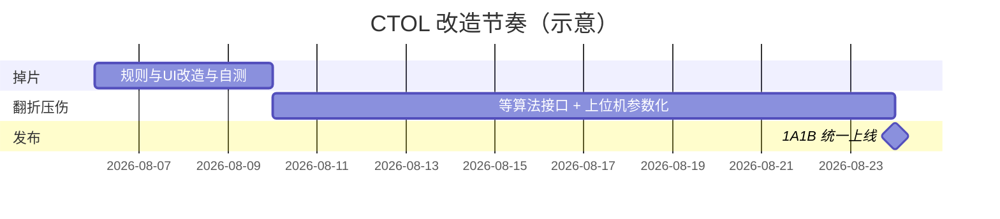

# CTOL 改造指南（掉片 / 翻折 / 压伤 / 上线）

> 文档版本：2026-08-06  
> 状态：**仅文档，尚未改代码**  
> 基准架构：**新架构页** `VM_CTOLAutoDetectionPage` + `Services/Project/CTOL/*`  
> 关联：[接手指南](./CTOL项目分析与接手指南.md)

---

## 1. 目标与节奏

| 项 | 内容 |
|----|------|
| 开发原则 | **先开发、验完再统一上线**（交接原话） |
| 首批节点 | **2026-08-10**：优先完成「正极 Y 方向掉片」规则改造（上位机侧已具备完整逻辑，可独立推进） |
| 翻折 / 压伤 | 节点：**待算法/交接方开发完再定**（依赖新参数与可能的 DLL 接口） |
| 上线范围 | 仅 **拉 1A、拉 1B**（当前在生产）；6A/6B 暂不更新 |
| 上线动作 | 功能齐后更新工控机程序（含交接提到的「多进程程序」，见 §6 待澄清） |



（甘特中翻折/压伤时长为占位，以交接方「开发完再定」为准。）

---

## 2. 需求一：正极 Y 方向掉片规则修改

### 2.1 业务规则对照

| | **现行（代码实现）** | **目标（交接要求）** |
|--|----------------------|----------------------|
| a | Y 向 AC OH：AI+后处理抓取，或中间层与相邻任一层 AC OH 差 ≥ **Gap45**（默认 0.3mm） | **不变**（阈值仍可设） |
| b | \|1-Y + 3-Y − 2-Y − 4-Y\| ≥ **Gap46**（默认 **0.3**mm） | 同式，默认改为 ≥ **0.8**mm（可设） |
| c | \|1-Y−3-Y\| 或 \|2-Y−4-Y\| ≥ **Gap47**（默认 0.5mm） | **删除**，不再参与判定 |
| 合成 | **a ∧ b ∧ c** → NG | **a ∧ b** → NG |
| 可配置 | a/b/c 对应 Gap45/46/47 | 仅 **a/b**（Gap45/Gap46）需开放可设 |

### 2.2 代码现状锚点（新架构）

| 层级 | 位置 | 行为 |
|------|------|------|
| 单图初判（偏 a） | `ImageProcessorBase.NgOkJudge` | Y 图且相邻 OH 差 ≥ Gap45 → 先标 `正极Y方向掉片` |
| 跨图终判（a∧b∧c） | `BarcodeGroupingService.CheckCrossYDrop` | 层循环：①相邻差 ②对角和差 ③同侧差；三者同时满足才确认 NG；否则撤销单图掉片标记 |
| 默认值 | `CheckCrossYDrop` / VM / XAML | Gap45=0.3，Gap46=**0.3**，Gap47=0.5 |
| UI | `CTOLAutoDetectionPage.xaml`「正极Y方向掉片参数」 | 三个 `NumericUpDown`：SharedGap45 / 46 / **47** |
| 持久化 | `VM_CTOLAutoDetectionPage`、`MonitorControlViewModel`、`GapThresholdService` | 字典键 `Gap45Limit` / `Gap46Limit` / `Gap47Limit` |

现行跨图伪码（改造前）：

```text
for each layer i:
  if not (任一Y图上该层有相邻OH差 ≥ gap45): continue          // a
  if |y1+y3-y2-y4| < gap46: continue                            // b
  if |y1-y3| ≥ gap47 OR |y2-y4| ≥ gap47: return NG             // c
return 非掉片
```

目标伪码：

```text
for each layer i:
  if not (任一Y图上该层有相邻OH差 ≥ gap45): continue          // a
  if |y1+y3-y2-y4| ≥ gap46: return NG                          // b（默认 gap46=0.8）
return 非掉片
```

### 2.3 建议改动清单（实施时，非当前）

1. **`BarcodeGroupingService.CheckCrossYDrop`**  
   - 去掉条件 ③（Gap47）。  
   - Gap46 默认值改为 **0.8**。  
   - 更新方法注释：由「三条件」改为「a∧b」。
2. **`ImageProcessorBase`**  
   - Gap46Limit 字段默认 0.8；Gap47 可保留字段但跨图不再读取（或标记废弃）。  
   - 单图初判逻辑（a）保持，避免误伤其它缺陷优先级。
3. **UI**  
   - 隐藏或删除「\|1-Y−3-Y\| 或 \|2-Y−4-Y\|≥」一行。  
   - 文案可标明 NG 条件为「a 且 b」。  
   - SharedGap46 默认显示 0.8；重置默认值同步改。
4. **配置兼容**  
   - 已落盘的 `Gap47Limit` 可忽略；读不到 Gap46 时默认 0.8。  
   - 现场 JSON / project_setting 若写死 0.3，发布说明中要求核对或重置。
5. **自测**  
   - 构造/选用：仅 a、仅 b、a∧b、旧规则靠 c 才 NG 的样例，确认行为符合新规则。

### 2.4 8.10 验收建议

- [ ] 新默认：Gap46=0.8，跨图不再使用 Gap47。  
- [ ] UI 仅保留 a/b 可调，停机可改、启动后生效（与现有阈值机制一致）。  
- [ ] 样例图：a∧b→NG；缺一→不因掉片 NG。  
- [ ] 回归：其它缺陷类型（间隙、层数、压伤标志等）行为无意外变化。

---

## 3. 需求二：负极片翻折 — 新增可调参数

### 3.1 交接原文

> 负极片翻折需要新增一个参数在界面可调：**翻折距离正极面积 0.Xmm**，**大于等于设定面积则 NG**。  
> 时间节点：待对方开发完再确定。

### 3.2 代码现状

| 现象 | 说明 |
|------|------|
| 缺陷名 | 判级里已有 **`负极突起`**（`neTQflag == 1`），未见独立「负极翻折」字符串 |
| 判定方式 | **布尔标志**：算法输出 `neTQflag`，上位机不读面积阈值 |
| UI | 新架构页 **无**「翻折面积」NumericUpDown |

### 3.3 实现依赖（待澄清）

必须与算法/交接方确认：

1. 「负极翻折」是否等于现有「负极突起」，还是新缺陷类型？  
2. 「翻折距离正极面积」由 **DLL 内计算后与阈值比较**，还是 DLL 输出面积、**上位机比较**？  
3. `Algorithm_Action` 是否新增 `out` 面积，或通过配置文件把阈值传入模型？

### 3.4 上位机侧预期改动（接口明确后）

| 层 | 内容 |
|----|------|
| 阈值服务 | 新增如 `NeFoldAreaLimit`（命名待定），进 `GapThresholdService` 或独立配置节 |
| UI | 设置区增加一项「翻折距离正极面积 ≥」 |
| 判级 | `NgOkJudge`：面积 ≥ 阈值 → `NG_负极翻折`（或沿用突起名，需统一菜单/优先级/上传白名单） |
| 归档/统计 | `DefectTypePriorities`、DailyUpload、饼图统计键同步 |

**在算法未交付前：只预留 UI/配置设计，不强行改判级。**

---

## 4. 需求三：负极片压伤 — 组合规则与多参数

### 4.1 交接原文（摘要）

界面新增可调：

1. **角度 α（X）**  
2. **压伤宽度 0.Xmm**  
3. **撞伤宽度 0.Xmm**  

组合示例：

| 规则 | 条件 | 结果 |
|------|------|------|
| A | α ≤ 100° 且 「S 型弯折」≥ 1 层（压伤宽度 ≥ 0.5mm） | **NG** |
| B | α ＞ 100° 且 「S 型弯折」≥ 1 层（撞伤宽度 ＜ 1mm） | **OK** |

节点：待对方开发完再定。

### 4.2 代码现状

| 现象 | 说明 |
|------|------|
| 判定 | `negPressureFlag == 1`（`neNGflag`）→ 直接 `NG_负极压伤` |
| 参数 | **无**角度 / 压伤宽 / 撞伤宽 / S 型层数 |
| UI | 无对应调节项 |

示例中的 100°、0.5mm、1mm 应全部做成可配置；规则 A/B 的完备性（α≤100 且撞伤宽条件？无 S 弯折？）需产品再确认。

### 4.3 待澄清问题（建议书面问交接方）

1. 「S 型弯折」层数、α、压伤宽、撞伤宽是否均由新版算法输出？结构体字段名？  
2. 规则是否仅 A/B 两条，还是还有「默认 NG/OK」兜底？  
3. 示例数值是默认值还是仅说明？  
4. 多视野（1-X/1-Y…）是「任一视野命中即 NG」还是「按工位聚合」？

### 4.4 上位机侧预期改动（接口明确后）

| 层 | 内容 |
|----|------|
| 模型适配 | Processor 解析新输出字段 |
| 阈值 | `CrushAngleLimit`、`CrushWidthLimit`、`CollisionWidthLimit` 等 + UI |
| 判级 | 用组合规则替换单纯 `neNGflag==1`（或 flag 仅作「存在压伤形貌」门控） |
| 回归 | 旧金样在新规则下的 OK/NG 对照表 |

---

## 5. 需求四：「更新多进程程序」

交接原文放在压伤需求之后，语义偏向 **发布动作**，而非第三条缺陷规则。

可能含义（需确认其一）：

1. 工控机上除主 WPF 外，另有 **多进程推理/监控** 配套程序，上线时一并覆盖；  
2. 新架构 RemoteFileMonitor + 四路 Processor 的并发模型，发布时要替换整包；  
3. 其它独立安装包名称待补充。

**待交接方补充**：进程名、安装目录、是否与 `SUNWODA_SEVB` 同版本发布、1A/1B 路径是否一致。

在未澄清前，发布清单中单独占位：「多进程程序 — 路径 TBD」。

---

## 6. 上线范围与现场

| 线体 | IP（交接） | 账号 | 本次更新 |
|------|------------|------|----------|
| 拉 1A | 10.178.32.139 | Work / d | **是** |
| 拉 1B | 10.178.32.158 | Work / d | **是** |
| 拉 6A | 10.178.32.158 | Work / 1 | 否 |
| 拉 6B | 10.178.35.160 | Work / 1 | 否 |

发布前检查：

- [ ] 本地/测试机：掉片新规则通过；翻折/压伤若已合入则金样通过  
- [ ] `AddCTOLRemoteFileMonitor` 已启用；DefaultProject / 模块开关正确  
- [ ] 备份 1A/1B 当前程序目录与 `remote_file_monitor_config.json`  
- [ ] 确认 Gap46 现场值（避免旧 0.3 残留导致过严/过松）  
- [ ] 停线窗口、回滚包、联系人  
- [ ] 「多进程程序」覆盖步骤（澄清后填入）

---

## 7. 推荐实施顺序

```text
P0（→8.10）  正极Y掉片：CheckCrossYDrop 去 c + Gap46 默认 0.8 + UI 去掉 Gap47
P1（接口到齐）负极翻折：面积阈值 UI + 判级 + 优先级/上传
P2（接口到齐）负极压伤：三角参数 UI + A/B 组合判级 + 回归金样
P3（齐套后）  1A/1B 备份 → 更新主程序 + 多进程程序 → 抽检 → 观察
```

依赖关系：

- P0 **不依赖**新 DLL，可立即开干。  
- P1/P2 **强依赖**算法输出与产品规则定稿。  
- P3 依赖 P0 必做；P1/P2 按「是否已开发完」决定是否同包上线（交接：全部弄完再一起上线 → 倾向 **等 P1/P2 齐再发**，若业务允许可先发仅含 P0 的包，需产品点头）。

---

## 8. 待沟通问题汇总（可直接转发）

1. 1B 与 6A 是否同机 `10.178.32.158`？如何避免误更新 6A？  
2. 「多进程程序」名称、路径、与主程序版本关系？  
3. 负极翻折 vs 负极突起？面积谁算、谁比阈值？  
4. 压伤：α / 压伤宽 / 撞伤宽 / S 型层数的 DLL 接口与完整真值表？  
5. 「一起上线」是否允许 **只含掉片改造** 的中间包上 1A/1B，还是必须三需求齐套？  
6. 掉片/翻折/压伤金样图与期望 OK/NG 表能否提供？

---

## 9. 文档变更记录

| 日期 | 说明 |
|------|------|
| 2026-08-06 | 初稿：交接需求拆解、与代码现状对照、8.10/上线范围、待澄清项；**未改代码** |
