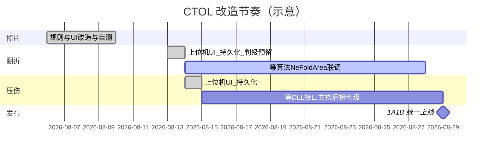

# CTOL 改造指南（掉片 / 翻折 / 压伤 / 上线）

> 文档版本：2026-08-14  
> 状态：**P0 已完成；P1 上位机侧已预留（待算法面积接口）；P2 仅完成界面/持久化（判级未接）；P3 未开始**  
> 基准架构：**新架构页** `VM_CTOLAutoDetectionPage` + `Services/Project/CTOL/*`（旧页 C06 **不改业务**）  
> 关联：[接手指南](./CTOL项目分析与接手指南.md)

---

## 0. 改造进度总览（2026-08-14）

| 项 | 状态 | 说明 |
|----|------|------|
| **P0 正极 Y 方向掉片** | ✅ **已完成**（新架构） | 跨图仅 a∧b；Gap46 默认 0.8；UI 去掉 Gap47 |
| **P1 负极片翻折** | 🟡 **上位机已预留** | UI + `Gap48Limit` 持久化 + 面积判级逻辑已接入；等 Worker 输出 `NeFoldArea` |
| **P2 负极片压伤** | 🟡 **仅界面/持久化** | Gap49/50/51 可调并落库；`NgOkJudge` 仍走旧 `neNGflag==1`；等 DLL 接口文档再写逐层判级 |
| **P3 1A/1B 上线** | ⬜ 未开始 | 等功能齐套（或产品允许仅发 P0/P1） |

P1 联调前注意：算法未输出 `NeFoldArea` 时该条判级 **跳过**（不误报）；接口到齐后按面积比较生效。

P2 注意：当前改阈值 **不会改变压伤 OK/NG**（判级未接）。

---

## 1. 目标与节奏

| 项 | 内容 |
|----|------|
| 开发原则 | **先开发、验完再统一上线**（交接原话） |
| 首批节点 | **2026-08-10**：优先完成「正极 Y 方向掉片」规则改造 → **已完成** |
| 翻折 | 上位机参数化 + 判级预留 → **已完成**；算法面积字段 → **待对方交付** |
| 压伤 | 界面三项可调 + 落库 → **已完成**；逐层组合判级 → **等 DLL 接口文档** |
| 上线范围 | 仅 **拉 1A、拉 1B**（当前在生产）；6A/6B 暂不更新 |
| 上线动作 | 功能齐后更新工控机程序（含交接提到的「多进程程序」，见 §5 待澄清） |



（甘特中压伤/联调时长为占位，以交接方「开发完再定」为准。）

---

## 2. 需求一：正极 Y 方向掉片规则修改

### 2.1 进度：✅ 已完成（新架构）

| | **改造前** | **改造后（当前代码）** |
|--|-----------|------------------------|
| a | 中间层与相邻任一层 AC OH 差 ≥ **Gap45**（默认 0.3mm） | **不变**（可设） |
| b | \|1-Y + 3-Y − 2-Y − 4-Y\| ≥ **Gap46**（默认 0.3mm） | 同式，默认 **0.8mm**（可设） |
| c | \|1-Y−3-Y\| 或 \|2-Y−4-Y\| ≥ **Gap47** | **已删除**，不再参与判定 |
| 合成 | **a ∧ b ∧ c** → NG | **a ∧ b** → NG |
| UI | SharedGap45 / 46 / 47 | 仅 SharedGap45 / SharedGap46 |

### 2.2 代码锚点（改造后）

| 层级 | 位置 | 行为 |
|------|------|------|
| 单图初判（偏 a） | `ImageProcessorBase.NgOkJudge` | Y 图且相邻 OH 差 ≥ Gap45 → 先标 `正极Y方向掉片` |
| 跨图终判（a∧b） | `BarcodeGroupingService.CheckCrossYDrop` | 仅 ①相邻差 + ②对角和差；满足则确认 NG，否则撤销单图掉片标记 |
| 默认值 | CheckCrossYDrop / VM / XAML | Gap45=0.3，Gap46=**0.8** |
| UI | `CTOLAutoDetectionPage.xaml`「正极Y方向掉片参数」 | 两个 `NumericUpDown`：SharedGap45 / SharedGap46 |
| 持久化 | `Gap45Limit` / `Gap46Limit` → ProjectSetting（`BelongToVM=VM_CTOLAutoDetectionPage`） | 点「保存设置」落库 |

跨图伪码（当前）：

```text
for each layer i:
  if not (任一Y图上该层有相邻OH差 ≥ gap45): continue          // a
  if |y1+y3-y2-y4| ≥ gap46: return NG                          // b（默认 gap46=0.8）
return 非掉片
```

### 2.3 验收清单

- [x] 新默认：Gap46=0.8，跨图不再使用 Gap47。  
- [x] UI 仅保留 a/b 可调，停机可改、保存后生效。  
- [ ] 样例图：a∧b→NG；缺一→不因掉片 NG（待现场/金样）。  
- [ ] 回归：其它缺陷类型行为无意外变化（待联调）。  
- [ ] 上线前核对现场已落盘 Gap46，避免旧 0.3 残留。

> 说明：`MonitorControlViewModel`（独立模式）仍残留 Gap47 字段；主路径为共享阈值模式，旧页 C06 未改。

---

## 3. 需求二：负极片翻折 — 新增可调参数

### 3.1 交接原文

> 负极片翻折需要新增一个参数在界面可调：**翻折距离正极面积 0.Xmm**，**大于等于设定面积则 NG**。  
> 时间节点：待对方开发完再确定。

补充确认（2026-08-13）：

| 项 | 结论 |
|----|------|
| 单位 | **mm²**（面积） |
| 缺陷归档名 | 继续用 **「负极突起」**，不另建「负极翻折」 |
| 比较方 | 算法输出面积，**上位机比较** |
| 面积为 0 | 打日志并 **判 NG** |
| 面积字段未到 | `NeFoldArea == null` → **跳过本条**（不误报） |

### 3.2 进度：🟡 上位机已完成预留，待算法接口

| 层 | 状态 | 说明 |
|----|------|------|
| UI | ✅ | `CTOLAutoDetectionPage`「负极突起（翻折）参数」：`翻折距离正极面积≥ (mm²)` → `SharedGap48Limit` |
| 持久化 | ✅ | 键名 **`Gap48Limit`**（必须 `Gap` 前缀，否则 `LoadSharedThresholds` 读不回）；默认占位 **0.1**，待产品确认正式默认值 |
| 运行时阈值 | ✅ | `GapThresholdService` + `ImageProcessorBase.Gap48Limit` / `ApplyThresholds` |
| 判级 | ✅ 逻辑已接 | `TryJudgeNegativeProtrusion`：≤0 → 日志+NG；≥ Gap48 → NG；缺陷名 `NG_负极突起` |
| 旧 `neTQflag==1` | ✅ 已废弃于判级 | 不再传入 `NgOkJudge`；`NeTQFlag` 仅保留兼容旧 Worker JSON |
| 结果模型 | 🟡 预留 | `CtAlgorithmResult.NeFoldArea`（`double?`，mm²） |
| 四路 Processor | ✅ | 读 `algorithm.NeFoldArea` 传入判级 |
| 优先级 / 上传 | ✅ | `BarcodeGrouping` 缺「负极突起」时自动插到「负极压伤」后；`DefectFileMoverService` 白名单已含 |

### 3.3 算法侧待交付

Worker stdout JSON 需输出面积字段，属性名建议：

```text
"NeFoldArea": <double>   // 单位 mm²；缺省则上位机视为 null 跳过
```

若对方字段名不同，在 `CtAlgorithmResult.NeFoldArea` 上补 `[JsonPropertyName("对方字段名")]` 即可。

判级约定：

| `NeFoldArea` | 上位机行为 |
|--------------|-----------|
| 无字段 / null | 跳过本条 |
| ≤ 0 | Warn 日志 + `NG_负极突起` |
| ≥ `Gap48Limit` | `NG_负极突起` |
| 0 &lt; 面积 &lt; 阈值 | 本条通过 |

仍受层数门控：C06 需 负极 77 / 正极 76；非 C06 需 108 / 107。

### 3.4 联调 / 验收建议

- [ ] Worker 已输出 `NeFoldArea`，反序列化非 null。  
- [ ] 面积 &lt; 阈值 → 不因突起 NG；≥ 阈值 → NG_负极突起。  
- [ ] 面积为 0 → 有日志且 NG。  
- [ ] 界面改 Gap48、保存设置、重启后阈值仍生效。  
- [ ] 聚合目录 / 饼图 / 每日上传能出现「负极突起」。

---

## 4. 需求三：负极片压伤 — 组合规则与多参数

### 4.1 进度：🟡 仅界面/持久化（2026-08-14）

交接原文——界面新增可调：

1. **角度 α（X）**  
2. **压伤宽度 0.Xmm**  
3. **撞伤宽度 0.Xmm**  

同事口头补充（规则未定稿，**判级尚未按此实现**）：

> 先看层数。有一层时：小于 100 度或者压伤宽度大于 0.5 → NG。  
> 有一层时：大于 100 度，宽度也小于 1mm → OK。

算法侧口头约定（接口文档未到，字段名待定）：

| 项 | 约定 |
|----|------|
| 输出 | **层数**、**角度数组**、**压伤宽度数组** |
| 数组长度 | 约负极 **108** 层（正极不参与压伤判断） |
| 判级方式 | 按层遍历，写法类似现有 OH 逐层比较 |
| 当前代码 | 仍用旧 `neNGflag==1` 直判，**未读上述数组** |

### 4.2 上位机已完成（仅 UI + 落库）

| 层 | 状态 | 说明 |
|----|------|------|
| UI | ✅ | `CTOLAutoDetectionPage`「负极压伤参数」三项 NumericUpDown |
| 持久化 | ✅ | `Gap49Limit` 角度默认 100°；`Gap50Limit` 压伤宽 0.5mm；`Gap51Limit` 撞伤宽 1.0mm |
| 运行时字段 | ✅ | `ImageProcessorBase.Gap49/50/51Limit` 已由 `ApplyThresholds` 写入 |
| 判级 | ⬜ 未改 | 仍 `negPressureFlag == 1` → `NG_负极压伤` |
| 结果模型 | ⬜ 未加数组字段 | 等接口文档再补 `CtAlgorithmResult` |

改阈值后须点 **「保存设置」** 才写入 ProjectSetting；**当前改这三项不会改变 OK/NG**。

### 4.3 规则缺口（接口文档到齐后再定）

1. OK 里的「宽度」是压伤宽还是撞伤宽？DLL 口头目前只有压伤宽。  
2. α = 100°、宽 = 0.5 / 1.0 的开闭区间。  
3. 「有一层」是 S 型弯折层数，还是「负极总层数正常后再逐层扫」？  
4. 逐层命中即 NG，还是要聚合 8 张图？  
5. Worker JSON 数组字段正式名。

### 4.4 接口到齐后的后续改动（尚未做）

| 层 | 内容 |
|----|------|
| `CtAlgorithmResult` | 增加角度数组、压伤宽数组（及层数，若与现有 `negativeCount` 重复则复用） |
| 四路 Processor | 取出数组传入判级 |
| `NgOkJudge` | 按层遍历替换 `neNGflag==1`；阈值用已落库的 Gap49/50/51 |
| 真值表 | 按接口文档 + 产品书面规则写死，注释说明与口头稿差异 |
| 回归 | 旧金样 OK/NG 对照 |

---

## 5. 需求四：「更新多进程程序」

交接原文放在压伤需求之后，语义偏向 **发布动作**，而非第三条缺陷规则。

可能含义（需确认其一）：

1. 工控机上除主 WPF 外，另有 **多进程推理/监控** 配套程序，上线时一并覆盖；  
2. 新架构 RemoteFileMonitor + 四路 Processor 的并发模型，发布时要替换整包；  
3. 其它独立安装包名称待补充。

**待交接方补充**：进程名、安装目录、是否与 `SUNWODA_SEVB` 同版本发布、1A/1B 路径是否一致。

在未澄清前，发布清单中单独占位：「多进程程序 — 路径 TBD」。

---

## 6. 上线范围与现场

| 线体 | IP（交接） | 账号 | 本次更新 |
|------|------------|------|----------|
| 拉 1A | 10.178.32.139 | Work / d | **是** |
| 拉 1B | 10.178.32.158 | Work / d | **是** |
| 拉 6A | 10.178.32.158 | Work / 1 | 否 |
| 拉 6B | 10.178.35.160 | Work / 1 | 否 |

发布前检查：

- [ ] 本地/测试机：掉片新规则通过；翻折在算法接口到齐后金样通过  
- [ ] `AddCTOLRemoteFileMonitor` 已启用；DefaultProject / 模块开关正确  
- [ ] 备份 1A/1B 当前程序目录与 `remote_file_monitor_config.json`  
- [ ] 确认 Gap46 现场值（避免旧 0.3 残留导致过严/过松）  
- [ ] 确认 Gap49/50/51 现场值已保存（压伤判级接入前改了也要落盘）  
- [ ] 停线窗口、回滚包、联系人  
- [ ] 「多进程程序」覆盖步骤（澄清后填入）

---

## 7. 推荐实施顺序与进度

```text
P0  ✅ 正极Y掉片：CheckCrossYDrop 去 c + Gap46 默认 0.8 + UI 去掉 Gap47
P1  🟡 负极翻折：UI + Gap48 持久化 + 面积判级已接；等 NeFoldArea 联调
P2  🟡 负极压伤：UI + Gap49/50/51 持久化已完成；判级仍旧 flag，等 DLL 接口文档
P3  ⬜ 1A/1B 备份 → 更新主程序 + 多进程程序 → 抽检 → 观察
```

依赖关系：

- P0 **不依赖**新 DLL，**已完成**。  
- P1 上位机 **已完成预留**；真正生效 **依赖** Worker 输出 `NeFoldArea`。  
- P2 界面 **已完成**；判级 **等 DLL 接口文档**（角度/压伤宽为负极逐层数组）。  
- P3 依赖齐套策略（交接倾向全部弄完再一起上线）。

---

## 8. 待沟通问题汇总（可直接转发）

1. 1B 与 6A 是否同机 `10.178.32.158`？如何避免误更新 6A？  
2. 「多进程程序」名称、路径、与主程序版本关系？  
3. ~~负极翻折 vs 负极突起？面积谁算、谁比阈值？~~ → **已确认**：沿用「负极突起」；算法出面积，上位机比；单位 mm²；面积 0 → NG。  
4. 压伤：DLL JSON 字段名（层数 / 角度数组 / 压伤宽数组）？OK 里「宽度」是否即压伤宽？α=100° 开闭？「有一层」定义？撞伤宽是否仍输出？  
5. 「一起上线」是否允许 **只含掉片+翻折预留+压伤界面** 的中间包上 1A/1B，还是必须三需求齐套？  
6. 掉片/翻折/压伤金样图与期望 OK/NG 表能否提供？  
7. **Worker JSON 中面积字段正式名是否为 `NeFoldArea`？** Gap48 正式默认值？

---

## 9. 文档变更记录

| 日期 | 说明 |
|------|------|
| 2026-08-06 | 初稿：交接需求拆解、与代码现状对照、8.10/上线范围、待澄清项；**未改代码** |
| 2026-08-13 | P0 掉片已完成；P1 翻折 UI/持久化/`Gap48Limit`/面积判级预留（待 `NeFoldArea`） |
| 2026-08-14 | P2 压伤：新架构仅完成界面三项 + `Gap49/50/51` 持久化；判级仍 `neNGflag`；算法约定角度/压伤宽为负极逐层数组，等接口文档再接 |
