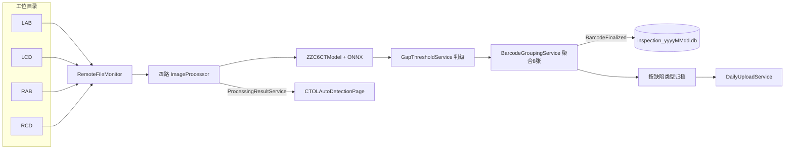

# CTOL 在线 CT AI 检测 — 项目分析与接手指南

> 文档版本：2026-08-06（交接信息修订）  
> 用途：接手 CTOL 时的代码地图、数据流、现场环境与建议学习顺序  
> 关联文档：  
> - [CTOL 改造指南](./CTOL改造指南.md)（本期需求：掉片/翻折/压伤规则）  
> - [项目架构说明](../项目架构说明.md)、[接手任务规划](../接手任务规划.md)

---

## 0. 已确认交接结论（2026-08-06）

| 项 | 结论 |
|----|------|
| 架构页 | **使用新架构页** `VM_CTOLAutoDetectionPage`（不以 C06 旧单体页为主开发） |
| 开发节奏 | **先本地/联调开发**；功能齐后再统一上线 |
| 首批目标节点 | **2026-08-10** 前完成可开发部分（详见改造指南） |
| 上线范围 | 当前仅 **拉 1A、拉 1B** 在生产；**到时只更新这两台**（6A/6B 暂不更） |
| 本期需求 | 正极 Y 掉片规则调整；负极翻折可调参；负极压伤组合规则可调参；更新多进程程序（见改造指南待澄清项） |

旧页 `VM_CTAutoDetectionC06` 仅作对照/迁移参考，**不要在旧页上改业务**。

---

## 1. 一句话定位

**CTOL = 产线「在线」CT 影像 AI 检测**：监控四路工位目录（LAB / LCD / RAB / RCD）中的新图 → 调用 ONNX/Halcon 算法 → 按间隙/OH 等规则判缺陷 → 按电芯条码聚合（通常 8 张）→ 归档到缺陷/OK 目录，并落库、可按日上传。

与相近模块的边界：

| 模块 | 含义 | 入口 |
|------|------|------|
| **CTOL** | 在线 CT（产线实时看图判级） | `ViewModels/Pages/CTOL/` |
| **CTAutoSlicer** | 离线 CT 切图 / VG 自动化 / AI 标注 | `ViewModels/Pages/CTAutoSlicer/`（另见 `docs/CTAutoSlicer/`） |
| **CTNCLX** | 南昌离线 CT | `ViewModels/Pages/CTNCLX/` |

接手 CTOL **不必先啃** CTAutoSlicer；二者算法生态有交集（Dlls、Halcon），业务流程独立。

---

## 2. 现场环境（远程桌面）

> 账号信息来自交接方，仅用于产线联调/发布；请勿写入公开仓库以外的渠道扩散。

| 线体 | 地址 | 用户名 | 密码 | 生产状态 | 本次是否更新 |
|------|------|--------|------|----------|--------------|
| 拉 1A | `http://10.178.32.139/` | Work | d | **在生产** | **是** |
| 拉 1B | `http://10.178.32.158/` | Work | d | **在生产** | **是** |
| 拉 6A | `http://10.178.32.158/` | Work | 1 | 非本次生产主线 | 否（暂缓） |
| 拉 6B | `http://10.178.35.160/` | Work | 1 | 非本次生产主线 | 否（暂缓） |

说明：

- 交接原文为浏览器式 IP；现场一般为 **Windows 远程桌面（RDP）** 连上述主机。若打不开网页，按 RDP 连 `10.178.x.x`。
- 1B 与 6A 交接表均为 `10.178.32.158`，上机前再向交接方确认是否同一台/多会话，避免误更。
- 发布策略：**功能全部开发验证通过后，再一起上 1A/1B**；不要边开发边半成品上线。

---

## 3. 代码与文件地图

约 **1.7 万行**业务相关代码；日常开发落在新架构分层上。

### 3.1 目录总览

```
SUNWODA_SEVB/
├── ViewModels/Pages/CTOL/
│   ├── VM_CTOLAutoDetectionPage.cs      # 新架构入口页（~1.1k 行）★ 主攻
│   ├── MonitorControlViewModel.cs       # 单路监控卡片 VM（~650 行）
│   └── VM_CTAutoDetectionC06Page.cs     # 旧版单体页（对照用，勿改业务）
├── Views/Pages/CTOL/
│   ├── CTOLAutoDetectionPage.xaml(.cs)  # 含「正极Y方向掉片参数」等 UI
│   └── CTAutoDetectionC06Page.xaml(.cs)
├── Services/Project/CTOL/
│   ├── BarcodeGroupingService.cs        # 条码聚合 + 跨图 Y 掉片二次判断 ★
│   ├── InspectionResultService.cs
│   ├── GapThresholdService.cs           # 阈值字典（含 Gap45/46/47）
│   ├── GapCsvService.cs / DailyUploadService.cs / …
│   ├── RemoteFileMonitorConfigService.cs
│   └── Processing/
│       ├── ImageProcessorBase.cs        # 单图判级 NgOkJudge、阈值注入 ★
│       ├── LAB/LCD/RAB/RCDImageProcessor.cs
│       └── ResultImageRenderer.cs
├── remote_file_monitor_config.json
└── Services/ServiceCollectionExtensions.cs → AddCTOLRemoteFileMonitor()

SUNWODA_SEVB.Core/Dlls/  → RemoteFileMonitor、ZZC6OnlineCTModel、Halcon、ONNX 等
SUNWODA_SEVB.Component/.../CTOL/ → ImageShowControl、PiePlotViewer
```

### 3.2 入口页对照（已锁定新架构）

| 项 | 新架构（采用） | 旧架构（仅对照） |
|----|----------------|------------------|
| 模块 ID | `VM_CTOLAutoDetectionPage` | `VM_CTAutoDetectionC06` |
| 目录监控 | `RemoteFileMonitor` + `IFileProcessor` | 页面内 `FileSystemWatcher` ×4 |
| AI 调用 | `ImageProcessorBase` → `ZZC6CTModel` | ViewModel 内四路 `IPredictor` |
| 业务服务 | `Services/Project/CTOL/*` | 逻辑堆在 VM |
| DI | 必须 `AddCTOLRemoteFileMonitor` | 页面自管 |

---

## 4. 业务数据流（新架构）



### 4.1 关键约定

1. 监控过滤默认 `*origin.png`。
2. 每电芯默认 8 张（4 拍位 × X/Y）。
3. 最终分类按 `DefectTypePriorities`；超时 / 算法异常有独立目录名。
4. 落库：`inspection_{yyyyMMdd}.db`。
5. **正极 Y 掉片**：单图初判在 `ImageProcessorBase`；**跨四路 Y 图二次确认**在 `BarcodeGroupingService.CheckCrossYDrop`（本期改造重点，见改造指南）。

### 4.2 算法与编译开关

`#define C06` → `ZZC6OnlineCTModel` + `.\model\1222\C06_best.onnx`。  
改机型需同步编译符号、模型路径与 DLL。

---

## 5. 启动与 DI

### 5.1 `InitCTOLEnvironment`

当 `global_setting.DefaultProject` **包含 `"CTOL"`** 时：建 `WatermarkDbContext`，并订阅 `BarcodeFinalized` → `InspectionResultService.SaveAsync`。

### 5.2 必须打开新架构 DI

仓库现状中以下行常被注释，**开发/现场跑新页前必须启用**：

```csharp
// App.xaml.cs ConfigureServices
services.AddCTOLRemoteFileMonitor(configuration);
```

未注册则新页构造注入失败；`InitCTOLEnvironment` 内 `GetRequiredService` 也会失败（被 catch 打日志）。

### 5.3 开发机启用 SQL

```sql
USE sunwoda_demo;

UPDATE workspace_project SET is_enabled = 1
WHERE vm_class_name = 'VM_CTOLAutoDetectionPage';

UPDATE global_setting
SET value = 'VM_CTOLAutoDetectionPage'
WHERE name = 'DefaultProject';

UPDATE global_setting SET value = 'MainWindow' WHERE name = 'AppStartMainWindow';
```

修改后完全退出并重启应用。

---

## 6. 配置项速查

`SUNWODA_SEVB/remote_file_monitor_config.json`：

| 节 | 作用 |
|----|------|
| `Monitor.*` | SQLite 目录、四路路径/过滤/轮询 |
| `BarcodeGrouping` | 张数、超时、缺陷优先级 |
| `DailyUpload` | 每日上传 UNC / 缺陷白名单 / 触发时分 |

掉片阈值 Gap45/46/47 经 UI → `GapThresholdService` / 配置持久化（共享或分路）。界面入口：设置区「正极Y方向掉片参数」。

---

## 7. 建议从何开始（结合本期改造）

### 第 0 步（已完成一部分）

- [x] 确认使用新架构页  
- [x] 确认 1A/1B 为上线对象、先开发后统一上线  
- [ ] 确认「多进程程序」具体指哪个进程/安装目录（见改造指南待澄清）  
- [ ] 确认翻折/压伤是否依赖算法 DLL 新接口（见改造指南）

### 第 1 步：本地跑通新页（1 天内）

1. 启用 `AddCTOLRemoteFileMonitor` + SQL 开模块。  
2. 进 `CTOLAutoDetectionPage`，熟悉四路卡片与「正极Y方向掉片参数」三档 NumericUpDown。  
3. 对照改造指南，标出 Gap45/46/47 与 a/b/c 的映射。

### 第 2 步：跟读掉片全链路（1～2 天）★ 8.10 主攻

| 顺序 | 文件 | 关注点 |
|------|------|--------|
| 1 | `ImageProcessorBase.NgOkJudge` | 单图 a 初判 → `正极Y方向掉片` |
| 2 | `BarcodeGroupingService.CheckCrossYDrop` | a∧b∧c 跨图二次确认 |
| 3 | `VM_CTOLAutoDetectionPage` + XAML | SharedGap45/46/47 绑定与保存 |
| 4 | `MonitorControlViewModel` / `GapThresholdService` | 分路阈值写入 |

**验收**：能说明「为何单图报掉片、聚合后可能被撤销或确认」；能指出改规则与改默认值要动的函数。

### 第 3 步：样例图联调 + 翻折/压伤调研

- 掉片：改 Gap46 默认 0.8、去掉 c，用样例验证。  
- 翻折/压伤：对照算法同事接口，确认现有 `neNGflag` / `neTQflag`（负极突起）是否够用，不够则等 DLL。

### 第 4 步：1A/1B 统一发布（功能齐后）

清单与回滚见 [CTOL改造指南](./CTOL改造指南.md) §发布。

### 刻意先不做

- 不改旧页 C06 业务逻辑。  
- 不改 ModuleManager / Python / CCTB。  
- 6A/6B 暂不发布。

---

## 8. 与接手任务规划的映射

| 规划项 | CTOL 对应 | 状态 |
|--------|-----------|------|
| 明确负责产线 | **CTOL** | ✅ |
| 阶段 2「在线 CT」 | 新架构 Services + VM | 进行中 |
| 启用模块 / DI | §5 | 待本地落实 |
| M3 跟读业务流程 | §7 第 2 步 + 改造指南 | 未完成 |
| 本期交付 | 见改造指南里程碑 | 8.10 起分批 |

---

## 9. 关键类职责速查

| 类 | 职责 |
|----|------|
| `*ImageProcessor` / `ImageProcessorBase` | 单路推理、单图 NG 规则、掉片初判 |
| `BarcodeGroupingService` | 8 张聚合、**跨图掉片二次判断**、目录归档 |
| `GapThresholdService` | Gap45/46/47（及后续新参数）运行时字典 |
| `InspectionResultService` | 按天 SQLite |
| `DailyUploadService` | 缺陷样本上传 |
| `RemoteFileMonitorConfigService` | JSON 配置持久化 |
| `VM_CTOLAutoDetectionPage` | 总控 UI、共享阈值、查询导出 |

---

## 10. 待确认清单

- [x] 现场开发基准：新架构页  
- [x] 上线机：1A、1B  
- [ ] 「更新多进程程序」的安装路径、进程名、是否与主 WPF 同包  
- [ ] 1B 与 6A 是否同 IP `10.178.32.158`  
- [ ] 负极翻折：是否即现有「负极突起」？面积阈值是否算法侧计算？  
- [ ] 负极压伤：角度/压伤宽/撞伤宽是否已由 `Algorithm_Action` 输出，还是等新 DLL  
- [ ] Halcon license + `model\1222\C06_best.onnx` 开发机是否齐全  
- [ ] 掉片/压伤/翻折金样图位置  

---

## 11. 相关锚点

| 主题 | 路径 |
|------|------|
| 模块 | `[Module("VM_CTOLAutoDetectionPage", ...)]` |
| DI | `AddCTOLRemoteFileMonitor` |
| 启动 | `App.InitCTOLEnvironment` |
| 掉片跨图 | `BarcodeGroupingService.CheckCrossYDrop` |
| 改造需求全文 | [CTOL改造指南.md](./CTOL改造指南.md) |
