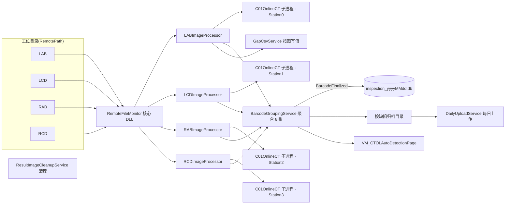

# CTOL（在线 CT AI 检测）项目开发规划

> 文档版本：2026-09-08（首次按标准三文档补齐）
> **角色：冷层详规** — 范围、架构、服务、判级键、里程碑；**不要**在本文维护每日进度
> **进度 / 待办 / 索引**：[CTOL进度存档.md](./CTOL进度存档.md)（新会话只拖进度存档）
> **本期改造细则**：[CTOL改造指南.md](./CTOL改造指南.md)（P0 掉片 / P1 翻折 / P2 压伤 / P3 上线）
> **代码地图 / 数据流 / 现场 / 学习顺序**：[CTOL项目分析与接手指南.md](./CTOL项目分析与接手指南.md)
> 平台：SUNWODA SEVB（`develop`，.NET 8 WPF）
> 维护人：接手开发者

---

## 0. 开发资料录入（工作流）

> **状态**：未录入（目录为空）· 原始投放目录见 [开发资料/](./开发资料/)
> 新原始现场资料请放入 `开发资料/` 后按 [Agent协作开发规程](../Agent协作开发规程.md) §2.2 走「开始录入」，由 AI 整理进本文相应节 / 索引。
> 当前无独立点位/工艺阈值 CSV（CTOL 为影像 AI 判级，阈值以 `Gap*` 键 + 代码默认值 + ProjectSetting 落库为准，见 §4.3）。

---

## 1. 项目定位与目标

### 1.1 业务定位

**CTOL = 产线「在线」CT 影像 AI 检测**，运行于欣旺达 SEVB 统一桌面平台。监控四路工位目录（LAB / LCD / RAB / RCD）中的新图 → 调用 ONNX/Halcon 算法 → 按间隙 / OH / 层数 / 掉片等规则判缺陷 → 按电芯条码聚合（通常 8 张）→ 归档到缺陷/OK 目录，并落库、可按日上传。

核心价值：

1. 替代人工 CT 判级：实时看图、自动出 OK/NG 结论并标注结果图
2. 多工位、多进程并行：一站一进程，崩溃隔离、故障自恢复
3. 结果可追溯：按天 SQLite 落库、缺陷样本归档、每日集中上传
4. 判级阈值可停机调整并落库（`Gap*` → ProjectSetting）

### 1.2 本期范围（P0 已合入；P1/P2 界面完成、判级待接口；P3 未上线）

| 能力 / 需求 | 状态 | 说明 |
|------|----------|------|
| 新架构页 `VM_CTOLAutoDetectionPage` | ✅ 已合入 | 旧页 C06 仅对照 |
| 四路监控 + 独立 `C01OnlineCT` 子进程 | ✅ 已合入 | 每工位一进程；崩溃自动重启 |
| **P0 正极 Y 掉片**（跨图仅 a∧b、Gap46 默认 0.8） | ✅ 已合入 | [改造指南 §2](./CTOL改造指南.md) |
| **P1 负极翻折**（UI + `Gap48Limit` 持久化 + 面积判级预留） | 🟡 判级待 `NeFoldArea` | [改造指南 §3](./CTOL改造指南.md) |
| **P2 负极压伤**（`Gap49/50/51` 界面 + 落库） | 🟡 判级仍 `neNGflag==1` | 等 DLL 接口文档，[改造指南 §4](./CTOL改造指南.md) |
| **P3 拉 1A/1B 上线** | ⬜ 未开始 | [改造指南 §6](./CTOL改造指南.md) |
| 结果落库 / 查询 / 导出 / 每日上传 | ✅ 已合入 | `InspectionResultService` 等 |
| 算法 / NG 判定真正按逐层数组判级 | ⏸ 等算法交付 | 不臆造工艺数值 |

### 1.3 明确不做（当前阶段）

- **不在旧页 `VM_CTAutoDetectionC06Page` 上改业务**（保留仅作对照/迁移参考）
- **暂不发布拉 6A / 6B**（非本次生产主线）
- **不臆造 PLC/工艺数值**：判级阈值中算法接口未到、默认值仅为占位/产品未确认的，一律以 `Gap*` 代码默认 + 现场已落库值为准，未确认项标 ⏸
- 不替算法侧实现层数/角度/压伤宽计算（接口未到前保持上位机不误报的 fail-open 语义，见审查报告 P1 #2）

---

## 2. 现有资料盘点

### 2.1 文档资料

| 文档 | 内容 | 定位 |
|------|------|------|
| [CTOL项目分析与接手指南.md](./CTOL项目分析与接手指南.md) | 代码地图、数据流、现场环境、DI、学习顺序 | 接手辅助 |
| [CTOL改造指南.md](./CTOL改造指南.md) | P0/P1/P2/P3 需求对照、代码锚点、验收、待澄清 | 本期改造细则 |
| [审查报告-20260903-1647.md](./审查报告-20260903-1647.md) | 2026-08-03~09-03 历史提交只读审查 | 风险台账 |
| [README.md](./README.md) | 目录说明 | 导航 |
| [开发资料/](./开发资料/) | 原始现场资料投放区 | 未录入 |

### 2.2 代码/配置事实（核查过）

- 四路工位目录、过滤、轮询、输出目录来自 `SUNWODA_SEVB/remote_file_monitor_config.json` 的 `Monitor.Targets`（默认 `*origin.png`，轮询 60s）。
- 结果按天 SQLite：`{DatabaseDirectory}\inspection_result\inspection_{yyyyMMdd}.db`（比接手指南 §4 多一层 `inspection_result` 子目录，已按代码修正）。
- 判级默认编译符号：`Processing/ImageProcessorBase.cs` 顶部 `#define C01`（期望正极 **107** / 负极 **108** 层）；`#if C06` 分支为 76 / 77（见改造指南 §3.3 与接手指南 §4.2 差异——**以当前代码为准**）。
- Worker 可执行：默认 `{BaseDir}\Worker\C01OnlineCT.exe`（C06 时 `C06OnlineCT.exe`），可被环境变量 `CT_WORKER_EXE` 覆盖；**仓库 bin 未见该 exe**，现场需确认存在或设 `CT_WORKER_EXE`（⏸）。

---

## 3. 总体架构设计

### 3.1 分层原则

| 层 | 职责 | 禁止 |
|----|------|------|
| View | 布局、图表宿主、绑定 | 业务计算、算法/子进程、写库 |
| ViewModel | 命令、状态、阈值编辑绑定、查询导出 | 直接 new 通讯类 / 算法、硬编码判级 |
| Service（`Services/Project/CTOL`） | 聚合、判级、CSV、落库、上传、清理、配置 | 依赖具体 Page |
| Communication（`CtSubprocessClient`） | 常驻子进程生命周期、请求/响应编解码 | 业务判级 |
| Core 模型 | 算法请求/结果 / 缺陷 / 检测 DTO | 引用 WPF |

### 3.2 服务清单（现状）

| 类 | 职责 |
|------|------|
| `RemoteFileMonitorConfigService` | 读写 `remote_file_monitor_config.json`（Monitor 目标）+ ProjectSetting（阈值键） |
| `GapThresholdService` | 各 monitorId 运行时阈值字典；`IsSharedMode` 共享/独立 |
| `BarcodeGroupingService` | 8 张聚合、超时巡检（60s）、缺陷归档移动、`BarcodeFinalized` 事件、跨图 Y 掉片终判 |
| `Processing/ImageProcessorBase` + 四路 | 单图判级（`NgOkJudge`）、子进程调用、渲染结果图 |
| `InspectionResultService` | 按天 SQLite 写入 / 跨日查询 / CSV 导出 |
| `GapCsvService` | 每张图的间隙值 CSV 落盘 |
| `DailyUploadService` | 每日把前一天缺陷目录复制到集中上传目录 |
| `ResultImageCleanupService` | 定期清理过期结果图目录（默认超 20 天） |
| `ProcessingResultService` | 处理结果 → UI 预览/计数通知 |

DI 注册：`Services/ServiceCollectionExtensions.cs` → `AddCTOLRemoteFileMonitor()`；启动订阅见 `App.xaml.cs` `InitCTOLEnvironment()`。

---

## 4. 判级与阈值设计

### 4.1 单图判级（`ImageProcessorBase.NgOkJudge`）

按优先级（高→低）：间隙超差 → 负极压伤（旧 `neNGflag==1`）→ 负极突起/翻折（面积）→ 层数异常（多片/少片）→ Y 掉片初判（`Gap45`）→ OH 越限 → 负极差超差。仅当实测层数符合机型期望（C01：正 107 / 负 108）才执行间隙/压伤/翻折判断。

### 4.2 聚合与跨图终判（`BarcodeGroupingService`）

- 同一 barcode 累计 **8 张**触发归档；超时 60s 未满 → `超时未达八张`；任一张算法异常 → `算法异常` 优先。
- 跨四张 Y 图掉片终判 `CheckCrossYDrop`：①任一张该层相邻 OH 差 ≥ `Gap45` 且 ②`|Y1[i]+Y3[i]−Y2[i]−Y4[i]| ≥ Gap46` → NG；否则**剔除**单图"正极Y方向掉片"视作 OK。（**已不用 Gap47 的 `|Y1−Y3|`/`|Y2−Y4|` 规则**。）

### 4.3 判级阈值键与默认值（事实只写此处）

> 全部以代码核查为准；现场实际以 ProjectSetting 已保存值优先。**算法接口未到 / 产品未确认的默认值仅作占位，不得当作工艺定稿**。

| 键 | 含义 | 代码默认 | 归属 / 状态 |
|----|------|----------|--------------|
| `Gap1Limit`~`Gap44Limit` | 各视野(1-X..4-Y) OH 下限/上限、负极差、负极边缘、正极边缘、正极中间 | 见 `ImageProcessorBase` 字段 + 两 VM | 视野路由 |
| `Gap45Limit` | 单图 Y 掉片初判：相邻正极层 OH 差上限 | 0.3 | 掉片 |
| `Gap46Limit` | 跨图掉片：`\|1Y+3Y−2Y−4Y\|` 上限 | **0.8**（P0 改） | 掉片 |
| `Gap47Limit` | 旧掉片规则 | —— | 已废弃（残留于独立模式/C06） |
| `Gap48Limit` | 负极突起（翻折）面积阈值 mm² | **0.1**（占位，待产品确认） | P1 |
| `Gap49Limit` | 负极压伤：角度 α 分界 ° | 100（占位） | P2（判级未接） |
| `Gap50Limit` | 负极压伤：压伤宽度 mm | 0.5（占位） | P2（判级未接） |
| `Gap51Limit` | 负极压伤：撞伤宽度 mm | 1.0（占位） | P2（判级未接） |

> 持久化注意：ProjectSetting 键必须带 `Gap` 前缀且 `BelongToVM=VM_CTOLAutoDetectionPage`，否则 `LoadSharedThresholds` 读不回（代码注释明确）。改阈值后须点「保存设置」。

### 4.4 待确认 / 代码遗留（详见审查报告与改造指南待澄清）

- `QueryAsync`：注释称 null/空=全查，代码仅在 `types.Count>0` 时查询——现场空选/全选是否正常待核（⏸）。
- 共享/独立阈值模式：新页 XAML 未见模式切换开关与独立表绑定（独立模式代码仍在 `MonitorControlViewModel`），独立 Gap46 默认 0.3 与共享 0.8 不一致（⏸ 待确认现场模式）。
- `ResetSettings` 文案「重置为上次保存值」实为写死默认值（观感问题，非业务）。
- `ResultImageCleanupService` / `DailyUploadService` 文档写按 `LastWriteTime`、代码疑按 `CreationTime`（⏸ 核对后统一说明）。

---

## 5. 配置与可运维性

| 配置 | 位置 | 说明 |
|------|------|------|
| 模块显示 / 默认项目 | `workspace_project` / `global_setting.DefaultProject`(含 `CTOL`) | 见接手指南 §5.3 SQL |
| 四路监控目标 / 过滤 / 轮询 | `remote_file_monitor_config.json` `Monitor.Targets` | 仅此节有值；BarcodeGrouping/DailyUpload 节缺省用代码默认 |
| 判级阈值 `Gap*` | `project_setting`（`BelongToVM=VM_CTOLAutoDetectionPage`） | 界面「保存设置」落库 |
| 每日上传 / 分组 | `DailyUploadOptions` / `BarcodeGroupingOptions` | 配置节缺省用代码默认 |
| Worker 路径 | 环境变量 `CT_WORKER_EXE`（优先）→ `{BaseDir}\Worker\{C01|C06}OnlineCT.exe` | 现场确认（⏸） |
| 结果数据库 | `Monitor.DatabaseDirectory\inspection_result\inspection_{yyyyMMdd}.db` | 按天分文件 |

---

## 6. 实施阶段与里程碑

> 历史演进见 [版本变更记录](./CTOL版本变更记录.md)；本期改造 P0~P3 细节与验收见 [改造指南](./CTOL改造指南.md)。

| 里程碑 | 内容 | 状态 |
|--------|------|------|
| 在线 CT 页/model（C06 单体） | `b312f1c`（2025-12） | 完成 |
| 重构新架构页 + 平台化 | `2d962b5`（2026-03） | 完成 |
| 服务层成形（聚合/落库/CSV/上传/清理） | `5e8fdc3`（2026-05） | 完成 |
| 算法多进程子进程化 | `38ad79f`（2026-08-05） | 完成 |
| **P0 掉片 + 启用 DI** | `711fbcf`（2026-08-25） | 完成 |
| **P1 翻折 / P2 压伤预留** | `cce37d1`（2026-08-25） | 界面完成 |
| **P1 联调 / P2 判级接线** | 等算法接口 | 待办 |
| **P3 拉 1A/1B 上线** | 备份→更新→抽检→观察 | 未开始 |

---

## 7. 风险与待确认事项（台账）

> 完整问题清单与审查 P1/P2 见 [审查报告-20260903-1647.md](./审查报告-20260903-1647.md)；本期改造待澄清见 [改造指南 §8](./CTOL改造指南.md)。

| # | 事项 | 影响 | 建议 | 状态 |
|---|------|------|------|------|
| 1 | `WarmupAsync()` 构造器 fire-and-forget | 首检超时/模型加载失败可能被吞 | 改宿主显式预热或 `ContinueWith` 记日志 | ⏸ 审查 P1 |
| 2 | P1 翻折 `NeFoldArea` 未到→fail-open | 负极突起漏检至联调完成 | 现场必须确认 Worker 出该字段 | ⏸ |
| 3 | 共享默认库被产线提交改写 | 启动连库漂移 | 现场依赖本机已落盘配置 | ⏸ |
| 4 | 掉片新旧路径不一致（独立模式/C06 残留 Gap47） | 模式不同判级不同 | 现场确认模式 + 落库 Gap46 | ⏸ |
| 5 | 判级层数期望 C01(107/108) 与文档 C06(76/77) 出入 | 换机型误判 | 以代码编译符号 + 现场机型为准 | ⏸ 核对 |
| 6 | Worker exe 缺省路径文件不在仓库 | 现场起不来 | 确认 `CT_WORKER_EXE` / `Worker\*.exe` | ⏸ |
| 7 | `QueryAsync` 空类型查询行为 | 检索空表 | 单测/现场验证后再定 | ⏸ |

---

## 8. 开发约定（对齐平台）

1. 主开发落新架构：`ViewModels/Pages/CTOL/VM_CTOLAutoDetectionPage.cs` ↔ `Views/Pages/CTOL/CTOLAutoDetectionPage.xaml`；**不在 C06 旧页改业务**。
2. 判级/聚合/落盘进 `Services/Project/CTOL`，VM 保持瘦。
3. 阈值键必须 `Gap` 前缀 + `BelongToVM=VM_CTOLAutoDetectionPage`；判级改动同时改 `ImageProcessorBase.ApplyThresholds` 覆盖链。
4. 算法接口未到前：判级 keep fail-open（跳过不误报），**不臆造工艺面积/角度/宽度**。
5. 先模拟/样例后现场；模型/worker 现场路径以实际为准。
6. 中文日志与注释；关键路径与异常必须 `ILoggerService` 记录。

---

## 9. 相关资料索引

| 资料 | 路径 |
|------|------|
| **进度存档（热层 / 索引）** | [`CTOL进度存档.md`](./CTOL进度存档.md) |
| **版本变更记录** | [`CTOL版本变更记录.md`](./CTOL版本变更记录.md) |
| **改造指南（本期 P0~P3）** | [`CTOL改造指南.md`](./CTOL改造指南.md) |
| **分析与接手指南** | [`CTOL项目分析与接手指南.md`](./CTOL项目分析与接手指南.md) |
| **历史提交审查报告** | [`审查报告-20260903-1647.md`](./审查报告-20260903-1647.md) |
| 目录说明 | [`README.md`](./README.md) |
| 原始资料投放区 | [`开发资料/`](./开发资料/) |
| 离线 CT | `docs/CTAutoSlicer/` |
| 平台架构 | `docs/项目架构说明.md` §7.3 |
| 新模块上手 / 接手任务 | `docs/新增业务模块上手指南.md` / `docs/接手任务规划.md` |

---

*本文档随代码同步；算法接口到位 / 现场联调结论补入 §4.3 / §7。*
