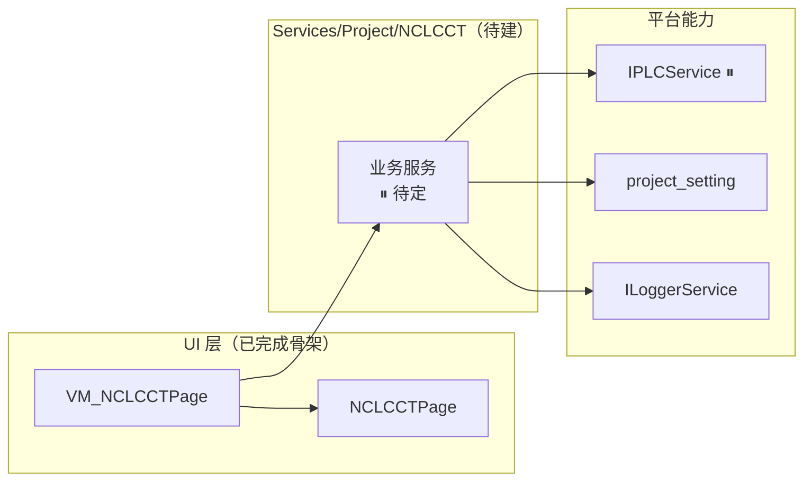

# NCLCCT 项目开发规划

> 文档版本：2026-09-20（南昌华为：界面与流程按 CTNCLX 迁移，视觉 DLL 待接入）  
> **角色：冷层详规** — 范围、架构、对接、资料索引；**不要**在本文维护每日进度  
> **进度 / 待办 / 索引**：[NCLCCT进度存档.md](./NCLCCT进度存档.md)（新会话只拖进度存档）  
> 平台：SUNWODA SEVB（`develop`，.NET 8 WPF）  
> 维护人：接手开发者  
> **事实可信度约定**：本文中凡未经现场资料/负责人确认的内容一律标 **⏸ 待确认**，禁止臆造点位、IP、阈值。

---

## 0. 开发资料录入（工作流）

> **状态**：**未录入**（等待现场资料投放）· 原始投放目录见 [开发资料/](./开发资料/)  
> **整理后真相**：暂无 CSV / 接口说明（资料录入后在本节登记文件名与链接）  
> **流程**：把原始资料放入 `开发资料/` → 工作流「开始录入」→ Agent 整理进本文对应章节与根目录 CSV → 进度存档 §0 索引更新。

资料到位后本节应补齐：

| 资料类型 | 是否已有 | 整理落点（约定） |
|----------|----------|------------------|
| PLC 点位表 | ❌ | `plc点位表.csv` + 本文 §5 |
| PLC / 设备信息（编号、IP、协议） | ❌ | `plc设备信息.csv` + 本文 §5.1 |
| 工艺参数 / 阈值表 | ❌ | `工艺阈值表.csv` + 本文 §5.3 |
| 对接方接口 / 算法说明 | ❌ | 本文 §4、§6 或独立接口文档 |
| 现场照片 / 说明 | ❌ | 本文对应节引用 |

---

## 1. 项目定位与目标

### 1.1 业务定位

**NCLCCT** 是本平台上的 **南昌华为离线 CT**。界面、路径监控、检测流程、结果渲染与 CSV 落盘按小米南昌离线 CT（`CTNCLX`，`VM_CTNCLXAutoDetectionPage`）迁移。菜单显示名保持代号 **NCLCCT**。

- 业务含义：南昌华为离线 CT 极片 Gap 检测（流程对照 CTNCLX）
- 与 CTNCLX 的差异：视觉 DLL 的加载、模型初始化、推理 **未接入**，入口为 `TryLoadVisionAssembly` / `TryInitVisionModel` / `TryInvokeVisionAlgorithm`，参数与结果结构已保留
- 配置归属：`project_setting.BelongToVM = VM_NCLCCTPage`，与小米项目的 `VM_CTNCLXAutoDetectionPage` 分开

### 1.2 本期范围（P0）

| 能力 | 是否本期 | 说明 |
|------|----------|------|
| 模块骨架（VM + View + `[Module]` + 菜单启用） | ✅ 已完成 | 见 §9 阶段 A |
| 界面与非视觉业务 | ✅ 已按 CTNCLX 迁移 | 监控、选图、阈值、绘图、CSV、统计 |
| 视觉 DLL 加载 / 初始化 / 推理 | ❌ TODO | 由后续视觉开发接入，不复用小米 `NJCT.dll` |
| PLC 采集 / 通讯 | 不在 CTNCLX 范围内 | CTNCLX 为文件夹监控，不是 PLC 触发 |
| 报警 / MES 上报 | 不在 CTNCLX 范围内 | 未从 CTNCLX 带出 |

### 1.2.1 当前进度

**见 [NCLCCT进度存档.md](./NCLCCT进度存档.md)**，不在本文重复维护。

### 1.3 明确不做（本期）

- 不实现视觉 DLL（加载、下载、`ModelInit`、`ModelAction`）
- 不把小米 CTNCLX 的 DLL 名、公钥、下载地址、模型代码写入 NCLCCT
- 不改 CTNCLX 原项目
- 不擅改平台公共框架（`ModuleManager`、`NavigationService`、Core 基础类型）

---

## 2. 现有资料盘点

| 项 | 状态 |
|----|------|
| 现场原始资料 | ❌ 未投放（`开发资料/` 为空） |
| 旧项目参考源码 | ⏸ 未知（若有，投放路径与摘要补充到本节） |
| 对接方接口文档 | ❌ 未提供 |
| 设备 / PLC 信息 | ❌ 未提供 |

> 资料投放后由工作流「开始录入」整理；本节保持"有什么写什么"，未知即空。

---

## 3. 平台约束（必须遵守）

对齐现有文档（不再做框架探查）：

- [项目架构说明](../项目架构说明.md)
- [新增业务模块上手指南](../新增业务模块上手指南.md)
- [Agent协作开发规程](../Agent协作开发规程.md)
- [代码开发规范](../代码开发规范.md)

### 3.1 模块形态（真实路径）

```
SUNWODA_SEVB/ViewModels/Pages/NCLCCT/VM_NCLCCTPage.cs          ← [Module] + 检测流程（视觉 DLL 为 TODO）
SUNWODA_SEVB/Views/Pages/NCLCCT/NCLCCTPage.xaml(.cs)           ← 界面（自 CTNCLX 迁移）
SUNWODA_SEVB/ViewModels/Dialogs/NCLCCT/VM_NCLCCTMonitorPathSelectDialog.cs
SUNWODA_SEVB/Views/Dialogs/NCLCCT/NCLCCTMonitorPathSelectDialog.xaml(.cs)
SUNWODA_SEVB.Core/Models/Project/NCLCCT/                       ← DetectionInfoModel / DetectionItemModel
```

业务逻辑落在 ViewModel，与 CTNCLX 相同，未另拆 `Services/Project/NCLCCT`。

### 3.2 三个名字必须对得上

| 位置 | 当前值 |
|------|--------|
| ViewModel 类名 / `[Module]` 第一参数 / `workspace_project.vm_class_name` | `VM_NCLCCTPage` |
| View 类名（去掉 `VM_`） | `NCLCCTPage` |
| `NCLCCTPage.xaml` 的 `x:Class` | `SUNWODA_SEVB.Views.Pages.NCLCCT.NCLCCTPage` |
| 左侧菜单显示名（`[Module]` 第二参数） | `NCLCCT` |

### 3.3 配置与启用（平台约定）

| 项 | 位置 | 本机现状 |
|----|------|----------|
| 模块是否显示在菜单 | `workspace_project.is_enabled` | `VM_NCLCCTPage` = **1**（已执行 enable 脚本） |
| 业务参数 | `project_setting`（JSON） | 尚未使用 |
| PLC 连接 | 平台 `IPLCService` + `plc_config` | 未配置（⏸ 无设备信息） |
| 主窗口类型 | `global_setting.AppStartMainWindow` | `MainWindow` |
| 数据库 | `appsettings.json`（运行时生成于输出目录） | 本机 `sunwoda_demo`（MariaDB 12.3 @127.0.0.1:3306） |

启用脚本：[enable_nclcct_module.sql](./enable_nclcct_module.sql)

---

## 4. 总体架构设计

> 目标形态按平台分层约定搭骨架；**具体服务清单待 §0 资料到位后填写**。



### 4.1 分层原则

| 层 | 职责 | 禁止 |
|----|------|------|
| View | 布局、控件、绑定 | 业务计算、设备读写、写文件 |
| ViewModel | 命令、状态、数据绑定 | 直接 `new` 通讯类、硬编码地址 |
| Service | 采集/判定/落盘/配置 | 依赖具体 Page |
| Core 接口/模型 | 契约与 DTO | 引用 WPF |

### 4.2 待建服务清单

| 接口 | 职责 | 状态 |
|------|------|------|
| `INCLCCTConfigService`（暂名） | 读写 `project_setting`：点位、周期、阈值、路径 | ⏸ 待需求确认后建 |
| 其余业务服务 | ⏸ 未知 | ⏸ |

DI 注册位置：`SUNWODA_SEVB/Services/ProjectServiceCollectionExtensions.cs` 的 `AddProjectServices()`（BoxGluing 有项目内分文件注册样板 `BoxGluingServiceCollectionExtensions.cs`）。

---

## 5. 数据与设备对接（⏸ 全部待资料）

### 5.1 设备与通讯

| 项 | 值 |
|----|-----|
| 设备编号 | ⏸ |
| PLC 型号 / IP / 端口 | ⏸ |
| 协议 | ⏸（平台支持常见品牌，选定后在此登记枚举名） |
| 内网 / 远程访问 | ⏸ |

### 5.2 采集点位

| 分组 | 参数 | 地址 | 启用 |
|------|------|------|------|
| ⏸ | ⏸ | ⏸ | ⏸ |

> 点位表投放后整理为 `plc点位表.csv`，本文只写结论与分组，不重复抄全表。

### 5.3 工艺阈值

| 阶段 / 参数 | 下限 | 上限 | 来源 |
|-------------|------|------|------|
| ⏸ | ⏸ | ⏸ | ⏸ |

> 阈值以 CSV（`工艺阈值表.csv`）为准；未确认前不写入代码默认值。

### 5.4 触发与状态

| 项 | 值 |
|----|-----|
| 触发方式（信号 / 边沿 / 手动） | ⏸ |
| 触发值类型与有效值 | ⏸ |
| 多工位是否并行 | ⏸ |

---

## 6. 数据存储与算法（⏸ 待定）

| 项 | 结论 |
|----|------|
| 是否落 CSV | ⏸ |
| 目录与命名规则 | ⏸（参考其他项目习惯，需求确认后冻结） |
| 是否写数据库业务表 | ⏸ |
| 算法 / 模型接入 | **TODO**。参数与结果结构已留在 `VM_NCLCCTPage`；加载、初始化、推理三个入口待视觉开发。不复用小米 `NJCT.dll` |
| 结果回写设备 | ⏸（涉及误写风险，必须现场确认后再做） |

---

## 7. 界面与展示

### 7.1 当前页面

界面与 CTNCLX 自动检测页一致：连续检测、路径监控、单张/目录选图、Gap 阈值、结果图与统计。视觉推理未接通时，检测流程仍走原图显示与后续统计/CSV 逻辑，日志写明「视觉DLL未实现」。

### 7.2 后续展示方案（选型待定）

| 需求 | 结论 |
|------|------|
| 曲线 / 趋势图 | ⏸ 待定（平台已有 ScottPlot 使用先例，需要时评估复用） |
| 表格 / 记录列表 | ⏸ 待定 |
| 参数设置区 | ⏸ 待定（业务参数统一走 `project_setting`） |

### 7.3 UI 草图

```
┌──────────────────────────────────────────────┐
│  NCLCCT（菜单显示名，可改）                  │
├──────────────────────────────────────────────┤
│                                              │
│        NCLCCT 项目基础页面（骨架 demo）      │
│   NCLCCT 项目骨架页：菜单已通，业务功能待开发 │
│                                              │
└──────────────────────────────────────────────┘
```

---

## 8. 配置与可运维性

| 配置 | 位置 |
|------|------|
| 模块是否显示 | `workspace_project.is_enabled`（VM 类名精确匹配） |
| 业务参数 | `project_setting`（JSON；键名随需求定） |
| PLC 连接 | `plc_config`（品牌 / IP / 端口，待定） |
| 全局配置 | `global_setting`（如 `AppStartMainWindow`） |
| 日志 | `ILoggerService<T>`（关键路径与异常必记） |

---

## 9. 实施阶段与里程碑

### 阶段 A：骨架与菜单（已完成，2026-09-16）

- [x] 建 `NCLCCT` 目录三件套（VM + View + code-behind）并 `[Module("VM_NCLCCTPage", "NCLCCT")]` 注册
- [x] `enable_nclcct_module.sql` 写入 `docs/NCLCCT/` 并对 `sunwoda_demo` 执行（`is_enabled = 1`）
- [x] 确认 `AppStartMainWindow = MainWindow`
- [x] 三文档 + `开发资料/` 建立
- [x] 本地编译 0 error

**验收**：完整重启应用后，左侧菜单出现「NCLCCT」，进入显示骨架页不崩。  
**待人工验收**：需用户完整退出 SEVB 后重启确认（Agent 不启动 GUI）。

### 阶段 B：需求与资料固化（待开始）

- [ ] `开发资料/` 投放现场资料 → 工作流「开始录入」
- [ ] 本文 §1/§5/§6 由 ⏸ 变为确定结论；生成 CSV
- [ ] 与负责人确认范围边界与验收标准

**验收**：规划中不再有大面积 ⏸；点位/阈值有 CSV 支撑。

### 阶段 C：功能实现（待 B 完成后排期）

- [ ] 按确认范围建 Service / Core 接口与模型，DI 注册
- [ ] 页面绑定与交互
- [ ] 联调 / 模拟数据 / 真机验证

### 阶段 D：打磨与交付

- [ ] 异常与边界处理、日志完善
- [ ] 文档收尾（进度存档 / 版本变更 / 本文）
- [ ] 现场部署说明

---

## 10. 风险与待确认事项

| # | 事项 | 影响 | 建议 | 状态 |
|---|------|------|------|------|
| 1 | 视觉 DLL 未接入 | 无算法判定结果 | 在 `TryLoadVisionAssembly` / `TryInitVisionModel` / `TryInvokeVisionAlgorithm` 接入华为 DLL | 🔄 |
| 2 | 菜单显示名用代号 `NCLCCT` | 现场辨识度 | 已确认继续用代号，不改中文菜单名 | ✅ |
| 3 | 无 PLC / 设备信息 | 通讯层无法起步 | 提供点位表与设备信息表 | ⏸ |
| 4 | 阈值口径未定 | 误判风险 | 以 CSV 为准，禁止代码硬编码 | ⏸ |
| 5 | 是否需写回设备 | 设备误写风险 | 上线前专项确认 | ⏸ |
| 6 | 数据留存与磁盘规划 | 满盘 / 追溯 | 需求明确后定目录与清理策略 | ⏸ |

---

## 11. 开发约定（对齐平台）

1. 命名：`VM_NCLCCTPage` ↔ `NCLCCTPage`，命名空间 `SUNWODA_SEVB.ViewModels.Pages.NCLCCT` / `SUNWODA_SEVB.Views.Pages.NCLCCT`
2. 业务逻辑进 `Services/Project/NCLCCT`，ViewModel 保持瘦
3. 中文日志与注释；关键路径与异常必须 `ILoggerService` 记录
4. 不把现场 IP、账号、密钥写死进仓库；走配置
5. 点位 / 阈值 / IP 以 CSV 与现场确认为准，禁止臆造
6. 一次只做一个可演示节点，收尾更新进度存档 + 版本变更记录

---

## 12. 相关资料索引

| 资料 | 路径 |
|------|------|
| **进度存档（热层 / 索引）** | [`NCLCCT进度存档.md`](./NCLCCT进度存档.md) |
| **版本变更记录** | [`NCLCCT版本变更记录.md`](./NCLCCT版本变更记录.md) |
| 启用模块 SQL | [`enable_nclcct_module.sql`](./enable_nclcct_module.sql) |
| 原始开发资料投放区 | [`开发资料/`](./开发资料/) |
| 平台架构 | `docs/项目架构说明.md` |
| 新模块上手 | `docs/新增业务模块上手指南.md` |
| 协作规程 | `docs/Agent协作开发规程.md` |
| 格式样板 | `docs/BoxGluing/` |

---

## 13. 决策记录（规划确认用）

| 决策项 | 结论 | 状态 |
|--------|------|------|
| 项目代号 | `NCLCCT` | **已确认** |
| 业务定位 | 南昌华为离线 CT | **已确认** |
| 参照实现 | 小米南昌离线 CT `CTNCLX` | **已确认**（视觉 DLL 除外） |
| 菜单显示名 | `NCLCCT` | **已确认** |
| 页面类名 | `VM_NCLCCTPage` / `NCLCCTPage` | **已落地** |
| 主窗口 | `MainWindow` | **已确认** |
| 数据库 | `sunwoda_demo` | **已确认（代码默认值，本机 appsettings.json 未落盘）** |
| 业务范围 / 架构 / 通讯 / 存储 | ⏸ | 待资料录入后逐项拍板 |

---

*本文档随代码同步；现场结论补入 §5 / §6 / §10 / §13。*
