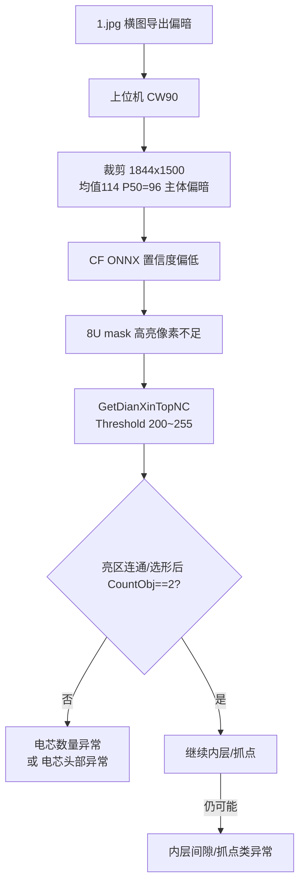

# 1.jpg NJCT 识别失败原因分析

> **日期**：2026-07-29  
> **样本目录**：`C:\AutoSlice\output\test\`  
> **反编译源码**：`C:\AutoSlice\NJCT\NJSwdCT.cs`、`C:\AutoSlice\CF\SeDPredictor.cs`、`C:\AutoSlice\CF\PredictorBase.cs`  
> **对照成功图**：`30.jpg`、`123.png`（用户确认可出图）  
> **已排除**：方向问题（上位机已 CW90°）；VG 叠加层（成功图同样带叠加）

---

## 1. 结论（摘要）

| 问题 | 结论 |
|------|------|
| 是否「ROI 平均灰度 &lt; 100」硬伤？ | **否**。`1.jpg` 经 CW90 后裁剪区均值约 **114.7**，未触发上位机 `TooDarkRoiMeanThreshold=100`。 |
| `1.jpg` 相对成功图本质差异？ | **亮度/对比度偏弱**（尤其中位数与电芯主体区），使 **CF 推理 mask 亮区不足**，进而使 Halcon **`Threshold(200,255)`** 选不出稳定的 2 个电芯区。 |
| 最可能的 NJCT `RunInfo` | **`电芯数量异常`**，或 Halcon 抛错被包装成 **`电芯头部异常：…`**；仅当未捕获业务 `ExInfo`、外层 `catch` 时才变成「当前图像暂不支持检测」。 |
| 建议处置 | 在 VG 提高直方图/LUT，使 CW90 后送入 NJCT 的图接近成功样本：**ROI 均值约 130～160、电芯主体区更亮**；不要靠加大 `BlackHeight` 解决。 |

**一句话**：`1.jpg` 失败主因不是「方向/叠加/尺寸不足」，而是 **送入 CF→Halcon 管线的有效亮度偏低，卡在 `GetDianXinTopNC` 的高阈值亮区分割（≥200）上**。

---

## 2. NJCT/CF 实际处理链路（反编译）

`ModelAction` / `ModelAction_origin` 公共路径（`NJSwdCT.cs`）：

```text
ImRead(ImgPath)
  → 硬裁剪 Rect(0,0,1844,1500)          // 不足则抛异常 → 外层 catch
  → CF.SeDPredictor.Predict(img)         // ONNX 分割/置信度图 → 缩放到 0~255 的 8U 图
  → ConvertMat32FC1ToHObject             // 非 32FC1 时写 D:\TEST.png 再 ReadImage
  → ZoomImageSize ×2                     // 1844×1500 → 3688×3000
  → GetDianXinTopNC(...)                 // ★ 找 2 个电芯头部区域
  → GetDianXinNeiCengLinesNC(...)        // 内层间隙
  → Threshold(灰度, 60, 255) + 循环 2 芯
  → GetDianXinTwoCengRegionNC(...)       // 抓点
```

### 2.1 CF 预处理（`PredictorBase.Inference`）

- `BlobFromImage(img, scale=1/255, size=ModelInputW×H, swapRB=true)`
- 输出经 `SeDPredictor.ParseOutput`：`float → ×255 → CV_8UC1 → Resize 回原裁剪尺寸`

→ **输入图越暗/对比越弱，ONNX 响应通常越弱，落在 8U mask 上的高亮像素越少。**

### 2.2 关键卡点：`GetDianXinTopNC`（`NJSwdCT.cs` ≈227～283 行）

对 **AI 结果图（已 Zoom×2）**，不是对原 CT 图直接分割：

1. `Rgb1ToGray`
2. `GrayClosingRect(111, 21)`
3. **`Threshold(..., 200, 255)`** ← 要求闭运算后仍有 **≥200** 的亮区  
4. `OpeningCircle(13.5)` → `ShapeTrans(rectangle2)` → 腐蚀等  
5. 另路 `Threshold(0, 120)` 与亮区矩形相交  
6. `SelectShape(inner_radius, 300~99999)`  
7. **`CountObj != 2` → `RunInfo = "电芯数量异常"`**  
8. Halcon 异常 → `"电芯头部异常：" + 错误码`

后续还有：

| 阶段 | 典型 RunInfo |
|------|----------------|
| 内层间隙 | `电芯内层间隙异常`（`Threshold(50,255)` 等） |
| 抓点 | `内层抓点数量异常` / `内层正极数量查找异常` / … |
| 最外层 catch | `当前图像暂不支持检测`（**吞掉真实异常**） |

### 2.3 与上位机「过暗诊断」的关系

`OfflineCtImageDiagnostics.TooDarkRoiMeanThreshold = 100`（对照失败≈69、成功≈146）只是**启发式**，**不是 NJCT 内部逻辑**。  
NJCT 真正卡死的是 **AI mask + Threshold(200)**，因此会出现：

- 诊断说「ROI 灰度正常」（均值 &gt; 100）  
- 但推理仍失败（mask 亮区不够 / 区域数 ≠ 2）

本案例即属于此类。

---

## 3. 样本与测试方法

### 3.1 目录实际文件

`C:\AutoSlice\output\test\`：

| 文件 | 用户结果 | 原始尺寸 |
|------|----------|----------|
| `1.jpg` | **失败** | 3000×1924 |
| `2.jpg` | （更暗，风险更高） | 3000×1924 |
| `30.jpg` | **成功** | 3000×1924 |
| `123.png` | **成功** | 1845×3000（已是竖图） |

无 `3.jpg` / `4.jpg`。

### 3.2 模拟上位机送图方式

与 `OfflineCtAnnotationHelper.SaveClockwiseRotated90` 一致：先 **顺时针 90°**，再按 NJCT 取左上角 **1844×1500**。

分析工具：`tools/VisionNjctFailProbe`（只读统计，不调用 DLL）。

---

## 4. 实测数据（裁剪区 1844×1500）

### 4.1 CW90 后（与主流程一致，重点看此表）

| 图 | 均值 | P50 | ≥200% | ≥150% | Top/Mid/Bot 均值 | 备注 |
|----|------|-----|-------|-------|------------------|------|
| **1.jpg** | **114.7** | **96** | 2.38 | 31.4 | **73 / 133 / 139** | 失败；中位数明显偏低 |
| **2.jpg** | **100.2** | **79** | 2.28 | 24.3 | 58 / 101 / 142 | 更暗，极易失败 |
| **30.jpg** | **119.4** | **115** | 3.20 | 35.9 | 74 / 132 / **153** | 成功；主体区更亮 |
| **123.png** | 见下节 | — | — | — | — | 原图已是竖图，再 CW90 会二次旋转 |

说明：

- 四图 CW90 后均值均 **≥100** → 上位机不会报「输入图过暗」。  
- `1.jpg` vs `30.jpg`：均值差仅约 5，但 **P50 差约 19（96 vs 115）**，底部电芯主体 **139 vs 153**，`≥150` 占比 **31% vs 36%**。  
- 对依赖 **高阈值亮区（200）** 的 AI+Halcon 链，这种「整体略暗 + 主体不够亮」足以使 mask 亮连通域不稳定，最终 **CountObj≠2**。

### 4.2 原图直接裁剪（未旋转，仅对照）

| 图 | 均值 | P50 | L/M/R |
|----|------|-----|-------|
| 1.jpg | 118.4 | 133 | 81 / 141 / 134 |
| 30.jpg | 123.8 | 137 | 80 / 146 / 146 |
| 123.png | **145.7** | 135 | 146 / 145 / 146 |

`123.png` 不旋转时亮度最接近成功样本区间（130～160），与「能出图」一致。

### 4.3 关于 `123.png` 与二次旋转

`123.png` 已是 **1845×3000** 竖图。若再强制 CW90：

- 变成 3000×1845，左三分之一均值仅约 **72**（暗背景占左），构图与训练/标定朝向可能不一致。  
- 用户侧若「能出图」，更可能是：**测试时该图已是正确朝向，或未再旋转**；与横图 `1.jpg`/`30.jpg`「导出后再 CW90」不是同一路径。  
- **不推翻**「方向已排除」对 `1.jpg` 的结论：横图族在统一 CW90 下，`30` 成功、`1` 失败，差异仍落在亮度。

---

## 5. 根因推理链（1.jpg）



与成功图 `30.jpg` 对比要点：

1. **同一构图族、同一旋转与裁剪规则** → 排除方向与叠加作为主因。  
2. **未触发 ROI&lt;100** → 排除上位机「过暗硬伤」文案路径。  
3. **P50 / 主体带亮度系统性低于成功图** → 与 CF→`Threshold(200)` 敏感点吻合。  
4. 故判定：`1.jpg` 失败主因是 **有效亮度/对比不足以支撑 AI 亮区分割**，属于 **「偏暗导致算法链路失败」**，但 **不是** 诊断阈值意义上的「ROI 灰度不够（&lt;100）」。

---

## 6. 建议验证步骤（真机）

1. 对同一 `.vgl` 提高 VG 直方图/LUT（目标：CW90 后裁剪区接近 `30.jpg`/`123.png` 亮度），再导出对比 `1.jpg`。  
2. 单测「测试 AI 图像标注」，记录真实 `RunInfo`（应看到业务文案，而非仅兜底句）。  
3. 若出现「当前图像暂不支持检测」：查 `D:\TEST.png` 是否写出、Halcon 许可、以及上位机诊断改写后的「具体原因」。  
4. 可用 `tools/VisionNjctFailProbe` 对导出图做 CW90+裁剪统计，作为进 NJCT 前的亮度门槛参考：  
   - 建议经验门槛：**CW90 裁剪均值 ≥120，P50 ≥110，底部三分带均值 ≥145**（以本批成功样本为锚，可再标定）。

---

## 7. 与改造进度文档的关系

- 直方图红线/LUT（进度存档 §0）直接影响上视图导出亮度，从而影响本阶段七 NJCT。  
- `OfflineCtIsRunCuda` / `BlackHeight`：**不能替代** VG 侧提亮；`BlackHeight` 只在出结果图时底部打黑。  
- 上位机过暗诊断阈值 100 可保留，但日志中应区分：  
  - **硬伤过暗（&lt;100）**  
  - **临界偏暗（100～130）仍可能电芯数量异常** ← 本案例

---

## 8. 参考路径

| 项 | 路径 |
|----|------|
| NJCT 反编译 | `C:\AutoSlice\NJCT\NJSwdCT.cs` |
| CF 反编译 | `C:\AutoSlice\CF\PredictorBase.cs`、`SeDPredictor.cs` |
| 上位机诊断 | `SUNWODA_SEVB.Tool/Helper/OfflineCtImageDiagnostics.cs` |
| CW90 封装 | `SUNWODA_SEVB.Tool/Helper/OfflineCtAnnotationHelper.cs` |
| 统计探针 | `tools/VisionNjctFailProbe` |
| 样本 | `C:\AutoSlice\output\test\1.jpg` 等 |

---

## 9. 建议动作（亮度）

产线偏暗图（如 `1.jpg`）优先 VG 提亮；上位机已实现**方案 B 条件预提亮**（`OfflineCtPreBrightenHelper`）：

1. CW90（若开启，**仅内存**，不落盘中间图）后统计左上角 1844×1500 ROI 的均值/P50  
2. 若均值&lt;触发线（默认 120）或 P50&lt;110 → 线性增益拉向目标均值（默认 145，增益钳制 1～2.5）  
3. **仅**落盘 `AI标注/input_for_njct.*` 与 `prebrighten_report.txt`，**再**调用 NJCT  
4. 亮度已合格则将（已旋转的）图直接存为 `input_for_njct.*`，避免伤成功图  
5. **检测失败时**：不再把 DLL 回填的整图当 `result_enhance`；改为落盘 `njct_algo_crop_1844x1500.*`（与 `Rect(0,0,1844,1500)` 一致）  

增益/提亮：已改为类 PS **分区**（阴影暗部强抬、中间调轻抬、高光少动、白场保护），不再全图线性 ×gain。

开关：`EnableOfflineCtPreBrighten`（UI「调用前条件提亮」）。

---

*本文基于反编译逻辑 + 裁剪区灰度统计归纳；最终以真机 `RunInfo` 为准。若实测 `RunInfo` 为内层/抓点类而非头部数量类，请回写本节第 1、5 节并补充对应阈值分析。*
