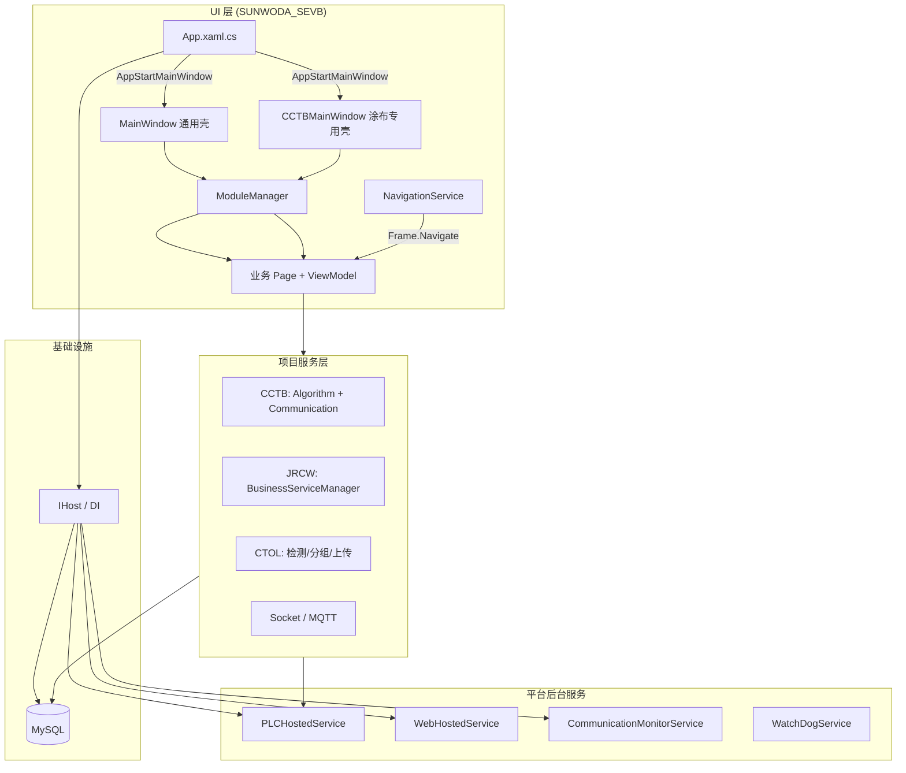

# SUNWODA SEVB 项目架构说明

> 文档版本：2026-07-06（develop 分支）  
> 用途：接手整合项目、AI 辅助开发时的快速参考。  
> 对应解决方案：`SUNWODA_SEVB.sln`（.NET 8 WPF）  
> 分支说明：本文档基于 **develop** 分支编写，该分支为各产线项目整合后的最新版本；master 分支为早期基础平台，模块与能力较少。

---

## 1. 项目定位

**单机数字化平台** — 欣旺达闭环控制部产线设备桌面端应用，在统一 WPF 平台上承载多条产线/工序的独立业务模块。

集成能力：

| 能力 | 技术/库 | 所在项目 |
|------|---------|----------|
| 桌面 UI | WPF + HandyControl + MahApps.Metro | `SUNWODA_SEVB` |
| 依赖注入 / 生命周期 | Microsoft.Extensions.Hosting (`IHost`) | `SUNWODA_SEVB` |
| 数据库 | MySQL + SqlSugar | `SUNWODA_SEVB.Data` |
| 日志 | NLog（可写入 MySQL） | `SUNWODA_SEVB.Logging` |
| PLC 通信 | HslCommunication | `SUNWODA_SEVB.PLC` |
| MES 对接 | HTTP + Polly | `SUNWODA_SEVB.Services`（MES） |
| Web 服务 | HostedService + API 客户端 | `SUNWODA_SEVB.WEB` |
| Python 算法 | Python.NET (`Python.Runtime`) | `SUNWODA_SEVB.Tool` |
| Socket / MQTT | 自研封装 + HslCommunication.MQTT | `SUNWODA_SEVB.Tool` |
| AI / 视觉 | OpenCvSharp、ONNX Runtime、Halcon（Dlls） | `SUNWODA_SEVB.Core` + 各业务模块 |
| 看门狗 | Windows Service | `SUNWODA_SEVB.WatchDogService` |

---

## 2. 解决方案结构

```
sunwoda2.0.0.1/
├── SUNWODA_SEVB.sln
├── SUNWODA_SEVB/                    # 主程序：入口、双主窗口、全部业务 Views/ViewModels、项目服务
│   ├── ViewModels/Pages/            # 按产线/项目分子目录（见 §5）
│   ├── Views/Pages/
│   ├── Services/Project/            # 各项目业务服务（CCTB、CTOL、JRCW…）
│   ├── Communication/               # 设备 TCP 通信（涂布工序等）
│   └── App.xaml.cs                  # 启动入口
├── SUNWODA_SEVB.Core/               # 核心：接口、模型、枚举、MVVM 基类、项目契约
│   ├── Interfaces/Project/          # 各项目服务接口（CCTB、JRCW、PCD…）
│   ├── Models/Project/              # 各项目业务模型
│   ├── Dlls/                        # 原生算法库（Halcon、YOLO、ONNX 等，需从现场拷贝）
│   └── Behavior/、Events/           # 行为与事件
├── SUNWODA_SEVB.Data/               # SqlSugar 仓储、数据库初始化
├── SUNWODA_SEVB.Logging/            # NLog 封装
├── SUNWODA_SEVB.PLC/                # PLC 通信 + PLCHostedService
├── SUNWODA_SEVB.Services/           # MES 集成（程序集名 SUNWODA_SEVB.MES）
├── SUNWODA_SEVB.WEB/                # Web API + WebHostedService
├── SUNWODA_SEVB.Tool/              # 配置加密、Python、Socket/Mqtt、各类 Helper
├── SUNWODA_SEVB.Component/          # 通用 + 项目专用 UI 控件（CCTB/CTOL/JRCW）
├── SUNWODA_SEVB.WatchDogService/    # 看门狗 Windows 服务
├── SUNWODA_SEVB.ConfigTool/         # 配置加密 CLI（未纳入 sln，按需使用）
├── docs/                            # 接手文档（本文件）
├── README.md                        # 团队开发规范
└── appsettings.json                 # 位于 SUNWODA_SEVB/ 输出目录
```

### 子项目职责速查

| 项目 | 职责 | 日常开发是否常改 |
|------|------|------------------|
| `SUNWODA_SEVB` | 主程序、全部业务页面、项目服务实现 | **是** |
| `SUNWODA_SEVB.Core` | 接口契约、跨项目共享模型 | 经常 |
| `SUNWODA_SEVB.Data` | 仓储、建表、种子数据 | 偶尔 |
| `SUNWODA_SEVB.Component` | 可复用 UI 控件（含 CCTB 大量专用控件） | 按需 |
| `SUNWODA_SEVB.PLC` | PLC 后台通信 | 按需 |
| `SUNWODA_SEVB.Services` | MES | 按需 |
| `SUNWODA_SEVB.WEB` | Web 后台 | 按需 |
| `SUNWODA_SEVB.Tool` | Python/Socket/Mqtt/工具类 | 按需 |
| `SUNWODA_SEVB.Logging` | 日志基础设施 | 很少 |
| `SUNWODA_SEVB.WatchDogService` | 进程守护 | 很少 |

---

## 3. 架构总览



**一句话**：统一 WPF 平台提供 Host + 模块化导航；各产线业务以 `ViewModels/Pages/<项目>/` 组织，复杂逻辑下沉到 `Services/Project/`；MySQL 存配置与业务数据；PLC/MES/Web/Socket/MQTT 通过 DI 注入。

---

## 4. 应用启动流程

入口：`SUNWODA_SEVB/App.xaml.cs` → `OnStartup`

| 步骤 | 动作 | 失败后果 |
|------|------|----------|
| 0 | `MonitorAppIsRunning()` — 单实例互斥锁 | 已有实例则置顶并退出 |
| 1 | `ConfigurationService.EnsureValidConfig()` | 配置文件校验 |
| 2 | `BuildHost()` — 加载加密/远程配置、注册 DI | 无法启动 |
| 3 | `host.StartAsync()` — 启动 PLC/Web/CCTB 通讯监控等 HostedService | 后台服务不运行 |
| 4 | `InitializeDatabaseAsync()` — 建库建表、种子数据 | **弹窗退出** |
| 5 | `ConfigureNLogDatabase()` | 仅影响日志写库 |
| 6 | `InitializeApplicationSettings()` — 默认用户、DefaultProject、看门狗 | 影响默认模块/守护 |
| 7 | `SetupGlobalExceptionHandling()` + `StartBackgroundTasks()` | — |
| 8 | `InitPythonEnvironment()` — 按全局开关初始化 Python.NET | CCTB/JRCW 等算法模块依赖 |
| 9 | `InitCTOLEnvironment()` — CTOL 项目 SQLite/检测服务 | 仅 CTOL 相关 |
| 10 | `ShowMainWindow()` — 按 `AppStartMainWindow` 选择主窗口 | — |

> develop 分支启动链路中 **不再在 App 层显式调用 MES 初始化**；MES 仍通过 DI 注册，由业务模块按需使用。

### DI 注册入口（`ConfigureServices` 摘要）

```csharp
services.AddNLogServices();
services.AddDataServices();           // SqlSugar + Repository
services.AddPLCService();             // PLC + PLCHostedService
services.AddMesServices();            // MES
services.AddWebServices();            // Web + WebHostedService
services.AddMvvmFramework();          // ModuleManager + NavigationService + [Module] 自动注册
services.AddProjectServices();        // CCTB / JRCW / Socket / MQTT / 螺丝控制器 等
services.AddSingleton<MainWindow>();  // 通用主窗口
services.AddSingleton<CCTBMainWindow>(); // 涂布闭环专用主窗口
```

`AddProjectServices()` 定义于 `Services/ProjectServiceCollectionExtensions.cs`，是 develop 分支相对 master 的重要扩展点。

---

## 5. 业务模块与产线项目

### 5.1 目录组织

业务代码按 **产线/项目代号** 分子目录：

```
ViewModels/Pages/
├── Common/          # 仪表盘、设置、用户中心
├── Demo/            # 平台开发模板与控件演示
├── CCTB/            # 涂布闭环（develop 重点整合项目之一）
├── CTOL/            # 在线 CT AI 检测
├── CTNCLX/          # 小米南昌离线 CT
├── NCLCCT/          # 南昌华为离线 CT
├── PTO/             # 叠片 AI 检测（PTO / 雅康）
├── HawkEye/         # 鹰眼机损监测
├── JRCW/            # 卷绕极耳错位闭环
├── JRRY/            # 极耳冗余 AI 检测
├── ZZPACK/          # 焊接过程预警
├── PCD/             # 义乌人员合规检测
├── STC/             # 螺丝拧紧曲线
├── CoatingOPMM/     # 涂布工序监测
├── CapacityPrediction/  # 容量预测
└── MiniProgram/     # 图片压缩上传等工具页
```

对应服务实现：`SUNWODA_SEVB/Services/Project/`（CCTB、CTOL、JRCW 等）。

### 5.2 顶层业务模块一览（带 `[Module]` 的入口页）

| 目录 | vm_class_name（示例） | 菜单显示名 | 说明 |
|------|----------------------|------------|------|
| Common | `VM_DashBorad` | 仪表盘 | 通用 |
| Demo | `VM_DevelopProjectDemoPage` | 业务项目开发 Demo | **新增模块模板** |
| Demo | `VM_DemoPage` | 示例业务 | |
| HawkEye | `VM_MachineDamageMonitoringPage` | 鹰眼机损监测 | 含子模块相机管理/标定 |
| CCTB | `VM_CCTBMonitoringPage` | 涂布闭环监测 | 使用 `CCTBMainWindow`，含大量子页面 |
| CTOL | `VM_CTOLAutoDetectionPage` | 在线 CT AI 检测 v2.0 | |
| CTOL | `VM_CTAutoDetectionC06` | 在线 CT AI 检测 v2.0（C06） | |
| CTNCLX | `VM_CTNCLXAutoDetectionPage` | 南昌离线 CT | 小米南昌离线 CT |
| NCLCCT | `VM_NCLCCTPage` | NCLCCT | 南昌华为离线 CT；界面与流程按 CTNCLX，视觉 DLL 待接入 |
| PTO | `VM_PTODamageDetectionPage` | PTO 叠片 AI 检测 | |
| PTO | `VM_YKDamageDetectionPage` | 雅康叠片机损 AI 检测 | |
| JRCW | `VM_JRCWClosedLoopPage` | 卷绕极耳错位闭环 | 多业务场景工厂模式 |
| JRRY | `VM_EarTabRedundancy` | 极耳冗余 AI 检测 | |
| ZZPACK | `VM_MeltingDepthDetectionPage` | 焊接过程预警 | |
| PCD | `VM_PersonCheckPage` | 义乌人员合规检测 | |
| STC | `VM_P230ConnectorInstallerPage` | 螺丝拧紧曲线 | |
| CoatingOPMM | `CoatingOPMM` | 涂布工序监测系统 | |
| CapacityPrediction | `VM_CapacityPredictionPage` | 容量预测 | |
| MiniProgram | `VM_ZZFTPImageCompressUploadPage` | 图片压缩上传 | |
| Common | `VM_SettingsPage` | 设置 | ModuleType.Settings |
| Common | `VM_UserCenter` | 用户 | ModuleType.UserCenter |

CCTB 项目另有 **20+ 子模块**（监测/记录/设置的多级 `Category`），通过 `Category = "父模块/子模块"` 组织层级导航，在 `CCTBMainWindow` 内由 `ModuleManager.AutoRegisterModulesByName` 局部加载。

### 5.3 双主窗口机制（develop 新增）

| 主窗口 | 适用场景 | 配置项 |
|--------|----------|--------|
| `MainWindow` | 通用平台壳，左侧标准导航 | `AppStartMainWindow = MainWindow`（默认） |
| `CCTBMainWindow` | 涂布闭环专用 UI 壳，集成通讯状态/用户操作 | `AppStartMainWindow = CCTBMainWindow` |

```sql
-- 切换为涂布闭环专用主窗口
UPDATE global_setting SET value = 'CCTBMainWindow' WHERE name = 'AppStartMainWindow';

-- 恢复通用主窗口
UPDATE global_setting SET value = 'MainWindow' WHERE name = 'AppStartMainWindow';
```

`ShowMainWindow()` 读取 `global_setting.AppStartMainWindow` 决定实例化哪个窗口。

---

## 6. 模块化 UI 系统（平台机制）

### 6.1 `[Module]` 特性

标在 **ViewModel** 上，声明可被平台发现的业务模块：

```csharp
[Module("VM_DevelopProjectDemoPage", "业务项目开发Demo")]
public class VM_DevelopProjectDemoPage : ViewModelBase { }

// CCTB 多级分类示例
[Module("VM_SummaryPage", "概要", Order = 1, Category = "VM_CCTBMonitoringPage/VM_SummaryPage")]
```

| 属性 | 含义 |
|------|------|
| `Name` | 模块唯一标识（导航用） |
| `DisplayName` | 菜单显示名 |
| `Order` | 排序 |
| `Category` | 多级导航路径（`父/子/孙`） |
| `Type` | `Normal` / `Settings` / `Dashboard` / `UserCenter` |

### 6.2 ViewModel ↔ View 命名约定

| ViewModel | View |
|-----------|------|
| `ViewModels.Pages.Demo.VM_DevelopProjectDemoPage` | `Views.Pages.Demo.DevelopProjectDemoPage` |

规则：去掉 `VM_` 前缀；命名空间 `.ViewModels.` → `.Views.`。

### 6.3 `[Module]` 的三次触点

1. **DI 注册** — `ServiceCollectionExtensions.AddModuleViewModels/Views`
2. **DB 种子** — `DatabaseInitializer` → `workspace_project` 表
3. **运行时菜单** — `ModuleManager.AutoRegisterModules()`（或 CCTB 的 `AutoRegisterModulesByName`）

### 6.4 模块启用开关

**代码有 `[Module]` ≠ 菜单一定显示。**

```csharp
var isEnabled = _workSpaceProjectRepository.GetIsEnabled(vmType.Name);
```

首次种子数据：仅 `Settings`、`UserCenter` 默认 `is_enabled = 1`，其余为 `0`。

```sql
-- 开发环境启用全部
UPDATE workspace_project SET is_enabled = 1;
```

修改后需 **重启应用**。

### 6.5 ViewModel 生命周期

| 方法 | 时机 |
|------|------|
| `OnInitialize()` / `OnInitializeAsync()` | ViewModel 首次创建 |
| `OnNavigatedTo(parameter)` | 进入页面，加载数据 |
| `OnNavigatedFrom()` | 离开页面 |
| `CanNavigateFrom()` | 离开前拦截 |
| `OnCleanup()` | 缓存回收 |

---

## 7. 项目服务层（develop 重点）

通过 `AddProjectServices()` 统一注册，定义于 `ProjectServiceCollectionExtensions.cs`。

### 7.1 CCTB 涂布闭环

| 服务 | 类型 | 职责 |
|------|------|------|
| `IAlgorithmService` | 单例 | Python 算法下载/校验/调用 |
| `ICommunicationService` | 单例 | PLC + Socket 服务端/客户端 + MQTT 统一管理 |
| `CommunicationMonitorService` | HostedService | 后台监控设备连接与状态 |
| `ICustomMqttClient` | 单例 + 工厂 | MQTT 客户端（基于 HslCommunication.MQTT） |
| `ISocketServerManager` | 单例 | 多 Socket 服务实例管理 |

CCTB 监测页 `VM_CCTBMonitoringPage` 初始化时会调用 `InitializeAlgorithmVerityAsync()`，依赖 Python 环境（见 §9）。

### 7.2 JRCW 卷绕极耳错位

| 服务 | 职责 |
|------|------|
| `YWC05BusinessService` / `DYC01BusinessService` | 义乌 C04 / 德阳 C01 等业务实现 |
| `BusinessServiceFactory` + `BusinessServiceManager` | 单项目多业务场景工厂 |

### 7.3 CTOL 在线 CT 检测

服务位于 `Services/Project/CTOL/`：`InspectionResultService`、`BarcodeGroupingService`、`GapCsvService`、图像处理器等。  
`App.InitCTOLEnvironment()` 在 `DefaultProject` 含 `CTOL` 时初始化 SQLite（`WatermarkDbContext`）并订阅条码分组事件。

### 7.4 通用通信能力

| 能力 | 位置 |
|------|------|
| Socket 服务端/客户端 | `SUNWODA_SEVB.Tool/Services/Socket/` |
| MQTT 客户端 | `SUNWODA_SEVB.Tool/Services/Mqtt/` |
| PLC | `SUNWODA_SEVB.PLC` → `IPLCService` |
| 螺丝控制器 HTTP | `ScrewControllerService` |

---

## 8. 数据层

### 8.1 技术栈

- ORM：**SqlSugar**（CodeFirst 自动建表）
- 数据库：**MySQL**（默认库名 `sunwoda_demo`）
- 连接串：`SUNWODA_SEVB/appsettings.json` → `ConnectionStrings:DefaultConnection`
- 映射：**Mapster**

建表策略：`DatabaseInitializer.GetAllModelTypes()` 扫描 `SUNWODA_SEVB.Data.Models` 下所有实体类自动 `InitTables`。

### 8.2 平台核心表

| 表名 | 用途 |
|------|------|
| `global_setting` | 全局运行时配置（Python 开关、主窗口类型、PLC 开关等） |
| `workspace_project` | **业务模块启用开关**（`vm_class_name` + `is_enabled`） |
| `project_setting` | 各业务模块专属 JSON 配置 |
| `users` | 用户账户 |
| `device` | 设备信息 |
| `plc_config` / `plc_rw_config` / `plc_address_config` | PLC 配置 |
| `mes_setting` / `mes_interface_logs` | MES |
| `web_interface_logs` | Web 调用日志 |
| `app_logs` | 应用日志 |
| `detection_statistics` | 检测统计（部分项目按需建表） |

各业务项目还会在 `project_setting` 中存储大量 JSON 参数，或在运行时创建 SQLite（如 CTOL）。

### 8.3 重要全局配置项（`global_setting`）

| Name | 默认值 | 说明 |
|------|--------|------|
| `DefaultProject` | 空 | 启动默认打开的 ViewModel 类名 |
| `AppStartMainWindow` | `MainWindow` | 主窗口类型：`MainWindow` / `CCTBMainWindow` |
| `IsInitPythonEnvironment` | `false` | 是否初始化 Python.NET |
| `PythonInstallDir` | 空 | 64 位 Python 安装目录 |
| `PythonSearchDir` | 空 | 额外模块搜索路径（`;` 分隔） |
| `IsCycleReadPLC` / `IsCycleWritePLC` | `false` | PLC 循环读写开关 |
| `IsMESEnabled` | `false` | MES 功能开关 |
| `IsUseWeb` | `false` | Web 服务开关 |
| `IsEnableWatchDogService` | `false` | 看门狗 Windows 服务 |

设置页通过 **反射动态生成** 编辑界面（`VM_SettingsPage`），按当前用户角色过滤 `RoleRank`。

### 8.4 默认用户

| 账号 | 密码 | 角色 |
|------|------|------|
| `guest` | （空） | 访客 |
| `engineer` | `swd123456` | 工程师 |
| `admin` | `ime123456` | 管理员 |
| `sadmin` | `sime123456` | 超级管理员 |

---

## 9. Python 环境与算法（CCTB / JRCW 等）

### 9.1 启动时初始化

`App.InitPythonEnvironment()` 在 `IsInitPythonEnvironment == true` 时：

1. `PythonConfigHelper.Start()` — 启动专用 Python 线程
2. `PythonConfigHelper.InitPythonConfig(pythonDir, searchDirs)` — 加载 `python*.dll`、设置 `PythonPath`

### 9.2 业务侧校验

`AlgorithmService.InitializePythonConfig()` 在 CCTB 页面加载时检查：

- `IsInitPythonEnvironment` 必须为 `true`，否则抛出 **「未开启 Python 环境初始化开关！」**
- `PythonInstallDir` 必须有效
- `PythonConfigHelper.IsInitConfig` 必须为 `true`（即启动阶段已成功初始化）

### 9.3 配置步骤

1. 设置页或 SQL 将 `IsInitPythonEnvironment` 设为 `true`
2. 配置 `PythonInstallDir` 为 **64 位** Python 路径
3. **重启应用**
4. 确认 `SUNWODA_SEVB.Core/Dlls/` 下算法原生库齐全（Halcon、YOLO 等需从现场环境拷贝）

---

## 10. 后台服务一览

| 子系统 | 挂载方式 | 启动时机 |
|--------|----------|----------|
| **PLC** | `PLCHostedService` | `host.StartAsync()` |
| **Web** | `WebHostedService` | `host.StartAsync()`（受 `IsUseWeb` 控制） |
| **CCTB 通讯监控** | `CommunicationMonitorService` | `host.StartAsync()` |
| **MES** | `IMesService` 单例 | 业务按需调用 `InitializeAsync()` |
| **看门狗** | `SUNWODA_SEVB.WatchDogService` | `IsEnableWatchDogService=true` 时安装 Windows 服务 |
| **Python** | `PythonConfigHelper` 专用线程 | `IsInitPythonEnvironment=true` 时 App 启动 |

---

## 11. 原生依赖与编译注意

### 11.1 NuGet 还原

develop 分支 `SUNWODA_SEVB.Core` 等项目依赖：`HslCommunication`、`CsvHelper`、`OpenCvSharp4.Windows`、`Newtonsoft.Json`、`Python.Runtime` 等。  
首次克隆后必须执行 **还原 NuGet 程序包**，否则出现 CS0246 找不到命名空间。

### 11.2 原生 DLL

`SUNWODA_SEVB.Core/Dlls/` 引用大量非 NuGet 库（Halcon、Yolo8Core、XCloudSDK 等），Git 仓库中可能不完整，需从**原开发机或同事**拷贝。

### 11.3 运行环境

- Windows + Visual Studio 2022（.NET 桌面开发 workload）
- .NET 8 SDK
- MySQL 5.7+
- 部分模块需：64 位 Python、CUDA（ONNX GPU）、Halcon 授权

---

## 12. 开发命名规范（摘自 README）

| 类型 | 规范 | 示例 |
|------|------|------|
| 视图模型 | `VM_` + 名称 | `VM_DemoPage` |
| 视图 | 名称（无 VM_ 前缀） | `DemoPage` |
| 项目服务 | `I{Name}Service` + 实现类 | `IAlgorithmService` |
| 帮助类 | 名称 + `Helper` | `PythonConfigHelper` |

---

## 13. 新增业务模块标准流程

```
1. 在 ViewModels/Pages/<项目名>/ 创建 VM_XxxPage.cs
   - 继承 ViewModelBase
   - 添加 [Module("名称", "显示名")]

2. 在 Views/Pages/<项目名>/ 创建 XxxPage.xaml + .xaml.cs

3. 构造函数注入 ILoggerService<T>、Repository、业务 Service

4. 复杂逻辑放入 Services/Project/<项目名>/，接口放 Core/Interfaces/Project/

5. 重启应用 → workspace_project 自动写入新记录

6. SQL 启用：UPDATE workspace_project SET is_enabled = 1 WHERE vm_class_name = '...';

7. 再次重启，确认菜单显示
```

**参考模板**：`VM_DevelopProjectDemoPage` + `DevelopProjectDemoPage.xaml`

---

## 14. 关键文件索引

| 文件 | 作用 |
|------|------|
| `SUNWODA_SEVB/App.xaml.cs` | 启动全流程、双主窗口、Python/CTOL 初始化 |
| `SUNWODA_SEVB/Services/ProjectServiceCollectionExtensions.cs` | 各项目服务 DI 注册 |
| `SUNWODA_SEVB/Services/ModuleManager.cs` | 模块扫描与注册 |
| `SUNWODA_SEVB/Services/NavigationService.cs` | Frame 导航 |
| `SUNWODA_SEVB/Services/Project/CCTB/AlgorithmService.cs` | CCTB Python 算法 |
| `SUNWODA_SEVB/Services/Project/CCTB/CommunicationService.cs` | CCTB 通讯聚合 |
| `SUNWODA_SEVB/ViewModels/Windows/Project/VM_CCTBMainWindow.cs` | 涂布专用主窗口 |
| `SUNWODA_SEVB.Data/DatabaseInitializer.cs` | 建库建表、种子数据 |
| `SUNWODA_SEVB.Tool/Helper/PythonConfigHelper.cs` | Python.NET 线程与初始化 |
| `SUNWODA_SEVB.Core/Attributes/ModuleAttribute.cs` | 模块特性 |
| `README.md` | 团队规范 |

---

## 15. 常见问题速查

| 现象 | 原因 | 处理 |
|------|------|------|
| 侧边栏只有设置和用户 | `workspace_project.is_enabled = 0` | SQL 启用后重启 |
| CS0246 找不到 HslCommunication 等 | NuGet 未还原 | `dotnet restore` 或 VS 还原包 |
| 未开启 Python 环境初始化开关 | `IsInitPythonEnvironment=false` 却打开 CCTB | 开启开关 + 配置 Python 路径 + 重启 |
| Python 环境未初始化 | 改了开关但未重启 | 完全退出后重启 |
| 启动涂布窗口但报通讯/算法错误 | CCTB 依赖 Python、PLC、Socket 配置 | 先在设置页配置通讯与算法地址 |
| 未能加载 [xxx] 程序 | `AppStartMainWindow` 值非法 | 设为 `MainWindow` 或 `CCTBMainWindow` |
| 软件已在运行中 | 单实例互斥锁 | 关闭已有实例或切换到已运行窗口 |
| `Dlls/` 运行时缺失 | 原生库未拷贝 | 从现场环境补齐 `SUNWODA_SEVB.Core/Dlls/` |
| `DashBorad` 拼写 | 历史遗留 | 改动需谨慎（涉及 DB 与导航名） |

---

## 16. 相关文档

- [接手任务规划](./接手任务规划.md) — 学习路径与阶段任务
- [README.md](../README.md) — 官方开发规范
- [.cursorignore](../.cursorignore) — Cursor AI 索引排除规则
